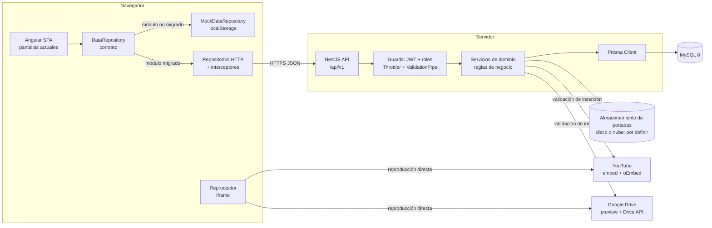
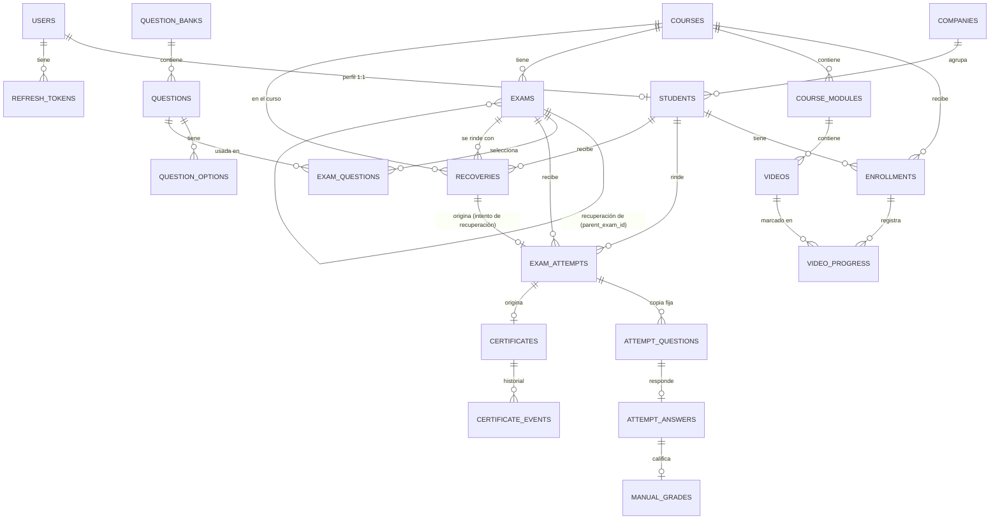

# Arquitectura del backend — Aula Virtual IMC

Documento iniciado en la **Fase 0** (análisis y diseño, 07/11/2026) y **actualizado en B0.2** (11/11/2026) para
alinearlo con el frontend R1–R9 y con el backend B1.1. Estado actual del proyecto: **sección 19**. Decisiones: sección
14 (aprobadas) y 14.1 (pendientes y propuestas de B0.2). Historial de B1: secciones 15 a 18.

Última actualización: 13/11/2026 (**B2.3c**: registro de estudiantes por el Instructor y activación de la cuenta por
enlace de correo; migración generada y NO aplicada; sin proveedor de correo real; sección 26). Antes, el mismo día (**B2.3b**: asignación y retiro de empresas de estudiantes existentes, sin migración
nueva; sección 25). Antes, el mismo día (**B2.3a**: consulta de estudiantes dentro del alcance por empresa del Instructor,
solo lectura y sin migración nueva; sección 24). Antes, 12/11/2026 (**B2.2c**: asignación de instructores a empresas por la administración general, sin
migración nueva; sección 23). Antes, el mismo día (**cierre de B2.2b**: decisiones institucionales sobre desactivación, corrección del
RUC y reactivación de empresas, 22.9). Antes, el mismo día (**B2.2b**: gestión de empresas por la administración general en
`/admin/companies`, sin migración nueva; sección 22). Antes, el mismo día (**B2.2a**: permiso administrativo especial de la administración general de IMC,
independiente del rol; sección 21. Su migración también está **generada pero no aplicada**). Antes, 11/11/2026
(**B2.1**: modelo de datos de empresas, instructores y matrículas, y autorización por
empresa; sección 20. La migración está **generada pero no aplicada** a ninguna base). Antes: corrección final de B0.2
(D-8, D-11 y D-12 armonizadas, sección 14) y B0.2 (alineación documental).
Versión anterior: 07/11/2026 (cierre de la Fase 0: decisiones D-1, D-3 a D-12 aprobadas; respaldo previo realizado).

**Estado real (11/11/2026):** el backend tiene implementadas la fase **B1.1** (autenticación, sesiones, usuarios,
empresas y estudiantes a nivel de tablas) y el subbloque **B2.1** (estudiantes en varias empresas o en ninguna, perfil
de Instructor con sus empresas, estructura mínima de cursos y matrículas, y autorización por empresa en
`GET /users/:id`; sección 20). La migración de B2.1 **no se ha aplicado** a ninguna base. **B2.2a (12/11/2026,
sección 21):** infraestructura del permiso administrativo `IMC_GENERAL_ADMIN` (tabla, guard, decoradores y comando
`admin:grant-general`), con su migración sin aplicar. **B2.2b (12/11/2026, sección 22):** gestión de empresas
(registrar, listar, consultar, actualizar, desactivar y reactivar) en `/admin/companies`, probada con la base
simulada y **pendiente de validación con MySQL**. **B2.2c (12/11/2026, sección 23):** asignación, reasignación y retiro
de instructores en empresas, con las mismas condiciones. **B2.3a (13/11/2026, sección 24):** listado, búsqueda,
filtro, paginación y detalle de estudiantes del alcance del Instructor (solo lectura). **B2.3b (13/11/2026, sección
25):** asignación y retiro de empresas de estudiantes existentes. **B2.3c (13/11/2026, sección 26):** registro de
estudiantes y activación por enlace de correo (migración sin aplicar; sin proveedor de correo real). Todo lo demás (gestión de
empresas, estudiantes y matrículas, contenido de cursos, exámenes, intentos, recuperaciones, certificados, reportes)
es **diseño propuesto**, no funcionalidad existente. El frontend funciona
completo en **modo demostración** (datos en el navegador).

| Estado de cada afirmación | Significado |
|---|---|
| **Verificado** | Comprobado en el código del repositorio o ejecutando las pruebas. |
| **Implementado** | Existe en el código y tiene pruebas (se indica la fase). |
| **Propuesta** | Recomendación técnica pendiente de aprobación. Las de B0.2 se marcan **«Propuesta (B0.2)»**. |
| **Pendiente de confirmar** | Ninguna fuente lo resuelve (en especial, el hosting). |

Para las **reglas de negocio** se usan las categorías de `docs/PENDIENTES.md`: confirmado; aprobado por el equipo;
implementado en el frontend y pendiente de validación formal de IMC; solicitado, pendiente de validación formal;
propuesto técnicamente; sin definir.

Documentos relacionados: `docs/PENDIENTES.md` (reglas, decisiones y etapas M1–M8).

---

## 1. Resumen

- El frontend Angular se **conserva completo**. Ya tiene una abstracción de datos (`DataRepository`, 65 métodos) que se cambia en un solo punto (`src/app/app.config.ts`). La integración consiste en añadir implementaciones HTTP detrás de esa abstracción sin tocar las pantallas. **Propuesta (B0.2):** activarlas **por grupos completos de datos** (catálogo e inscripción, evaluación, reportes), no método por método (sección 9.2).
- **El frontend R1–R9 (aprobado) es la referencia funcional del backend.** Sus reglas (intentos, recuperaciones, calificación, nota final, certificados, exportación) viven hoy en `MockDataRepository` y en los modelos, con 754 pruebas que sirven de especificación (sección 2.6).
- El backend es un proyecto **independiente** (NestJS + Prisma + MySQL), con su propio `package.json`, en la carpeta `backend/` del mismo repositorio (**aprobado**, D-1). En desarrollo usa el MySQL local (**aprobado**, D-3; verificado: MySQL Community Server 8.0.42, servicio `MySQL80`, Node.js 24.22.0). **Implementado: fase B1.1** (sección 16).
- Los videos **no se almacenan** en el servidor: se guardan la fuente (YouTube o Google Drive), su identificador, el enlace original y el resultado de la última comprobación de inserción.
- **El hosting contratado no se ha verificado.** Sus capacidades condicionan el despliegue (sección 11). Hasta confirmarlas, el desarrollo es local.

---

## 2. Estado actual del frontend (actualizado el 11/11/2026, tras R9)

La versión del 07/11/2026 de esta sección describía el frontend antes de B1.2: 342 pruebas, rol `admin`,
`MAX_ATTEMPTS = 1` sin recuperación y sin entornos. Se actualiza con lo verificado tras R9 (`PENDIENTES.md`, 28.3).

### 2.1 Tecnología

| Elemento | Valor |
|---|---|
| Angular | 22.2 (componentes standalone, signals, rutas con carga diferida) |
| TypeScript | 6.0 |
| Pruebas | Vitest + jsdom: **754 de 754** pruebas en 82 archivos (11/11/2026); `tsc` de aplicación y pruebas sin errores; `ng build` correcto (18 avisos CommonJS preexistentes) |
| Dependencias de negocio | `jspdf` (PDF del certificado), `qrcode` (QR). La exportación `.xlsx` (R8) usa una utilidad propia (`core/utils/xlsx-export.ts`), **sin dependencias** |
| Estilos | `src/styles.css` (tokens azul y turquesa, Inter) + CSS por componente |
| Entornos (B1.3) | `src/environments/environment.ts` (`authMode: 'demo'`, predeterminado para `npm start`, `ng build` y pruebas) y `environment.api.ts` (`authMode: 'api'`, solo en la configuración `development-api` con `proxy.conf.json` → `http://localhost:3000`) |
| Uso de la API | **Solo el inicio de sesión** y en modo `development-api`. Todas las pantallas usan `MockDataRepository` (`app.config.ts`) |

### 2.2 Estructura

```
src/
├── environments/            environment.ts (demo) y environment.api.ts (API, B1.3)
└── app/
    ├── app.config.ts        ← punto único donde se elige la implementación de DataRepository (hoy: MockDataRepository)
    ├── app.routes.ts        ← rutas públicas (login, verificar, cambiar-clave), /instructor/... (/admin/... redirige)
    │                          y zona del estudiante (/panel, /cursos/:courseId/..., /progreso, /certificados)
    ├── core/
    │   ├── auth/            api-session, demo-auth-backend, session-store, refresh-lock (B1.3)
    │   ├── http/            auth.interceptor, api-errors, auth-api.mapper (B1.3; solo autenticación)
    │   ├── config/          app-environment.ts, demo.config.ts (escala, nota mínima, tiempo de demostración…)
    │   ├── data/            seed.ts (incluye empresas emp-a y emp-b), demo-state.ts (v4 y migraciones v2 → v3 → v4)
    │   ├── guards/          roleGuard, courseAccessGuard (protección visual)
    │   ├── models/          user (Role, Company), course, exam (Attempt, courseResult), recovery (R1), certificate
    │   ├── services/
    │   │   ├── data-repository.ts       contrato abstracto (65 métodos, sección 2.4)
    │   │   ├── mock-data-repository.ts  implementación sobre localStorage (2 196 líneas; reglas de negocio)
    │   │   ├── auth.service.ts          sesión: modo demostración o modo API (B1.3)
    │   │   ├── exam-session.service.ts  examen en curso (sessionStorage; desde R2 adopta el inicio registrado)
    │   │   └── certificate.service.ts   QR y PDF en el navegador
    │   └── utils/           youtube.ts, drive.ts, duration.ts, xlsx-export.ts (R8)
    ├── features/
    │   ├── administration/  dashboard, participantes, cursos, contenido, videos, evaluaciones,
    │   │                    evaluaciones rendidas (admin-results, admin-attempt-detail, admin-recoveries), certificados
    │   ├── auth/            login, change-password (B1.3)
    │   ├── certificates/    mis certificados, detalle, vista, verificación pública
    │   ├── courses/         aula (course-room)
    │   ├── dashboard/       tablero del estudiante
    │   ├── exam/            instrucciones, examen, resultado
    │   └── progress/        Mi progreso
    ├── layouts/             auth, participant, admin (archivos «admin-*» conservados, decisión B1-b)
    └── shared/              video-player, course-cover, status-badge, progress-bar, icon, a11y, pipes
```

### 2.3 Modelos

| Modelo | Archivo | Notas para el backend |
|---|---|---|
| `User`, `Role` (`participant` \| `instructor`), `Company` | `user.model.ts` | Sin contraseña. Nombres y apellidos separados más `fullName` (D-9, B1.2). `dni?` opcional en el modelo por datos antiguos, pero obligatorio (8 dígitos, único) en el alta. `companyId?` opcional: los estudiantes sin empresa se muestran como «Sin empresa». `Company` solo tiene `id` y `name` (sin RUC). El valor antiguo `admin` se interpreta como `instructor` (`normalizeRole`). |
| `CourseRecord`, `CourseModule`, `VideoRecord`, `VideoSource`, `Enrollment` | `course.model.ts` | `VideoSource` distingue `youtube`, `drive`, `url` y `placeholder`. Una sola portada (`coverImage`). `Enrollment` guarda `completedVideoIds` y `status` (`ParticipantStatus`). |
| `Exam`, `ExamQuestion`, `Question` | `exam.model.ts` | Las preguntas pertenecen al examen (no hay banco). `Exam.kind` (`regular` \| `recuperacion`, por defecto regular) y `parentExamId` (R1). `Question.selectCount`: cantidad exacta a marcar en selección múltiple (Bloque 1). `MAX_ATTEMPTS = 1` **por examen**; la recuperación es una oportunidad aparte (D-8). |
| `Attempt`, `AttemptReview`, `CourseResult` | `exam.model.ts` | El intento guarda respuestas, nota, escala, `gradingRule` (`proporcional`; si falta, `todo_o_nada`), `questionScores`, `maxPoints`, `kind`, `recoveryId` y `autoSubmitted`. No guarda una copia de las preguntas. `courseResult()` calcula la nota final y la condición (R4). |
| `Recovery`, `RecoveryInput`, `RecoveryState`, `ExamStart`, `StartedExam` | `recovery.model.ts` (R1) | Recuperación por estudiante y curso con motivo (`desaprobado` \| `ausente`), modalidad (`original` \| `independiente`), ventana (`opensAt`, `closesAt`), anulación (`cancelledAt`), inicio, intento y `noShowAt`. `ExamStart`: inicio registrado con respuestas guardadas y `closedAt`. El estado (`RecoveryStatus`) se calcula, no se guarda. |
| `Certificate` | `certificate.model.ts` | Conserva datos del momento de emisión (incluye `entityName` y `trainingHours`); incluye `participantDni` (no debe salir en respuestas públicas). Estados `vigente` \| `revocado`; **el frontend no tiene operación para revocar**. |
| `DemoState` (v4) | `demo-state.ts` | Colecciones planas, ya parecidas a tablas: `users`, `courses`, `modules`, `videos`, `exams`, `questions`, `enrollments`, `attempts`, `certificates`, más `companies`, `recoveries` y `examStarts` (R1). |

### 2.4 Contrato `DataRepository`: métodos y destino

Verificado el 11/11/2026 en `src/app/core/services/data-repository.ts`: **65 métodos abstractos**. Todos devuelven
`Observable`, salvo los tres de demostración. La columna «Grupo» es la **propuesta (B0.2)** de integración por grupos
completos (sección 9.2); la columna «Fase» indica cuándo se implementaría su versión HTTP.

| Grupo de métodos | Métodos | Módulo backend | Fase | Grupo |
|---|---|---|---|---|
| Usuarios, empresas e inscripciones | `getUsers` (dashboard, participantes, evaluaciones rendidas; en modo demostración también el inicio de sesión simulado), `listCompanies` (R1), `addParticipant`, `enrollParticipant`, `unenrollParticipant`, `listEnrollments` | Users, Companies, Students | B2 | 1 |
| Cursos | `getCourses`, `getCourseContent`, `createCourse`, `updateCourseById`, `getPublicationCheck` | Courses | B3 | 1 |
| Módulos y videos | `saveCourseModule`, `moveCourseModule`, `deleteCourseModule`, `assignCourseVideoToModule`, `saveCourseVideo`, `moveCourseVideo`, `setCourseVideoPublished`, `deleteCourseVideo` | Courses | B3 | 1 |
| Estudiante: cursos y avance | `getParticipantCourses`, `getParticipantCourseContent`, `markCourseVideoCompleted` | Students (`/me`) | B4 | 1 |
| Evaluaciones | `getExams`, `getActiveExam`, `getExamQuestions`, `createCourseExam`, `updateExamConfigById`, `saveExamQuestion`, `deleteExamQuestion`, `createRecoveryExam` (R5) | QuestionBank, Exams | B5 | 2 |
| Intentos e inicio | `getExamAvailability`, `getStudentExam` (R2), `startExam` (R2), `saveExamAnswers` (R3), `submitExamAttempt`, `listAttempts`, `gradeOpenAnswers` | Attempts | B6 | 2 |
| Recuperaciones (R3) | `authorizeRecovery`, `cancelRecovery`, `listRecoveries`, `getRecoveryStatus`, `listRecoveryStates` | Attempts | B6 | 2 |
| Certificados | `getCertificates` (2 pantallas), `listCertificates`, `findCertificateByCode`, `findCertificatesByDni` | Certificates | B7 | 2 |
| Solo demostración | `resetDemo` (login), `getStorageStatus` (layout de administración), `removeLegacyState` (sin uso) | — (solo mock) | — | — |
| **Heredados sin uso en pantallas** (16) | `getCourse`, `getEnrollment`, `getEnrollments`, `getExamConfig`, `getQuestions`, `getAttempts`, `markVideoCompleted`, `submitAttempt`, `updateCourse`, `saveVideo`, `moveVideo`, `setVideoPublished`, `deleteVideo`, `updateExamConfig`, `saveQuestion`, `deleteQuestion` | **No se implementan en HTTP** | Retiro posterior (con sus pruebas, previa autorización) | — |

**«Evaluaciones rendidas» y la exportación R8** no tienen métodos propios: la pantalla combina `getUsers`,
`listCompanies`, `listEnrollments`, `listAttempts`, `listRecoveryStates` y `listCertificates`. El reporte del backend
(B8, grupo 3) es una propuesta (sección 8).

**Parámetros de identidad.** Varios métodos reciben el usuario explícitamente (`getParticipantCourses(userId)`,
`startExam(userId, …)`, `authorizeRecovery(instructorId, …)`). En la API, el usuario sale **siempre del token**; los
adaptadores HTTP no deben enviar esos parámetros como fuente de identidad (sección 7.2).

**Inicio de sesión.** En modo demostración, `AuthService` usa `getUsers` y compara en el navegador. En modo API (B1.3) ya
no lo hace: usa `POST /auth/login` y `POST /auth/refresh`.

### 2.5 Uso de almacenamiento del navegador

| Clave | Dónde | Contenido | Destino |
|---|---|---|---|
| `imc-demo-state-v4` | `MockDataRepository` | Todo el estado de la demostración (B1.2; colecciones de R1 añadidas sin cambiar la clave) | Se conserva para el modo demostración |
| `imc-demo-state-v3`, `imc-demo-state-v2`, `imc-demo-state-v3-respaldo`, `imc-demo-state-v3-respaldo-b1`, `imc-demo-state-v4-respaldo` | `MockDataRepository` | Estados anteriores y copias de respaldo; **nunca se borran ni se modifican** (D-7) | Se conservan |
| `imc-demo-session` | `AuthService` (modo demostración) | Copia del usuario autenticado | En modo API **no se escribe**: token de acceso en memoria y cookie HttpOnly `imc_refresh` (B1.3) |
| `imc-demo-exam-session` (sessionStorage) | `ExamSessionService` | Examen en curso en esta pestaña | Desde R2 ya es una caché: la fuente de verdad es el inicio registrado en el repositorio (`examStarts`). En la API lo será el intento en el servidor |

### 2.6 Reglas de negocio que hoy viven en el navegador y deben pasar al servidor

Todas están en `mock-data-repository.ts` y en los modelos, cubiertas por pruebas. El backend debe reproducirlas **con
el mismo comportamiento y los mismos mensajes**, y las pruebas existentes sirven de especificación. **No se modifican
para adaptarlas al diseño anterior del backend.** Su categoría está en `PENDIENTES.md` (secciones 28 a 31): son
reglas aprobadas por el equipo e implementadas en el frontend, **pendientes de validación formal de IMC**, salvo las
que provienen de las RN.

**Cursos y contenido**
- RN-03: 5 a 7 videos publicados por curso, cada uno de 5 a 10 minutos; máximo 7 videos; examen activo con preguntas para publicar.
- RN-04 / RN-11: examen habilitado solo con todos los videos vistos; un examen en curso a la vez.
- Acceso solo a cursos asignados (hoy `courseAccessGuard` y el repositorio, protección visual).

**Evaluaciones** (`PENDIENTES.md` 19, 30 y 31)
- RN-15: evaluación bloqueada (configuración y preguntas) si tiene al menos un intento registrado.
- Etapa 2A: la suma de los puntajes debe ser **exactamente** la nota máxima (20 o 100); con el curso publicado se exige al guardar y para rendir; las evaluaciones ya rendidas se conservan.
- Bloque 1 (P1, P2): en selección múltiple, `correctas ≤ selectCount < alternativas`; por defecto, tantas como correctas.

**Intentos y calificación** (`PENDIENTES.md` 15, 28 y 31)
- Un intento regular por examen (`MAX_ATTEMPTS = 1`) más una recuperación excepcional autorizada (D-8).
- Calificación **proporcional** para todo intento nuevo, regular o de recuperación: `(correctas marcadas / correctas configuradas) × puntaje`; las incorrectas no restan, pero ocupan espacios; nunca negativa ni mayor que el máximo; más marcas que las exigidas vale 0 (D1, D2).
- Los intentos anteriores (sin `gradingRule`) conservan **todo o nada** y no se recalculan; los que quedaron «En revisión» se terminan de calificar con su regla (D4).
- Entrega voluntaria: todas las preguntas completas (D3). Por tiempo agotado: solo lo registrado, sin exigir nada (P4).
- **Inicio persistente e idempotente** (R2): una recarga u otra pestaña obtienen el mismo inicio y el tiempo no se reinicia. Respuestas guardadas en el repositorio mientras se responde (corrección de R3).
- **Tolerancia de 5 segundos** (`TIMEOUT_TOLERANCE_SEC`) entre el temporizador del navegador y el límite.
- **Cierre automático** (corrección de R3): un inicio vencido sin entrega se califica con las respuestas guardadas (`autoSubmitted`); sin respuestas, nota 0; con abiertas, «En revisión». No es una ausencia.
- Preguntas abiertas → «En revisión» («Pendiente de calificación» para el estudiante); certificado solo tras calificar y aprobar.
- **Nota del intento (regla vigente del frontend):** se redondea a **entero** (`Math.round`). La decisión aprobada D-12 (dos decimales, mitad hacia arriba) **está pendiente en el backend** (B5–B6, sección 6.5) y no cambia el modo demostración.

**Recuperaciones** (`PENDIENTES.md` 28)
- Solo el Instructor autoriza o anula.
- Corresponde a quien **desaprobó** el examen regular o estuvo **ausente** (sin intento y sin haberlo iniciado); sin intentos ficticios. Precisa el texto original de D-11 (sección 14).
- Como máximo **una recuperación no anulada por estudiante y curso**. La anulación solo es posible **antes del inicio** y no consume la oportunidad (se puede volver a autorizar).
- Modalidad **original** (el examen regular tal cual) o **independiente** (examen de recuperación creado por el Instructor a partir de preguntas del examen regular, R5, que conserva escala, nota mínima y duración, con suma exacta). Precisa el texto original de D-8 (sección 14).
- La **ventana limita solo el inicio**: quien inicia a tiempo tiene la duración completa, aunque termine después del cierre.
- Una ventana que cierra sin inicio queda como **«No rindió recuperación»** (`noShowAt`), de forma **definitiva**, sin intento ni nota.
- La **nota de recuperación reemplaza siempre a la regular**, incluso si es menor (`courseResult`). El estudiante ve solo la nota final; el Instructor ve la regular, la de recuperación y la final.

**Certificados y exportación**
- RN-08: un certificado vigente por estudiante y curso, con datos del momento de emisión; D-11: con la nota del intento con el que aprobó (también la recuperación).
- R8: exportación `.xlsx` de **una hoja y exactamente cinco columnas** (Estudiante, Curso, Nota final, Estado, Certificación); se excluyen pendientes de calificación, quienes no rindieron y quienes tienen una recuperación en curso; un certificado revocado figura como «Pendiente».

---

## 3. Arquitectura recomendada

### 3.1 Evaluación de la distribución propuesta

| Pieza | Evaluación |
|---|---|
| Angular (actual) | **Adecuado.** Se sirve como archivos estáticos compilados; no requiere Node en producción. |
| NestJS | **Adecuado.** Estructura modular, inyección de dependencias similar a Angular, guards, pipes de validación, Swagger integrado. Requiere un **proceso Node permanente** (ver hosting). |
| MySQL 8 | **Adecuado.** Requiere 8.0+ por columnas generadas, `CHECK` y JSON. Con MySQL 5.7 o MariaDB hay que revisar el modelo (pendiente del hosting). |
| Prisma | **Adecuado.** Migraciones versionadas (`prisma migrate`), tipos generados. Usar la **última versión estable** (7.x al 07/11/2026; la 8 está en versión candidata y no se usará). Prisma 7 se conecta a MySQL con el adaptador `@prisma/adapter-mariadb` y se configura con `prisma.config.ts`: verificar al instalar. Requiere Node `^22.18` o `^24.11` (local: 24.22.0). |
| Argon2 (`argon2id`) | **Adecuado.** Módulo nativo: necesita compilar o descargar binarios en el servidor. Alternativa si el hosting no lo permite: `bcrypt` (también nativo) o `@node-rs/argon2` (binarios precompilados). |
| DTO + `class-validator` | **Adecuado**, con `ValidationPipe({ whitelist: true, forbidNonWhitelisted: true, transform: true })`. |
| Autorización por roles | **Adecuado:** `JwtAuthGuard` global + `RolesGuard` + decorador `@Roles()`, y comprobaciones de propiedad en los servicios (un alumno solo ve lo suyo). |
| Limitación de solicitudes | **Adecuado:** `@nestjs/throttler`, más estricto en inicio de sesión y verificación pública. |
| Swagger | **Adecuado** en desarrollo; en producción, desactivado o protegido. |
| Jest + Supertest | **Sustituido en B1.1 por Vitest + Supertest** (sección 16.2): es el estándar de NestJS 12 (ESM) y el mismo que usa el frontend. Hay tres niveles, todos **implementados**: unitarias (`npm test`), integración HTTP con una base simulada en memoria (`test:e2e`, `test/support/fake-prisma.ts`) e integración contra MySQL real en `aula_imc_test` (`test:db`, que aplica migraciones y vacía sus tablas). |
| Autenticación JWT con Passport | **Sustituido en B1.1** por un `JwtAuthGuard` propio con `@nestjs/jwt` (sección 16.2), que además comprueba en la base que el usuario siga activo y su versión de sesión. |

### 3.2 Diagrama de componentes



El video **nunca pasa por nuestro servidor**: el navegador lo reproduce directamente desde YouTube o Drive. El backend
solo guarda la referencia y comprueba si se puede insertar.

### 3.3 Relación entre Angular, NestJS y MySQL

1. Angular llama a la API REST (`/api/v1/...`) con JSON sobre HTTPS. En desarrollo, `ng serve` usa un proxy hacia `http://localhost:3000` (sin CORS).
2. NestJS autentica (JWT de acceso en la cabecera `Authorization`), autoriza por rol y por propiedad, valida el DTO y ejecuta la regla de negocio en un servicio.
3. El servicio usa Prisma dentro de **transacciones** cuando una operación toca varias tablas (entregar un intento, calificar, emitir certificado).
4. MySQL aplica las restricciones de integridad (claves foráneas, únicos) como última barrera.
5. Las respuestas se proyectan con DTO de salida: nunca se devuelven `password_hash`, DNI completo en rutas públicas ni respuestas correctas al alumno.

---

## 4. Estructura de carpetas propuesta

Repositorio único con dos proyectos independientes (**aprobado**, D-1). El proyecto Angular **no se mueve** de la raíz
para no romper su configuración ni sus pruebas. La carpeta `backend/` **todavía no está en Git** (riesgo T1).

Estructura **verificada el 11/11/2026** (B1.1). Lo marcado como «(propuesta)» no existe todavía.

```
aula-virtual-imc/
├── src/ … angular.json, package.json, proxy.conf.json   ← frontend (proxy.conf.json desde B1.3)
├── docs/
│   ├── PENDIENTES.md
│   └── ARQUITECTURA_BACKEND.md
└── backend/                                  ← proyecto NestJS independiente (B1.1)
    ├── package.json, tsconfig.json, tsconfig.build.json, nest-cli.json, prisma7.config.ts
    ├── vitest.config.ts, vitest.config.e2e.ts, vitest.config.db.ts
    ├── .env.example                          ← plantilla sin secretos (el .env real no se versiona)
    ├── prisma/
    │   ├── schema.prisma                     ← B1.1: User, Company, Student, RefreshToken, AuditLog
    │   ├── migrations/                       ← una migración: 20261107000000_auth_usuarios_empresas
    │   ├── seed.ts, seed-data.ts             ← datos de demostración con frenos (sección 9.3)
    │   └── sql/                              ← creación de bases locales (lo ejecuta el equipo con root)
    ├── src/
    │   ├── main.ts, app.setup.ts             ← helmet, CORS, ValidationPipe, prefijo /api/v1, Swagger (solo desarrollo)
    │   ├── app.module.ts
    │   ├── config/                           ← validación de variables de entorno al arrancar
    │   ├── common/                           ← guards (JWT, roles, cabecera), decoradores, filtro de errores, límites
    │   ├── prisma/                           ← PrismaModule y PrismaService
    │   ├── audit/                            ← bitácora de acciones sensibles
    │   ├── health/                           ← GET /health
    │   ├── ops/, cli/                        ← db:check-clean, admin:create, freno de la semilla
    │   ├── generated/prisma/                 ← cliente de Prisma generado (no se versiona)
    │   └── modules/
    │       ├── auth/                         ← implementado (B1.1)
    │       ├── users/                        ← implementado parcialmente: solo GET /users/:id
    │       ├── companies/                    ← (propuesta, B2)
    │       ├── students/                     ← (propuesta, B2; incluye inscripciones y rutas /me)
    │       ├── instructors/                  ← (propuesta, B2; Propuesta B0.2: módulo propio o dentro de users/)
    │       ├── courses/                      ← (propuesta, B2 lectura / B3)
    │       ├── question-bank/                ← (propuesta, B5)
    │       ├── exams/                        ← (propuesta, B5)
    │       ├── attempts/                     ← (propuesta, B6; incluye recuperaciones)
    │       ├── certificates/                 ← (propuesta, B7)
    │       └── reports/                      ← (propuesta, B8)
    └── test/
        ├── auth.e2e-spec.ts                  ← integración HTTP con base simulada
        ├── support/                          ← fake-prisma.ts, test-app.ts
        └── db/                               ← integración con MySQL real (aula_imc_test)
```

Cada módulo sigue la misma forma: `x.module.ts`, `x.controller.ts`, `x.service.ts`, `dto/`, `x.service.spec.ts`.

En el frontend ya existen (B1.3) `src/environments/`, `proxy.conf.json` y `src/app/core/http/` (solo autenticación). Los
repositorios HTTP de datos y el `HybridDataRepository` **no existen** (propuesta, sección 9.2).

---

## 5. Módulos del backend

| Módulo | Responsabilidad | Agrupa | Estado (11/11/2026) |
|---|---|---|---|
| `AuthModule` | Inicio y cierre de sesión, renovación de tokens, usuario actual, cambio de contraseña, bloqueo por intentos fallidos | `JwtAuthGuard` y `RolesGuard` globales. **Sin `RolesModule`:** solo hay dos roles fijos (enum `INSTRUCTOR` / `STUDENT`, D-4). | **Implementado** (B1.1) |
| `UsersModule` | Instructores y datos comunes de usuario | — | **Parcial:** solo `GET /users/:id` (Instructor; con alcance por empresa desde B2.1). Gestión en B2.2 y siguientes (B1-c) |
| `AuthzModule` (B2.1) | Autorización por empresa: empresas del Instructor autenticado y alcance sobre estudiantes y empresas (`CompanyScopeService`) | Infraestructura para los módulos de gestión de B2.2 en adelante | **Implementado** (B2.1) |
| Permisos administrativos (B2.2a) | Permiso especial `IMC_GENERAL_ADMIN`, independiente del rol: `AdminPermissionGuard` global (después de `RolesGuard`), decoradores `@RequireAdminPermission`, `@GeneralAdmin` y `@AdminController`, y `AdminRoutesVerifier` (la API no arranca si una ruta `/admin` no exige permiso) | Archivos en `src/common` y `src/authz`; registrados en `AppModule`. Sin módulo propio | **Implementado** (B2.2a), sin rutas funcionales (sección 21) |
| `InstructorAssignmentsModule` (B2.2c) | Consulta de instructores y sus empresas; asignación, reasignación y retiro de instructores en empresas, con bitácora | Rutas `/admin/instructors`, `/admin/companies/:id/instructors` y `/admin/instructor-assignments` (`@AdminController`) | **Implementado (B2.2c)**; pendiente de validación con MySQL (sección 23) |
| `CompaniesModule` | Empresas: registro, listado, detalle, actualización, desactivación y reactivación, con bitácora | Rutas `/admin/companies` (`@AdminController`, permiso `IMC_GENERAL_ADMIN`) | **Implementado (B2.2b)**; pendiente de validación con MySQL (sección 22) |
| `StudentsModule` | Estudiantes (empresa, documento), **inscripciones** y **avance**; rutas `/me/...` del estudiante | Inscripciones y progreso no justifican módulos propios. | **B2.3a implementado:** `GET /students` y `GET /students/:id` (solo lectura, alcance por empresa; sección 24). **B2.3b implementado:** `POST /students/:id/companies` y `DELETE /students/:id/companies/:companyId` (sección 25). **B2.3c implementado:** `POST /students` y `POST /students/:id/activation-email` (sección 26). Edición: B2.3d. Inscripciones y avance: propuesta (B2.4 y B4) |
| `MailModule` y `AccountActivationModule` (B2.3c) | Abstracción de correo (`MailSender`, hoy sin proveedor real) y enlaces de activación (emisión, envío y `POST /auth/activate`) | `src/mail`, `src/modules/account-activation` | **Implementado (B2.3c)**; sin proveedor de correo real (sección 26.6) |
| `CoursesModule` | Cursos, **módulos del curso**, **videos**, portadas, verificación de publicación (RN-03, D-6) | No se llama `ModulesModule` para no confundirlo con los módulos de NestJS. | Propuesta (B3; **Propuesta B0.2:** la tabla y la lectura de cursos se adelantan a B2) |
| `QuestionBankModule` | Bancos o categorías, preguntas, alternativas, `select_count`, estado activo, versiones | — | Propuesta (B5) |
| `ExamsModule` | Evaluaciones, selección de preguntas y puntajes (suma exacta, 2A), publicación, bloqueo RN-15, **exámenes de recuperación independientes** (R5) | — | Propuesta (B5) |
| `AttemptsModule` | Disponibilidad, **inicio persistente**, guardado de respuestas, entrega (voluntaria, por tiempo y **cierre automático**), copia fija de preguntas, calificación proporcional y manual, observaciones, **recuperaciones** (autorización, anulación, ventana, no presentado) y nota final (`courseResult`) | Todo opera sobre el mismo agregado: el intento. | Propuesta (B6) |
| `CertificatesModule` | Emisión, revocación, historial, PDF, verificación pública | — | Propuesta (B7). La revocación no tiene pantalla en el frontend |
| `ReportsModule` | Consultas filtradas de «Evaluaciones rendidas» con las reglas de exclusión de R8 | **Propuesta (B0.2):** el `.xlsx` se sigue generando en el navegador (R8, sin dependencias). La versión anterior proponía hojas Resumen y Detalle con `exceljs`: **aplazada** (`PENDIENTES.md` 24.3) | Propuesta (B8) |
| Infraestructura | `ConfigModule`, `PrismaModule`, `AuditModule`, `ThrottlerModule`, `HealthController` | — | **Implementado** (B1.1) |

---

## 6. Modelo de base de datos (MySQL 8)

**Propuesta**, salvo las cinco tablas de B1.1, que están **implementadas** (migración
`20261107000000_auth_usuarios_empresas`). Identificadores de texto de hasta 36 caracteres (en B1.1, `VARCHAR(36)`),
compatibles con los UUID y con los identificadores de la demostración (`a1`, `u1`, `c1`…). Todas las tablas tienen
`created_at` y `updated_at`. Codificación `utf8mb4`.

**Actualización B0.2 (11/11/2026).** El modelo propuesto el 07/11/2026 no podía representar reglas que el frontend ya
implementa (R1–R9): ausentes, ventanas, modalidad, anulación y no presentado en las recuperaciones; regla de
calificación y puntaje por pregunta en los intentos. Los cambios se marcan **«Propuesta (B0.2)»** y se conserva entre
paréntesis lo que proponía la versión anterior. **Nada de esta sección se ha llevado a `schema.prisma`.**

### 6.1 Diagrama de relaciones



Versión anterior (07/11/2026): `EXAM_ATTEMPTS ||--o| RECOVERY_AUTHORIZATIONS : "habilita (intento regular)"`. Se
sustituye porque un estudiante **ausente** no tiene intento regular y también puede recibir una recuperación (6.2).

### 6.2 Tablas

| Tabla | Campos principales | Restricciones e índices | Estado |
|---|---|---|---|
| `users` | id, email, password_hash, role ENUM('INSTRUCTOR','STUDENT'), first_names, last_names¹, active, must_change_password, failed_logins, locked_until, last_login_at, session_version | UNIQUE(email); INDEX(role) | **Implementada (B1.1)** |
| `refresh_tokens` | id, user_id, token_hash, family_id, expires_at, revoked_at, revoked_reason, replaced_by_id, user_agent, ip | UNIQUE(token_hash); INDEX(user_id); INDEX(family_id) | **Implementada (B1.1)** |
| `account_activation_tokens` | id, user_id, token_hash CHAR(64), expires_at, used_at, revoked_at, issued_by, created_at. Además, `users.activation_pending` BOOLEAN (false por defecto) | UNIQUE(token_hash); INDEX(user_id); INDEX(issued_by); FK user_id → `users` (CASCADE), issued_by → `users` (SET NULL). Solo el hash del token | **Implementada (B2.3c)**; migración generada y **no aplicada** (sección 26.5) |
| `companies` | id, name, ruc CHAR(11)², contact_email, active | UNIQUE(name); UNIQUE(ruc). **El RUC sigue pendiente de definición institucional**; B2.1 conserva sin cambios su obligatoriedad, longitud y unicidad | **Implementada (B1.1)** |
| `students` | user_id (PK, FK), dni CHAR(8)². (B1.1 tenía además `company_id NOT NULL`: **retirada en B2.1**, sus datos pasan a `student_companies`) | UNIQUE(dni) | **Implementada (B1.1); modificada en B2.1** |
| `instructors` | user_id (PK, FK a `users`) | Perfil 1:1 del Instructor, como `students`. No es un rol nuevo | **Implementada (B2.1)** |
| `student_companies` | student_id, company_id, assigned_by NULL (FK a `users`), assigned_at | PK(student_id, company_id); INDEX(company_id); INDEX(assigned_by); FK a `students` y `companies` con ON DELETE RESTRICT. Sin filas = estudiante sin empresa | **Implementada (B2.1)** |
| `instructor_companies` | instructor_id, company_id, assigned_by NULL, assigned_at | PK(instructor_id, company_id); INDEX(company_id); INDEX(assigned_by); FK a `instructors` y `companies` con ON DELETE RESTRICT | **Implementada (B2.1)** |
| `instructor_permissions` | instructor_id, permission ENUM('IMC_GENERAL_ADMIN'), granted_by NULL (FK a `users`), granted_at | PK(instructor_id, permission); INDEX(permission); INDEX(granted_by); FK a `instructors` (ON DELETE RESTRICT) y `granted_by` → `users` (SET NULL). Sin fila = sin permiso. **No modifica `users.role`** | **Implementada (B2.2a)**; migración sin aplicar (sección 21) |
| `audit_logs` | id, actor_id, action, entity, entity_id, data JSON, ip, created_at | INDEX(entity, entity_id); INDEX(actor_id); INDEX(action, created_at) | **Implementada (B1.1)** |
| `courses` | id, name, description, academic_hours DECIMAL(5,1) NULL, cover_desktop_url, cover_mobile_url, status ENUM('DRAFT','PUBLISHED'), is_demo | INDEX(status) | **B2.1: implementada solo con id, name y fechas**, lo mínimo para las matrículas. El resto de los campos sigue siendo propuesta (B3) |
| `course_modules` | id, course_id, title, description, position | UNIQUE(course_id, position) | Propuesta (B3) |
| `videos` | id, course_id, module_id, title, description, position, duration_sec, provider ENUM('YOUTUBE','DRIVE'), external_id, source_url, embed_status ENUM('UNVERIFIED','OK','BLOCKED','NOT_FOUND','ERROR'), embed_checked_at, embed_detail, published, settings JSON | UNIQUE(module_id, position); INDEX(course_id, published); CHECK(duration_sec > 0) | Propuesta (B3) |
| `enrollments` | id, student_id, course_id, assigned_by, assigned_at, started_at. **Propuesta (B0.2):** sin columna `status`; la condición (`ParticipantStatus`) se calcula a partir del avance, los intentos y las recuperaciones, como hace el frontend (antes: `status` guardado) | UNIQUE(student_id, course_id); INDEX(course_id) | **Implementada (B2.1)** con id, student_id, course_id, assigned_by NULL y assigned_at; UNIQUE(student_id, course_id), INDEX(course_id), INDEX(assigned_by), FK con ON DELETE RESTRICT. **Sin `status` ni `started_at`:** no se inventan estados (el frontend calcula la condición) |
| `video_progress` | enrollment_id, video_id, completed_at | PK(enrollment_id, video_id) | Propuesta (B4) |
| `question_banks` | id, name, description, course_id NULL, active | INDEX(course_id) | Propuesta (B5) |
| `questions` | id, bank_id, type ENUM('SINGLE','MULTIPLE','TRUE_FALSE','OPEN'), statement, default_points, rubric, active, version, previous_version_id. **Propuesta (B0.2):** `select_count` (cantidad exacta a marcar en selección múltiple; Bloque 1, P1 y P2) | INDEX(bank_id, active). Una pregunta ya usada en un intento no se edita: se crea una versión nueva. P1: `correctas ≤ select_count < alternativas` (validación en el servicio) | Propuesta (B5) |
| `question_options` | id, question_id, text, is_correct, position | UNIQUE(question_id, position); máximo 8 alternativas (M5) | Propuesta (B5) |
| `exams` | id, course_id, title, kind ENUM('REGULAR','RECOVERY'), **parent_exam_id** (antes: `root_exam_id`), duration_min, scale_max (20 o 100), pass_score, status ENUM('DRAFT','PUBLISHED','ARCHIVED'), locked_at | CHECK(scale_max IN (20,100)); INDEX(course_id, status). Un examen de recuperación conserva escala, nota mínima y duración de su examen regular (R5; validación en el servicio) | Propuesta (B5) |
| `exam_questions` | exam_id, question_id, points DECIMAL(6,2), position | PK(exam_id, question_id). «Suma de puntajes = escala» se valida en el servicio, en transacción (MySQL no admite CHECK sobre agregados). | Propuesta (B5) |
| ~~`recovery_authorizations`~~ | (versión 07/11/2026) id, regular_attempt_id, student_id, recovery_exam_id, authorized_by, authorized_at, reason, status ENUM('AUTHORIZED','USED','REVOKED') | UNIQUE(regular_attempt_id) | **Sustituida (Propuesta B0.2) por `recoveries`**: exige un intento regular (no admite ausentes) y no tiene ventana, modalidad, anulación ni no presentado |
| `recoveries` | id, student_id, course_id, regular_exam_id, exam_id (el que se rinde), regular_attempt_id NULL (trazabilidad; NULL si es ausente), reason ENUM('FAILED','ABSENT'), mode ENUM('ORIGINAL','INDEPENDENT'), opens_at, closes_at, authorized_by, authorized_at, cancelled_at, cancelled_by, started_at, attempt_id NULL, no_show_at, **active_key** (columna generada: `student_id:course_id` si `cancelled_at` es NULL; si no, NULL) | **UNIQUE(active_key)** = como máximo una recuperación no anulada por estudiante y curso (varias anuladas permitidas); UNIQUE(attempt_id); INDEX(course_id); INDEX(closes_at). El estado (pendiente, autorizada, anulada, rendida, no rindió) **no se guarda**: se calcula como `recoveryState()` (sección 6.4) | **Propuesta (B0.2)**, B6 |
| `exam_attempts` | id, exam_id, student_id, **kind** ENUM('REGULAR','RECOVERY') (antes: `attempt_type`), **recovery_id** NULL, started_at, deadline_at, submitted_at, **submit_mode** ENUM('VOLUNTARY','TIMEOUT','AUTO_CLOSED') (antes: 'MANUAL','AUTO_TIMEOUT'), status ENUM('IN_PROGRESS','IN_REVIEW','GRADED'), result ENUM('PENDING','IN_REVIEW','APPROVED','FAILED'), **grading_rule** ENUM('PROPORTIONAL','ALL_OR_NOTHING'), **max_points** DECIMAL(6,2), **correct_count**, **total_questions**, auto_score, manual_score, final_score, scale_max, pass_score, duration_min (copias), instructor_observation, **regular_key** (columna generada: `student_id:exam_id` solo si `kind` = REGULAR) | **UNIQUE(regular_key)** = un intento regular por examen; **UNIQUE(recovery_id)** = un intento por recuperación; INDEX(exam_id, result); INDEX(submitted_at); INDEX(status, deadline_at) para el cierre automático. (Antes: UNIQUE(student_id, root_exam_id, attempt_number), con `root_exam_id`, `attempt_number` y `recovery_authorization_id`.) | **Propuesta (B0.2)**, B6 |
| `attempt_questions` | id, attempt_id, question_id, position, type, statement, points, select_count, options JSON, correct JSON | Copia inmutable de cada pregunta tal como se presentó, **creada al iniciar** | Propuesta (B6) |
| `attempt_answers` | id, attempt_question_id, selected_option_ids JSON, text_answer TEXT, is_correct, auto_points (puntos automáticos sin redondear: `questionScores`), saved_at | UNIQUE(attempt_question_id). Se escribe mientras el estudiante responde (guardado de respuestas) | Propuesta (B6) |
| `manual_grades` | id, attempt_answer_id, points, comment, graded_by, graded_at | UNIQUE(attempt_answer_id). Medios puntos admitidos (M5) | Propuesta (B6) |
| `certificates` | id, code, student_id, course_id, attempt_id, participant_name, document_number, course_name, academic_hours, **entity_name** (Propuesta B0.2: el frontend lo guarda al emitir), score, scale_max (copias), approval_date, issued_at, status ENUM('VALID','REVOKED'), revoked_at, revoke_reason, valid_key (columna generada) | UNIQUE(code); UNIQUE(attempt_id); **UNIQUE(valid_key)** = un solo certificado vigente por alumno y curso | Propuesta (B7) |
| `certificate_events` | id, certificate_id, type, actor_id, data JSON, at | INDEX(certificate_id) | Propuesta (B7) |

¹ **Aprobado (D-9):** nombres y apellidos en campos separados. El nombre completo se compone al mostrarlo; los
certificados guardan el nombre tal como se emitió.
² **Aprobado (D-9):** los estudiantes se identifican con DNI y las empresas tienen RUC. Formato propuesto, pendiente de
confirmar: DNI de 8 dígitos (validación actual del frontend y del backend) y RUC de 11 dígitos.

**Notas (D-12, aprobado):** las notas (`auto_score`, `manual_score`, `final_score`, `certificates.score`) se guardan como
`DECIMAL(6,2)` y se calculan con aritmética decimal (no con `number` de JavaScript), redondeando a dos decimales con
redondeo convencional (mitad hacia arriba). La nota mínima (`pass_score`) admite dos decimales. Detalle de la
transición en 6.5.

Qué es cada cosa en el párrafo anterior:
- **Decisión aprobada (D-12):** dos decimales y redondeo mitad hacia arriba.
- **Diseño para el backend** (propuesta, pendiente de implementar en B5–B6): `DECIMAL(6,2)` y aritmética decimal.
- **Regla vigente del frontend** (modo demostración, sin cambios): nota del intento entera (`Math.round`).

**Nota del certificado (D-11, aprobado):** `certificates.score` es la `final_score` del intento con el que aprobó
(regular o de recuperación).

**Columnas generadas con unicidad condicional** (`valid_key`, `active_key`, `regular_key`): requieren MySQL 8 (H5) y
se crean con SQL en la migración, porque Prisma no las modela directamente. A verificar al implementar.

### 6.3 Correspondencia con el estado actual del frontend

| Frontend (`DemoState` v4) | Tabla |
|---|---|
| `users` (role `instructor`; el valor antiguo `admin` se normaliza) | `users` (role `INSTRUCTOR`) |
| `users` (role `participant`) | `users` + `students` + `student_companies` (B2.1: varias empresas o ninguna; ver 6.3.1) |
| `companies` (`id`, `name`) | `companies` (además `ruc`, `contact_email`, `active`) |
| `courses` | `courses` (`coverImage` → `cover_desktop_url`) |
| `modules`, `videos` | `course_modules`, `videos` (`source.kind` → `provider` + `external_id`) |
| `enrollments` (`completedVideoIds`, `status`) | `enrollments` + `video_progress`; `status` se calcula (Propuesta B0.2) |
| `exams` (`kind`, `parentExamId`) + `questions` (`selectCount`) | `exams` + `question_banks`/`questions`/`question_options` + `exam_questions` |
| `examStarts` (inicio, `endsAt`, respuestas guardadas, `closedAt`) | `exam_attempts` con `status = IN_PROGRESS` (`started_at`, `deadline_at`) + `attempt_answers` (Propuesta B0.2, 6.4) |
| `attempts` (+ `answers`, `review`, `gradingRule`, `questionScores`, `maxPoints`, `kind`, `recoveryId`, `autoSubmitted`) | `exam_attempts` + `attempt_questions` + `attempt_answers` + `manual_grades` |
| `recoveries` | `recoveries` (Propuesta B0.2) |
| `certificates` | `certificates` |

#### 6.3.1 Empresas: diferencia entre la demostración y el backend (sin resolver)

| Dónde | Empresas | Estudiantes |
|---|---|---|
| Frontend (`seed.ts`, R1) | `emp-a` «Empresa de Demostración A» y `emp-b` «Empresa de Demostración B», **sin RUC** | u1–u3 en `emp-a`, u4–u6 en `emp-b`; `companyId` opcional |
| Frontend (datos del navegador) | — | Los participantes creados desde la pantalla no tienen empresa: se muestran como **«Sin empresa»** |
| Backend (`seed-data.ts`, B1.1; adaptada en B2.1) | `emp-demo` «Empresa de demostración», RUC ficticio `00000000001` | u1–u6 en `emp-demo`. Desde B2.1 la asociación está en `student_companies` y el Instructor `a1` está asociado a `emp-demo` (`instructor_companies`) |
| `aula_imc_dev` (verificado el 07/11/2026, sección 25.4 de `PENDIENTES.md`) | 1 empresa (`emp-demo`) | 6 estudiantes en `emp-demo` (columna `company_id`; la migración de B2.1, aún sin aplicar, los copiará a `student_companies`) |

Mientras no se resuelva, el filtro por empresa de «Evaluaciones rendidas» da resultados distintos en modo
demostración y en modo API. Qué RUC usar para `emp-a` y `emp-b` sigue **pendiente** (14.1, B0-3). Sobre `emp-demo`
(B0-4), la decisión del 11/11/2026 es **conservar la empresa y sus asociaciones, sin reasignar a nadie**: la migración de
B2.1 las copia tal cual. En B0.2 y en B2.1 no se creó ni se modificó ningún dato.

**B2.1 (regla confirmada el 11/11/2026):** un estudiante puede pertenecer a **varias empresas o a ninguna**. Sustituye
a «cada estudiante pertenece a una sola empresa» (`PENDIENTES.md` 24.3, requisito del 07/11/2026). Por eso el valor
«Sin empresa» del frontend pasa a ser un caso válido también en el backend.

### 6.4 Intentos, inicio persistente y cierre automático (Propuesta B0.2)

Reproduce las reglas de R2, R3 y su corrección (sección 2.6).

- **Inicio:** al iniciar, el servidor crea el intento `IN_PROGRESS` con `started_at`, `deadline_at = started_at +
  duración` y la copia fija de las preguntas. Es **idempotente**: si ya existe un intento en curso del mismo estudiante
  y examen (o de la misma recuperación), lo devuelve con sus respuestas guardadas y no reinicia el tiempo. El adaptador
  HTTP lo convierte en `StartedExam` (`exam`, `startedAt`, `endsAt`, `answers`).
- **Respuestas guardadas:** se escriben en `attempt_answers` mientras el estudiante responde (`saved_at`). Equivalen a
  `ExamStart.answers`.
- **Entrega:** voluntaria (todas las preguntas completas, D3) o por tiempo (solo lo guardado, P4). La entrega por tiempo
  se admite desde `deadline_at − 5 s` (`TIMEOUT_TOLERANCE_SEC`); el límite lo decide el servidor, no la duración que
  informe el navegador.
- **Cierre automático** de intentos vencidos sin entrega (`deadline_at + 5 s`): se califican con las respuestas
  guardadas, `submit_mode = AUTO_CLOSED`, sin inventar respuestas; sin respuestas, nota 0; con abiertas, «En
  revisión». En la misma transacción se actualiza la condición y, si aprueba, se emite el certificado.
- **No presentado:** una recuperación sin inicio cuya ventana cerró recibe `no_show_at` una sola vez, sin intento ni
  nota.
- **Mecanismo propuesto (sin dependencias nuevas), en tres capas:**
  1. **cierre al consultar:** como el `settle()` actual, antes de cada operación que lea o escriba intentos o
     recuperaciones;
  2. **barrido periódico** dentro de la API, con un temporizador interno;
  3. **un comando CLI** (`attempts:settle`), para una tarea cron del hosting si H15 lo permite.

  Cada cierre es una actualización condicional (`WHERE status = 'IN_PROGRESS'`, o `no_show_at IS NULL`): idempotente,
  aunque corran dos procesos a la vez. `@nestjs/schedule` sería una alternativa, pero es una dependencia nueva que
  requiere autorización. **El intervalo y el mecanismo definitivo están pendientes** (14.1).
- **Bloqueo RN-15:** hoy se aplica desde el **primer intento entregado**. **Propuesta por validar (14.1):** bloquear
  desde el **primer inicio**, que el servidor sí puede detectar (`PENDIENTES.md` 19.3).
- **Estado de la recuperación** (calculado, igual que `recoveryState()`): `rendida` si tiene intento; `no_rindio` si
  tiene `no_show_at` (o venció sin inicio); `autorizada` si no está anulada; sin recuperación vigente, `anulada` (si hubo
  una anulada) o `pendiente` (si es elegible); sin estado si no corresponde.

### 6.5 Calificación y precisión decimal (Propuesta B0.2)

- **Regla:** todo intento nuevo se califica con la regla proporcional (`grading_rule = PROPORTIONAL`). Los intentos
  importados sin regla se guardan como `ALL_OR_NOTHING`, sin recalcular su nota (D4).
- **Puntos por pregunta:** `attempt_answers.auto_points`, sin redondear.
- **Nota:** se calcula en el servidor con aritmética decimal. El cliente de Prisma incluye un tipo `Decimal`, lo que
  evitaría una dependencia nueva (**a verificar en B5**).
- **Redondeo (D-12, decisión aprobada):** dos decimales, mitad hacia arriba. Propuesta de implementación: redondear una
  sola vez, sobre la nota final del intento.
- **Notas existentes:** las notas ya registradas (hoy enteras) se conservan tal cual (80 pasa a 80.00); no se
  reescriben.
- **Diferencia con el frontend actual:** hoy la nota se redondea a entero (`Math.round`). Mientras convivan el mock y la
  API, una misma entrega podría dar 77 en uno y 76,50 en el otro; por eso el grupo 2 (evaluación) se activa completo
  (sección 9.2).
- **Pendientes (14.1, B0-8). No los define D-12 y no son decisiones nuevas:**
  - si el aprobado se decide comparando la nota ya redondeada con la nota mínima (propuesta: sí);
  - cómo muestra el frontend las notas decimales (por ejemplo, «76,50 / 100»); es un cambio de pantallas que requiere
    autorización.

### 6.6 Fechas y zona horaria de Lima (Propuesta B0.2)

- **Almacenamiento:** en UTC (`DATETIME(3)`), como en B1.1.
- **Entrada:** las fechas que envía el cliente (por ejemplo, la ventana de una recuperación) deben traer zona horaria
  explícita (`Z` o `±hh:mm`), igual que `parseInstant` del frontend; sin zona se rechazan.
- **Salida (propuesta):** ISO 8601 con el desplazamiento de Lima (`-05:00`, sin horario de verano), igual que
  `limaIso()`, para que el contrato del frontend no cambie. La alternativa es responder en UTC (`Z`) y convertir en
  el adaptador. **El formato de la API está pendiente** (14.1).
- **Fechas sin hora** (`approval_date` del certificado): se calculan en hora de Lima.

### 6.7 Certificados y exportación (Propuesta B0.2)

- **Estados:** `VALID` y `REVOKED` en la base; el adaptador los convierte a `vigente` y `revocado`.
- **Campos:** `academic_hours` equivale a `trainingHours` (`null` = «Por definir», D12). Se agrega `entity_name`. El
  certificado se emite automáticamente al aprobar (también en la recuperación) y es inmodificable.
- **Datos públicos:** `document_number` nunca sale en la verificación pública.
- **Pendientes (14.1):** la **revocación** (el frontend no tiene operación ni pantalla para revocar), la **reemisión**
  después de revocar y el formato del código en producción (hoy `IMC-DEMO-NNNN`).
- **Exportación:** el comportamiento vigente es el de **R8**: un `.xlsx` de una hoja y exactamente cinco columnas,
  generado en el navegador. Propuesta para B8: el servidor devuelve las filas ya filtradas con las mismas reglas de
  exclusión y el archivo se sigue generando en el navegador. El Excel de dos hojas (Resumen y Detalle) está
  **aplazado** (`PENDIENTES.md` 24.3).

---

## 7. Autenticación, autorización y protección de rutas

### 7.1 Autenticación (aprobado, D-5)

| Elemento | Propuesta |
|---|---|
| Contraseñas | `argon2id` (parámetros OWASP), nunca en texto plano ni en registros. Contraseña inicial generada por el Instructor y cambio obligatorio en el primer ingreso (`must_change_password`; PENDIENTES D17). |
| Token de acceso | JWT firmado, **15 minutos**, en memoria del navegador (no en `localStorage`), enviado en `Authorization: Bearer`. Contiene solo `sub`, `role` y versión de sesión. |
| Token de renovación | Valor aleatorio opaco, **guardado con hash** en `refresh_tokens`, en cookie `httpOnly; Secure; SameSite=Strict; Path=/api/v1/auth`. **Rotación** en cada uso; si se reutiliza uno ya rotado, se revoca toda la familia. |
| Cierre de sesión | Revoca el token de renovación y borra la cookie. |
| Fuerza bruta | Límite por IP y por cuenta; bloqueo temporal tras N fallos (`failed_logins`, `locked_until`). Mensaje genérico (no revela si el correo existe, como hoy). |
| Revocación | Cerrar todas las sesiones de un usuario (incrementa `session_version` y revoca sus tokens de renovación); el Instructor puede desactivar una cuenta y sus sesiones se invalidan. |
| `SameSite` | `Strict` si frontend y API comparten sitio (mismo dominio o subdominios); si el hosting obliga a dominios distintos, `None; Secure` con protección CSRF adicional en `/auth/refresh`. Depende del hosting (D-2). En desarrollo, el proxy de `ng serve` hace que todo sea el mismo origen. |

### 7.2 Autorización

- `JwtAuthGuard` **global**; las rutas públicas se marcan explícitamente con `@Public()` (inicio de sesión, renovación, verificación de certificados).
- `RolesGuard` + `@Roles('INSTRUCTOR')` en toda la gestión.
- **Permiso de administración general (B2.2a, sección 21):** las operaciones de la administración general de IMC
  exigen el rol `INSTRUCTOR` **y** el permiso `IMC_GENERAL_ADMIN` (`AdminPermissionGuard`, `@GeneralAdmin()` o
  `@AdminController()`). El permiso se guarda en `instructor_permissions`, se consulta en la base en cada solicitud y
  no viaja en el token. Ningún endpoint otorga permisos; solo el comando `admin:grant-general`.
- **Propiedad:** las rutas del alumno (`/me/...`) toman el usuario del token, nunca de un parámetro. El servicio comprueba la inscripción antes de devolver contenido, intentos o certificados.
- **Datos sensibles:** las respuestas correctas nunca se envían al alumno; la verificación pública no devuelve DNI, correo ni nota.

### 7.3 Protección en Angular

Los guards actuales (`roleGuard`, `courseAccessGuard`) **se conservan** como protección de navegación. La seguridad real
pasa a la API. Se añadirán:

- `AuthInterceptor`: añade el token y, ante un 401, intenta una renovación y repite la solicitud una vez.
- `ErrorInterceptor`: convierte los errores 403, 409 y 422 en los mensajes que ya muestran las pantallas.
- `AuthService` deja de leer todos los usuarios: llama a `POST /auth/login` y `GET /auth/me`.

### 7.4 Seguridad transversal

`helmet`, CORS restringido al dominio del frontend, `ValidationPipe` en modo lista blanca, límite de tamaño del cuerpo,
`@nestjs/throttler`, variables de entorno validadas al arrancar (la aplicación no arranca sin `JWT_SECRET` o
`DATABASE_URL`), `.env` fuera de Git, Swagger desactivado en producción, bitácora de acciones sensibles (calificación,
autorización de recuperación, revocación de certificados). Datos personales tratados según la **Ley 29733** (Perú).

---

## 8. Endpoints (resumen)

Prefijo `/api/v1`. I = Instructor, S = Estudiante, P = público. **Solo las rutas de B1.1 están implementadas**; el resto
es propuesta. La tabla se actualizó en B0.2 (11/11/2026) para cubrir el contrato de R1–R9; los cambios respecto de
la versión del 07/11/2026 se listan debajo.

| Módulo | Endpoints | Métodos del contrato que cubre | Estado |
|---|---|---|---|
| Auth (B2.3c) | `POST /auth/activate` (P, límite estricto): activa la cuenta de un estudiante con el token del enlace y su contraseña nueva | — | **Implementado (B2.3c)**, sección 26 |
| Auth | `POST /auth/login` (P), `POST /auth/refresh` (P, cookie y `X-Requested-With`), `POST /auth/logout` (P, cookie y `X-Requested-With`), `POST /auth/logout-all`, `GET /auth/me`, `PATCH /auth/password` | Inicio de sesión en modo API (`AuthService`, B1.3) | **Implementado (B1.1).** B2.1: el perfil (`user.student`) devuelve `companies` (colección) en lugar de `company` (sección 20.3) |
| Users (I) | `GET /users/:id`. **B2.1:** un estudiante solo es visible si pertenece a una empresa asignada al Instructor autenticado; si no, 404 (igual que inexistente). El propio usuario y los demás instructores se siguen viendo como en B1.1 | — | **Implementado (B1.1); alcance por empresa en B2.1** |
| Salud (P) | `GET /health` | — | **Implementado (B1.1)** |
| Administración general (I con permiso `IMC_GENERAL_ADMIN`) | Prefijo reservado `/admin/...` (`@AdminController`). **B2.2b:** `GET /admin/companies?q&active`, `POST /admin/companies`, `GET/PATCH /admin/companies/:id`, `POST /admin/companies/:id/deactivate`, `POST /admin/companies/:id/activate` (sección 22). **B2.2c:** `GET /admin/instructors?q&active`, `GET /admin/instructors/:instructorId`, `GET /admin/companies/:companyId/instructors`, `POST /admin/instructor-assignments`, `PUT /admin/instructors/:instructorId/companies`, `DELETE /admin/instructors/:instructorId/companies/:companyId` (sección 23). El **alta** de Instructores (fila de abajo) sigue pendiente | `listCompanies` (lectura para la administración; el filtro del Instructor no cambia) | **Empresas (B2.2b) y asignaciones (B2.2c) implementados**, pendientes de validación con MySQL; alta de instructores: propuesta |
| Instructores (I) | `GET/POST /instructors`, `PATCH /instructors/:id` | — (sin pantalla en el frontend) | Propuesta (B2). **B2.2c:** la consulta y las asignaciones están en `/admin/instructors` (fila «Administración general»). El alta y la edición de instructores siguen pendientes (B2.2c-4) |
| Companies (I) | `GET /companies?q&active`, `POST /companies`, `GET/PATCH /companies/:id` | `listCompanies` | Propuesta (B2). **Sustituida en B2.2b** por las rutas `/admin/companies` de la fila «Administración general». Qué empresas puede listar un Instructor (por ejemplo, solo las suyas) sigue pendiente |
| Students (I) | `GET /students?companyId&q&page&pageSize`, `POST /students`, `GET/PATCH /students/:id`. Credenciales de los estudiantes creados por el Instructor: **pendiente (D17)** | `getUsers`, `addParticipant` | **B2.3a implementado:** `GET /students` (con `pageSize`, máximo 100) y `GET /students/:id` (sección 24). **B2.3b:** `POST /students/:id/companies` y `DELETE /students/:id/companies/:companyId` (sección 25). **B2.3c:** `POST /students` (registro) y `POST /students/:id/activation-email` (reenvío del enlace), sección 26; credenciales: **D17 resuelto** (activación por enlace de correo). `PATCH`: propuesta (B2.3d) |
| Inscripciones (I) | `GET /enrollments?courseId&studentId`, `POST /students/:id/enrollments`, `DELETE /students/:id/enrollments/:courseId` | `listEnrollments`, `enrollParticipant`, `unenrollParticipant` | Propuesta (B2) |
| Estudiante (S) | `GET /me/courses`, `GET /me/courses/:courseId`, `POST /me/courses/:courseId/videos/:videoId/complete`, `GET /me/progress`, `GET /me/certificates` | `getParticipantCourses`, `getParticipantCourseContent`, `markCourseVideoCompleted`, `getCertificates` | Propuesta (B4; certificados en B7) |
| Courses (I) | `GET/POST /courses`, `GET/PATCH /courses/:id`, `GET /courses/:id/publication-check`, `POST /courses/:id/publish`, `POST /courses/:id/unpublish`, `POST/PATCH/DELETE /courses/:id/modules[/:mid]`, `POST/PATCH/DELETE /courses/:id/videos[/:vid]`, `POST /videos/:vid/verify-embed`, `POST /courses/:id/covers` | Cursos, módulos y videos (sección 2.4) | Propuesta (B3; **Propuesta B0.2:** `GET /courses` desde B2) |
| QuestionBank (I) | `GET/POST /question-banks`, `GET/POST /question-banks/:id/questions`, `PATCH /questions/:id`, `PATCH /questions/:id/status` | — | Propuesta (B5) |
| Exams (I) | `GET /courses/:id/exams`, `POST /courses/:id/exams`, `GET/PATCH /exams/:id`, `PUT/DELETE /exams/:id/questions[/:qid]`, `POST /exams/:id/publish`, `POST /courses/:id/recovery-exams` | `getExams`, `getActiveExam`, `getExamQuestions`, `createCourseExam`, `updateExamConfigById`, `saveExamQuestion`, `deleteExamQuestion`, `createRecoveryExam` | Propuesta (B5) |
| Intentos (S) | `GET /me/courses/:courseId/exam` (disponibilidad y examen que corresponde), `POST /me/courses/:courseId/exam/start`, `PUT /me/courses/:courseId/exam/answers`, `POST /me/courses/:courseId/exam/submit`, `GET /me/courses/:courseId/result` | `getExamAvailability`, `getStudentExam`, `startExam`, `saveExamAnswers`, `submitExamAttempt` | Propuesta (B6) |
| Intentos (I) | `GET /attempts?courseId&studentId&companyId&kind&from&to`, `GET /attempts/:id`, `POST /attempts/:id/grades`, `PATCH /attempts/:id/observation` | `listAttempts`, `gradeOpenAnswers` | Propuesta (B6) |
| Recuperaciones (I) | `GET /recoveries?courseId&studentId`, `GET /recovery-states?courseId&studentId`, `POST /recoveries`, `POST /recoveries/:id/cancel` | `listRecoveries`, `listRecoveryStates`, `getRecoveryStatus`, `authorizeRecovery`, `cancelRecovery` | Propuesta (B0.2), B6 |
| Certificates | I: `GET /certificates`, `POST /certificates/:id/revoke` (**pendiente:** sin pantalla en el frontend), `GET /certificates/:id/pdf`. P: `GET /public/certificates/:code`, `GET /public/certificates?dni=` (con límite de solicitudes) | `listCertificates`, `findCertificateByCode`, `findCertificatesByDni` | Propuesta (B7) |
| Reports (I) | `GET /reports/evaluations?…filtros de R7` (filas con las reglas de exclusión de R8) | La exportación de R8 (el `.xlsx` se genera en el navegador) | Propuesta (B8) |

**Cambios respecto de la versión del 07/11/2026 (Propuesta B0.2):**
- **Intentos del estudiante por curso** (`/me/courses/:courseId/exam/...`) en lugar de `POST /exams/:id/attempts`,
  `PUT /attempts/:id/answers` y `POST /attempts/:id/submit`. El contrato trabaja por curso, y es el servidor quien
  decide si corresponde el examen regular o el de recuperación; el estudiante no elige.
- **Recuperaciones** como recurso propio, en lugar de `POST /attempts/:id/recovery-authorization`: un ausente no tiene
  intento.
- `POST /courses/:id/recovery-exams` (R5) y `POST /courses/:id/exams` en lugar de `POST /exams`.
- `GET /reports/evaluations.xlsx` **queda aplazado** junto con el Excel de dos hojas.
- Se agregan `logout-all`, `/users/:id` y `/health`, ya implementados.

**Identidad:** las rutas `/me` toman el usuario del token, y las acciones del Instructor (autorizar, anular, calificar)
toman el actor del token. Los parámetros `userId` e `instructorId` del contrato no se envían como fuente de identidad.

**Errores:**
- **Códigos:** 400/422 validación, 401 sin sesión, 403 sin permiso, 404 no existe o no es accesible, 409 regla de
  negocio (RN-03, RN-15, intentos, recuperaciones, suma de puntajes), 429 límite de solicitudes.
- **Formato:** `{ statusCode, error, message }` (implementado en B1.1).
- **Mensajes:** deben ser **los mismos textos en español** que hoy produce el mock, porque las pantallas los muestran
  tal cual.

---

## 9. Migración progresiva y datos de demostración

### 9.1 Principio

El sistema **sigue funcionando completo en cada paso**. Ningún módulo se desconecta del mock hasta que su versión HTTP
pasa las mismas pruebas.

### 9.2 Integración por grupos completos (Propuesta B0.2)

**Propuesta original (07/11/2026), sustituida por esta sección:**

> 1. `src/environments/environment.ts` con `apiUrl` y un mapa de módulos migrados, por ejemplo
>    `apiModules: { auth: false, students: false, courses: false, … }`.
> 2. Un `HybridDataRepository` que implementa `DataRepository` y delega cada método en el repositorio HTTP del módulo
>    o en `MockDataRepository`, según ese mapa. Se registra en `app.config.ts` en lugar del mock.
> 3. Con todo el mapa en `false` el comportamiento es **idéntico al actual** (las 342 pruebas siguen siendo válidas).
> 4. Se activa un módulo a la vez, en el orden de la sección 13.
> 5. `MockDataRepository`, la semilla y `localStorage` **se conservan**: siguen sirviendo para la demostración sin
>    backend y para las pruebas del frontend.

**Por qué no basta delegar método por método.** Las reglas de `MockDataRepository` se apoyan en **sus propias
colecciones**. Si una parte de un mismo grupo de datos viene de la API y otra del mock, esas reglas se rompen. Por
ejemplo:
- `enrollParticipant` busca al estudiante en el `state.users` del mock: un estudiante creado por la API no está ahí y
  la operación falla («No se encontró el participante.»);
- `Enrollment` lleva el avance (`completedVideoIds`) y la condición (`status`), que dependen de los videos (B4) y de
  los intentos (B6). Una inscripción leída de la API sin esos datos mostraría un avance y una condición falsos;
- `getExamAvailability`, `startExam` y `authorizeRecovery` cruzan cursos, videos, inscripciones, exámenes, intentos y
  recuperaciones: si unos vienen de la API y otros del mock, la disponibilidad o la elegibilidad no son confiables;
- la nota se redondea distinto en el mock (entero, regla vigente) y en el servidor cuando se implemente D-12 (dos
  decimales, pendiente en B5–B6).

**Propuesta.** Se mantiene lo que no cambia de la propuesta original: `HybridDataRepository`, el mapa en el entorno, el
mock como predeterminado, y el mock, la semilla y `localStorage` conservados. Lo que cambia es la **unidad que se
activa**: un **grupo completo** de datos, nunca una parte de él.

| Grupo | Contenido (métodos en 2.4) | Se activa al terminar |
|---|---|---|
| **1. Catálogo e inscripción** | Usuarios, empresas, inscripciones, cursos, módulos, videos y avance | B4 |
| **2. Evaluación** | Exámenes, intentos, inicio y respuestas, recuperaciones y certificados | B7 |
| **3. Reportes** | «Evaluaciones rendidas» y exportación | B8 |

- Cada bloque del backend se valida con sus propias pruebas (unitarias, integración HTTP y MySQL real).
- Los repositorios HTTP del frontend se escriben y se prueban con `HttpTestingController`, **sin activarlos** hasta
  completar su grupo.
- `resetDemo`, `getStorageStatus` y `removeLegacyState` quedan siempre en el mock.
- El modo demostración (`npm start`, `ng build`, pruebas) no cambia en ningún momento.
- Los adaptadores convierten los datos (roles, estados, fechas y notas) y los errores de la API en el mismo
  `Error(message)` que produce el mock.

**Estado:** no existe `HybridDataRepository` ni ningún repositorio HTTP de datos. B0.2 no los implementa.

**Límite conocido** (se mantiene): mientras convivan la API y el mock, los identificadores deben coincidir. Por eso la
semilla del backend reutiliza los mismos identificadores de demostración (`u1`, `c1`, `c1-e1`…) en lugar de UUID nuevos.

### 9.3 Datos de demostración en MySQL

**Implementado (B1.1):**
- `backend/prisma/seed.ts` y `seed-data.ts` crean el Instructor `a1` y los estudiantes `u1`–`u6` con los mismos
  identificadores de la demostración, DNI ficticios `0000000X`, correos `.test` y la empresa `emp-demo` (RUC ficticio
  `00000000001`), porque cada estudiante debe pertenecer a una.
- La semilla solo crea lo que falta y nunca modifica registros existentes.
- La semilla tiene frenos (sección 16.5): `NODE_ENV` distinto de production, base `*_dev` o `*_test`,
  `SEED_DEMO_ALLOWED=true` y ausencia de datos reales.
- `aula_imc_dev` contiene 1 empresa, 7 usuarios y 6 estudiantes (`PENDIENTES.md` 25.4).

**Pendiente (propuesta, en la fase de cada tabla):**
- **Cursos y contenido:** cursos `c1`, `c-ia` y `c-mkt`, con sus módulos y videos.
- **Exámenes:** las preguntas del examen de `c1` se cargan en un banco «Demostración» y se seleccionan en su
  evaluación.
- **Intentos:** los intentos semilla (Ana, Carla, Jorge) se cargan con su copia de preguntas para que RN-15 se comporte
  igual. Son anteriores a la calificación proporcional, así que van con `ALL_OR_NOTHING` y su nota no se recalcula.
- **Empresas:** la diferencia entre `emp-demo` (backend), `emp-a` y `emp-b` (frontend) y «Sin empresa» (datos del
  navegador) está **sin resolver** (6.3.1). No se asignan RUC ficticios a `emp-a` y `emp-b` sin una decisión.

**Principios que se mantienen:**
- La semilla solo se ejecuta en desarrollo o en un entorno de demostración, nunca sobre datos reales. Producción
  empieza limpia (sección 16.5).
- **No se migra automáticamente lo que cada navegador tenga en `localStorage`**, pero **tampoco se descarta** (D-7,
  aprobado). La estrategia (conversión v3 → v4 para el rol Instructor y los nombres separados, con copia de respaldo y
  sin borrar v3) y las instrucciones para exportar esos datos están en `docs/PENDIENTES.md`, sección 24.4.

**Respaldos del proyecto** (copias completas verificadas con SHA-256, en `C:\aulavirtual01\respaldos\`):
- `aula-virtual-imc_20261107-030046_pre-B1` (ver su `LEEME.md`);
- `aula-virtual-imc_20261108-201627_pre-B1.2`;
- `aula-virtual-imc_20261108-214528_pre-B1.3`;
- `aula-virtual-imc_20261109-021226_pre-Etapa1`;
- `aula-virtual-imc_20261109-024741_pre-Etapa2A`;
- `aula-virtual-imc_20261109-114744_pre-Etapa2B-Bloque1`;
- `aula-virtual-imc_20261110-045504_pre-Etapa2B-Bloque2`.

---

## 10. Integración de Google Drive y YouTube

### 10.1 Qué se guarda

Solo la referencia, nunca el archivo:

| Campo | Ejemplo | Uso |
|---|---|---|
| `provider` | `YOUTUBE` / `DRIVE` | Elige el reproductor |
| `external_id` | `_tA5cinv0U8` / `1AbC…` (≥ 25 caracteres) | Construye la URL de inserción en el servidor y en el cliente |
| `source_url` | Enlace pegado por el Instructor | Auditoría y nueva comprobación |
| `embed_status`, `embed_checked_at`, `embed_detail` | `OK`, `BLOCKED`… | Mensaje claro al alumno y aviso al Instructor |
| `duration_sec` | 513 | RN-03 (se ingresa manualmente; YouTube Data API podría sugerirla) |
| `settings` JSON | inicio en segundo X, subtítulos | Configuración del reproductor |

El análisis del enlace reutiliza la lógica ya probada de `core/utils/youtube.ts` y `core/utils/drive.ts`, portada al
backend (no se duplica la validación: el servidor es la autoridad y el cliente solo orienta).

### 10.2 Reproducción dentro del aula

| Fuente | URL de inserción (ya implementada en `video-player.ts`) | Requisitos para que funcione |
|---|---|---|
| YouTube | `https://www.youtube-nocookie.com/embed/{id}?rel=0&playsinline=1` | Video **público o no listado** (recomendado: no listado); inserción permitida por el propietario; sin restricción de edad. Los videos privados no se reproducen. |
| Google Drive | `https://drive.google.com/file/d/{id}/preview` | Archivo de video compartido como **«Cualquier persona con el enlace»**; la cuenta (si es Google Workspace) debe permitir compartir fuera del dominio; el video debe haber terminado de procesarse. |

**Restricciones conocidas de Drive (documentar a la empresa):** no tiene API de errores en el visor; puede limitar la
reproducción de archivos con mucho tráfico; la calidad depende del procesamiento de Google; algunos navegadores móviles
con cookies de terceros bloqueadas pueden pedir iniciar sesión si el archivo no es público. **YouTube es la opción más
fiable para la reproducción integrada.**

### 10.3 Comprobación de inserción (backend)

| Fuente | Método | Interpretación |
|---|---|---|
| YouTube | `GET https://www.youtube.com/oembed?url=…&format=json` (sin clave) | 200 = insertable; 401/403 = inserción deshabilitada; 404 = privado o eliminado |
| YouTube (opcional) | YouTube Data API v3 `videos.list?part=status,contentDetails` (requiere clave) | `status.embeddable`, `privacyStatus`, duración |
| Drive | Drive API v3 `files.get?fields=mimeType,videoMediaMetadata&key=…` (requiere clave) | Solo responde si el archivo es público; `mimeType` debe ser `video/*` |
| Drive sin clave | No hay comprobación fiable | Se guarda como `UNVERIFIED` y se muestra el aviso de permisos |

Se comprueba al guardar el video y bajo demanda (`POST /videos/:vid/verify-embed`).

**Aprobado (D-6):** un curso no puede publicarse si alguno de sus videos obligatorios no supera la validación de
reproducción (`embed_status` distinto de `OK`). Se agrega como requisito bloqueante en la verificación de publicación,
junto a RN-03. Interpretación propuesta, pendiente de confirmar: son obligatorios todos los videos publicados del curso
(RN-11 exige verlos todos). Consecuencia: un video de Drive solo podrá llegar a `OK` si existe una forma fiable de
comprobarlo (sección 10.5).

### 10.4 Mensajes al alumno

- YouTube (**aprobado, D-10**): cargar la **IFrame API** (script público, sin clave) para detectar errores (códigos 2,
  5, 100, 101, 150 y 153) y mostrar un mensaje claro. **No mide ni registra el tiempo real de visualización**, y ningún
  texto de la interfaz ni de la documentación debe afirmarlo. El avance sigue siendo manual («Marcar como visto»).
- Drive: mensaje basado en `embed_status` y el aviso de permisos actual.
- Producción: política CSP con `frame-src https://www.youtube-nocookie.com https://drive.google.com`.

### 10.5 Análisis D-6b: qué requiere credenciales de Google

| Operación | ¿Requiere Google API? | Cómo se hace |
|---|---|---|
| Reproducir un video de YouTube en el aula | **No** | iframe `youtube-nocookie.com/embed/{id}` (ya implementado). |
| Reproducir un video de Drive en el aula | **No** | iframe `drive.google.com/file/d/{id}/preview`, si el archivo está compartido como «Cualquier persona con el enlace» (ya implementado). |
| Extraer el identificador del enlace (YouTube y Drive) | **No** | Análisis del enlace (`core/utils/youtube.ts`, `drive.ts`). |
| Detectar errores del reproductor de YouTube en el navegador | **No** | IFrame API: script público sin clave (D-10). |
| Validar en el servidor si un video de YouTube se puede insertar | **No** para lo esencial | oEmbed público (`youtube.com/oembed`): 200 = insertable; 401/403 = inserción deshabilitada; 404 = privado o eliminado. **No detecta** restricción de edad ni bloqueo por país. |
| Restricción de edad, bloqueo por país y duración de YouTube | **Sí: clave de API** (YouTube Data API v3) | `videos.list?part=status,contentDetails`. Opcional. |
| Validar en el servidor si un archivo de Drive es público y es un video | **Sí: clave de API** (Drive API v3) | `files.get?fields=mimeType,videoMediaMetadata&key=…` solo responde si el archivo es público; devuelve el tipo y, cuando ya se procesó, la duración. **No requiere OAuth ni cuenta de servicio**, porque los archivos que se pueden insertar son justamente los públicos. |
| Validar Drive **sin** clave | No hay método fiable | Pedir la página del archivo sin sesión y ver si redirige al inicio de sesión. Es un comportamiento no documentado que Google puede cambiar: **no recomendado** como base de D-6. |
| Detectar límite de reproducciones de Drive o archivo aún en proceso | Parcial | Ninguna API informa el límite de tráfico. El procesamiento se infiere si falta `videoMediaMetadata`. |

**Conclusión:**

- Para **YouTube**, D-6 se cumple **sin credenciales** (oEmbed). La clave de YouTube Data API es opcional y solo añade la restricción de edad, el país y la duración.
- Para **Google Drive**, D-6 **necesita una clave de API** (no OAuth). Sin ella, los videos de Drive quedarían en `UNVERIFIED` y, con D-6, bloquearían la publicación del curso.
- La credencial necesaria es **una clave de API de Google Cloud**, restringida a «Drive API» (y opcionalmente «YouTube Data API v3») y a la IP del servidor. Se guarda solo en variables de entorno del backend, nunca en Angular. Se necesita en **B3**, no en B1.

### 10.6 Portadas

A diferencia de los videos, las portadas (escritorio y móvil) sí son archivos propios. Opciones: carpeta del servidor
servida como estática, o almacenamiento en la nube. Depende del hosting (decisión D-13). Límite propuesto: JPG/PNG/WebP,
≤ 1 MB, validando el tipo real del archivo.

---

## 11. Requisitos de despliegue y verificación del hosting

### 11.1 Qué necesita cada pieza

| Pieza | Requisito mínimo |
|---|---|
| Frontend Angular | Servir archivos estáticos (`dist/aula-virtual-imc/browser`) con **reescritura de rutas a `index.html`** (rutas como `/cursos/c1`). HTTPS. |
| Backend NestJS | **Proceso Node.js permanente** (Node 20 o 22 LTS), reiniciado si cae (PM2, systemd o el gestor del panel). Proxy inverso HTTPS hacia su puerto. Escritura de registros. Permite instalar dependencias nativas (Prisma, Argon2). |
| MySQL | **8.0 o superior**, base y usuario propios, acceso desde el backend, copias de seguridad. Para `prisma migrate deploy`: permisos de crear y alterar tablas. |
| Dominio | Uno para el frontend y otro (o una ruta `/api`) para el backend. HTTPS en ambos. |

### 11.2 Información que hay que pedir al proveedor (todo **pendiente de confirmar**)

Desde el repositorio no se puede comprobar ninguna característica del hosting: no hay archivos de despliegue ni de
configuración del servidor.

| # | Dato | Por qué importa | Estado |
|---|---|---|---|
| H1 | Tipo: compartido, VPS o dedicado | Un compartido suele no permitir procesos permanentes | Pendiente |
| H2 | ¿Admite Node.js? ¿Mediante qué mecanismo (panel tipo «Setup Node.js App»/Passenger, PM2, Docker)? | NestJS lo necesita | Pendiente |
| H3 | ¿Puede ejecutar una aplicación Node **de forma permanente** y reiniciarla sola? | Sin esto la API se detiene | Pendiente |
| H4 | Versiones de Node.js disponibles | Se requiere 20 o 22 LTS | Pendiente |
| H5 | MySQL disponible y **versión** (¿MySQL 8 o MariaDB?) | El modelo usa características de MySQL 8 | Pendiente |
| H6 | ¿Acceso remoto a MySQL o solo local? | Migraciones y copias de seguridad | Pendiente |
| H7 | Acceso **SSH** | Instalar dependencias, ejecutar migraciones | Pendiente |
| H8 | Configuración de **variables de entorno** | Secretos fuera del código | Pendiente |
| H9 | ¿Permite compilar o ejecutar **módulos nativos** (Prisma, Argon2)? | Si no, hay que usar alternativas precompiladas | Pendiente |
| H10 | Dominios y **subdominios** disponibles (p. ej. `aula.` y `api.`) | Estructura de URLs, cookies y CORS | Pendiente |
| H11 | **Certificado SSL** (¿Let's Encrypt automático?) | HTTPS obligatorio | Pendiente |
| H12 | ¿Permite **proxy inverso** o reglas de reescritura (`.htaccess`, Nginx)? | Exponer la API y las rutas del SPA | Pendiente |
| H13 | Límites de **almacenamiento, memoria RAM, CPU, procesos** y conexiones a MySQL | NestJS + Prisma necesitan ≈ 256–512 MB | Pendiente |
| H14 | Copias de seguridad automáticas (archivos y base de datos) | Recuperación ante fallos | Pendiente |
| H15 | ¿Permite tareas programadas (cron)? | Revalidar videos, limpiar tokens vencidos | Pendiente |
| H16 | ¿Correo saliente (SMTP)? | Entrega de credenciales en el futuro (D17) | Pendiente |
| H17 | Ubicación del servidor y condiciones de tratamiento de datos | Ley 29733 | Pendiente |

**D-2 sigue pendiente:** ningún dato de la tabla anterior se ha confirmado. Se actualizará cuando el proveedor entregue
la información.

### 11.3 Entorno local de desarrollo (verificado el 07/11/2026)

| Elemento | Valor |
|---|---|
| Sistema | Windows 11 Pro |
| Node.js / npm | 24.22.0 / 11.19.1 |
| MySQL | Community Server 8.0.42, servicio `MySQL80` en ejecución e inicio automático. El cliente `mysql` no está en el `PATH` (está en `C:\Program Files\MySQL\MySQL Server 8.0\bin`). MySQL Workbench y Shell 8.0 instalados. |
| Docker | No se usa (D-3). |

### 11.4 Escenarios según la respuesta

| Escenario | Consecuencia |
|---|---|
| VPS o dedicado con SSH | Despliegue completo: Nginx como proxy, PM2 o systemd, MySQL 8, Let's Encrypt. **Recomendado.** |
| Compartido con Node.js gestionado por panel | Posible, con límites: verificar procesos permanentes, módulos nativos y memoria. Riesgo medio. |
| Compartido sin Node.js | El hosting sirve el frontend (y tal vez MySQL), pero **el backend debe alojarse en otro servicio**. |

---

## 12. Riesgos técnicos

Actualizada en B0.2 (11/11/2026): se conservan T1–T11 con su estado y se agregan T12–T18.

| # | Riesgo | Mitigación | Estado (11/11/2026) |
|---|---|---|---|
| T1 | **El trabajo no tiene commit.** En la versión del 07/11/2026: 60 archivos modificados y 69 nuevos (M1–M8). | Commit de respaldo en una rama, con autorización (D-0). | **Vigente y mayor:** 66 archivos rastreados modificados y 97 entradas sin seguimiento sobre `17e9ea6`; **`backend/` completo está fuera de Git**. Solo lo protegen los respaldos en carpeta (9.3). |
| T2 | El hosting puede no admitir procesos Node permanentes ni módulos nativos. | Verificar H1–H13 antes del despliegue; tener un plan alternativo de alojamiento del backend. | Vigente (D-2 pendiente). |
| T3 | Reglas de negocio duplicadas en el mock y en el backend durante la transición. | El servidor es la autoridad; las pruebas del mock sirven de especificación y se replican en las pruebas del backend (Vitest). | Vigente. Aumentó con R1–R9 (sección 2.6). |
| T4 | Identificadores distintos entre mock y backend en la etapa híbrida. | Semilla con los mismos identificadores (9.2). | Vigente; ver T15. |
| T5 | Drive no permite garantizar la reproducción integrada. | Recomendar YouTube no listado; `embed_status`; aviso claro. | Vigente. |
| T6 | YouTube o Google cambian sus políticas de inserción o sus API. | Comprobación periódica; aislar la integración en un servicio. | Vigente. |
| T7 | Contradicciones vigentes con `PENDIENTES.md` §10.1 (MP4 privados en la nube) y §15 (un solo intento). | Registrar formalmente la nueva decisión antes de B5–B6 (D-8). | **Resuelto en la documentación:** D-8 registrada (`PENDIENTES.md`, sección 24) e implementada en el frontend (`PENDIENTES.md`, sección 28). |
| T8 | Temporizador en el servidor y desconexiones del alumno. | `deadline_at` en el servidor, guardado automático, entrega automática al vencer (también si el alumno no vuelve). | El frontend lo simula desde R2 y R3 (inicio registrado y cierre al consultar). En el servidor: propuesta 6.4. |
| T9 | Verificación por DNI permite enumerar nombres. | Límite de solicitudes, respuesta mínima. | Vigente (B7). |
| T10 | Versiones de TypeScript distintas (frontend 6.0). | `package.json` independientes. | Mitigado (B1.1 usa también TypeScript 6). |
| T11 | Cambio de rol `admin` → `instructor` afecta sesiones y estado guardado. | Tolerancia al cargar el estado v3 o migración controlada (D-4). | **Resuelto en B1.2** (estado v4, `normalizeRole`). |
| T12 | El modelo de recuperación del 07/11/2026 no representaba ausentes, ventana, modalidad, anulación ni no presentado. | `recoveries` y nuevos campos de `exam_attempts` (6.2). | Propuesta (B0.2); se resuelve al implementar B6. |
| T13 | Mezclar fuentes (API y mock) dentro de un mismo grupo de datos rompe las reglas del repositorio. | Integración por grupos completos (9.2). | Propuesta (B0.2). |
| T14 | Notas distintas entre el mock (entero, regla vigente del frontend) y el servidor (dos decimales, D-12 aprobada y pendiente de implementar) durante la transición. | Activar el grupo de evaluación completo; decidir la presentación (6.5). | Pendiente de decisión. |
| T15 | Empresas distintas entre la demostración (`emp-a`, `emp-b`, «Sin empresa») y el backend (`emp-demo`). | Decisión sobre `emp-demo` y RUC ficticios (6.3.1); cualquier cambio de datos en `aula_imc_dev` requiere autorización. | Pendiente de decisión. |
| T16 | Ventanas desplazadas por zona horaria. | Fechas con zona explícita y salida en `-05:00` (6.6). | Propuesta (B0.2). |
| T17 | La base simulada de las pruebas HTTP (`test/support/fake-prisma.ts`) debe ampliarse con cada modelo nuevo. | Considerarlo en la estimación de cada bloque. | Vigente. |
| T18 | Reglas implementadas en el frontend (Etapas 1, 2A, 2B) sin validación formal de IMC: el backend podría reproducir reglas que la empresa luego cambie. | Pedir la validación formal antes de B5–B6 (14.1). | Pendiente. |

---

## 13. Orden recomendado de implementación

Cada fase termina con pruebas, `tsc`, compilación y verificación en navegador, y **espera autorización** antes de la
siguiente. **Las estimaciones son orientativas** (días-persona), no mediciones; lo verificado es el estado de cada fase.
Actualizado en B0.2 (11/11/2026): B2–B9 siguen siendo un plan propuesto y ninguna se ha autorizado.

| Fase | Contenido | Criterio de aceptación | Estimación | Estado |
|---|---|---|---|---|
| **B0** Preparación | Respaldo del proyecto; decisiones de la sección 14; `PENDIENTES.md` sección 24. **B0.1** diagnóstico del backend (11/11/2026); **B0.2** alineación documental (11/11/2026). Respuestas del hosting pendientes | Decisiones registradas | 0,5–1 (+ 1–2 de B0.2) | Hecho, salvo el hosting |
| **B1** Base, autenticación y rol Instructor | Sección 15 (B1.1 backend, B1.2 rol Instructor en el frontend, B1.3 inicio de sesión opcional con la API) | Inicio y cierre de sesión reales; un alumno recibe 403 en rutas del Instructor; sesiones y datos existentes siguen funcionando | 7–9 | **Implementada** (secciones 16 a 18) |
| **B2** Empresas, estudiantes, instructores e inscripciones | Companies, Students, Instructors, inscripciones; **Propuesta (B0.2):** tabla `courses` y lectura de cursos. Requiere decidir D17 y empresas (14.1) | Estudiante con DNI o correo duplicados rechazado (B2.1: un estudiante **sin empresa** es válido); asignar y retirar curso como hoy; mensajes iguales a los del mock; alcance por empresa del Instructor | 4–5 (B0.1: 6–8) | **B2.1 implementado** (modelo, migración sin aplicar y autorización por empresa, sección 20). **B2.2a implementado** (permiso de administración general, migración sin aplicar, sección 21). **B2.2b implementado** (gestión de empresas, sección 22; pendiente de validación con MySQL). **B2.2c implementado** (asignación de instructores a empresas, sección 23; pendiente de validación con MySQL). **B2.3a implementado** (consulta de estudiantes, sección 24). **B2.3b implementado** (empresas de estudiantes, sección 25). **B2.3c implementado** (registro y activación por correo, sección 26; migración sin aplicar; sin proveedor de correo real). B2.3d en adelante: pendientes de autorización |
| **B3** Cursos, módulos y videos | Courses, RN-03, D-6, comprobación de inserción, portadas | RN-03 idéntica al mock; video bloqueado detectado y comunicado | 5–7 (B0.1: 5–6) | Pendiente |
| **B4** Avance del estudiante | `/me/courses`, `video_progress`; **activación del grupo 1** (9.2) | Porcentaje igual al del mock; solo cursos asignados; Chrome en modo API y en modo demostración | 2–3 (B0.1: 3–4) | Pendiente |
| **B5** Banco y evaluaciones | QuestionBank, Exams, `select_count`, suma de puntajes, publicación, RN-15, exámenes de recuperación independientes, cálculo decimal | No se guarda ni publica con suma incorrecta; RN-15 devuelve 409 | 6–8 (B0.1: 7–9) | Pendiente |
| **B6** Intentos y recuperaciones | **B6a:** inicio persistente, guardado de respuestas, entrega, cierre automático, copia fija, calificación proporcional y manual, observaciones. **B6b:** recuperaciones (6.2, 6.4) y nota final (`courseResult`) | Paridad con las pruebas del mock; máximo 2 intentos; recuperación solo autorizada; «En revisión» nunca desaprobado; no presentado definitivo | 8–10 (B0.1: 12–15) | Pendiente |
| **B7** Certificados | Emisión, historial, verificación pública protegida; revocación (pendiente, 14.1); **activación del grupo 2** | Un vigente por alumno y curso; sin DNI ni correo en público | 3–4 (B0.1: 4–5) | Pendiente |
| **B8** Reportes | Filtros de «Evaluaciones rendidas» y filas de la exportación R8; el `.xlsx` se sigue generando en el navegador; **activación del grupo 3** | Las filas exportadas coinciden con la API y con R8 (una hoja, cinco columnas) | 4–5 (B0.1: 2–3, sin Excel de dos hojas) | Pendiente |
| **B9** Endurecimiento y despliegue | Pruebas de integración completas, revisión de seguridad, despliegue en el hosting confirmado | Lista de verificación de seguridad aprobada | 4–6 | Pendiente (depende de D-2) |
| | | **Total orientativo** | **≈ 42–56** (07/11/2026); **≈ 44–58** (B0.1, 11/11/2026) | |

Los ajustes del frontend que no dependían del backend (textos «Instructor», ocultar «Respuestas correctas» al alumno,
aviso de 5 minutos) se hicieron en B1.2 y en la Etapa 1 (`PENDIENTES.md` 26 y 29).

---

## 14. Registro de decisiones (07/11/2026)

| # | Decisión | Estado |
|---|---|---|
| D-0 | Commit del trabajo M1–M8 | **Sin autorizar.** En su lugar se hizo un respaldo completo verificado (sección 9.3). El commit sigue recomendado. Al 11/11/2026 sigue sin commits (T1). |
| D-1 | Backend en `backend/`, en este repositorio | **Aprobada** |
| D-2 | Características del hosting (H1–H17) | **Pendiente:** se espera la información del proveedor |
| D-3 | MySQL local, sin Docker | **Aprobada** (8.0.42 instalado) |
| D-4 | Administrador → Instructor, completo y compatible, en B1 | **Aprobada** (plan en 15.3) e implementada en B1.2 — **Precisión posterior (decisión institucional confirmada, 12/11/2026; B2.2a):** se mantienen **solo dos roles**, `INSTRUCTOR` y `STUDENT`. La administración general de IMC **no es un tercer rol**: es un **permiso administrativo especial** (`IMC_GENERAL_ADMIN`) que se otorga a algunos Instructores; la cuenta conserva el rol `INSTRUCTOR`. No todos los Instructores lo tienen, y solo se asigna por un mecanismo administrativo seguro (sección 21). |
| D-5 | Token de acceso corto + renovación en cookie `HttpOnly`/`Secure`/`SameSite`, con rotación y revocación | **Aprobada** (sección 7.1) e implementada en B1.1 y B1.3 |
| D-6 | No publicar un curso si sus videos obligatorios no superan la validación de reproducción | **Aprobada.** Alcance de «obligatorios» por confirmar (propuesta: todos los publicados). |
| D-6b | Credenciales de Google | **Analizada** (sección 10.5): YouTube no las necesita; Drive necesita una clave de API (no OAuth) para cumplir D-6. Pendiente de decisión. |
| D-7 | No descartar datos de demostración; respaldo y estrategia de migración | **Aprobada.** Respaldo hecho; estrategia en `PENDIENTES.md` 24.4. |
| D-8 | 1 intento regular + 1 recuperación autorizada; videos en Drive y YouTube | **Aprobada** y registrada en `PENDIENTES.md` (secciones 10.1, 15 y 24). Intentos implementados en el frontend, modo demostración (sección 28 de `PENDIENTES.md`); pendiente en el backend (B6). **Precisión posterior (Bloque 2, 10/11/2026):** dos modalidades. **Original:** reutiliza el examen regular. **Independiente:** examen de recuperación creado por el Instructor (R5). Ambas conservan la configuración académica del original (`PENDIENTES.md` 24.1 y 28.8). |
| D-9 | Nombres y apellidos separados; DNI; RUC | **Aprobada.** Formato (8 y 11 dígitos) por confirmar. |
| D-10 | IFrame API de YouTube solo para detectar errores, sin afirmar que mide la visualización | **Aprobada** |
| D-11 | La nota del certificado es la del intento aprobado | **Aprobada** — **Precisión posterior (Bloque 2, 10/11/2026):** la recuperación también se autoriza a estudiantes **ausentes**, no solo a quienes desaprobaron. D-11 no cambia: hay como máximo un intento aprobado por estudiante y curso, y el certificado lleva su nota (`PENDIENTES.md` 24.1 y 28.8). |
| D-12 | Notas con dos decimales y redondeo convencional | **Aprobada.** Pendiente en el backend; el frontend sigue con enteros (6.5). **Aclaración de la corrección final de B0.2:** decisión funcional aprobada (dos decimales, mitad hacia arriba); **implementación pendiente en el backend** (B5–B6); **regla vigente del frontend:** nota entera (`Math.round`), sin cambios en modo demostración. La presentación en pantallas y la comparación con la nota mínima son pendientes aparte (14.1, B0-8). |
| D-13 | Almacenamiento de las portadas | **Pendiente** (depende del hosting) |

### 14.1 Pendientes y propuestas registradas en B0.2 (11/11/2026)

**Ninguno de estos puntos está aprobado.** «Pendiente» = requiere una decisión del equipo o de IMC. «Propuesta
técnica» = recomendación de B0.1 o B0.2 que necesita autorización antes de implementarse.

| # | Asunto | Tipo | Detalle |
|---|---|---|---|
| B0-1 | **D17: credenciales de los estudiantes creados por el Instructor** | **Resuelto el 13/11/2026** (decisión confirmada) | Enlace de activación único, temporal y de un solo uso enviado al correo del estudiante, que crea su propia contraseña; nunca se envían contraseñas. Implementado en B2.3c (sección 26), sin proveedor de correo real todavía. (Propuesta anterior, no adoptada: contraseña temporal mostrada al Instructor.) |
| B0-2 | **S1: varios cursos** frente a RN-02 («un solo curso configurable») | Solicitado, pendiente de validación formal | Todo el diseño supone varios cursos. |
| B0-3 | **RUC ficticios** para `emp-a` y `emp-b` | Pendiente | No se inventan en B0.2. |
| B0-4 | **`emp-demo` y los estudiantes existentes** en `aula_imc_dev` | **Resuelto el 11/11/2026 (B2.1)** | Se conservan `emp-demo` y sus asociaciones, sin reasignar: la migración de B2.1 las copia a `student_companies`. |
| B0-5 | **Formato definitivo de DNI y RUC** (D-9) | Pendiente | Incluye si habrá estudiantes con carné de extranjería o pasaporte (hoy no se admiten). |
| B0-6 | **RN-15 desde el primer inicio** | Propuesta técnica, por validar | Hoy bloquea desde el primer intento entregado (6.4). |
| B0-7 | **Intervalo y mecanismo del cierre automático** | Propuesta técnica, pendiente | Cierre al consultar, barrido periódico y comando CLI, sin dependencias (6.4). |
| B0-8 | **Aplicación de D-12 en las pantallas:** formato de las notas decimales y comparación con la nota mínima | Pendiente | No es una decisión nueva sobre D-12 (aprobada): es cómo aplicarla. Cambio de pantallas; requiere autorización (6.5). Hasta entonces, el frontend sigue con notas enteras. |
| B0-9 | **Formato de fechas de la API** | Propuesta técnica, pendiente | Propuesta: `-05:00` (6.6). |
| B0-10 | **Revocación de certificados y su interfaz** | Pendiente | El frontend no tiene operación ni pantalla para revocar (6.7). |
| B0-11 | **Reemisión** de un certificado revocado | Pendiente | 6.7. |
| B0-12 | **Validación formal de IMC** de las reglas incorporadas en las Etapas 1, 2A y 2B (Bloques 1 y 2, R1–R9) | Pendiente | `PENDIENTES.md` 28 a 31 (T18). |
| B0-13 | **Excel de dos hojas** (Resumen y Detalle, `PENDIENTES.md` 24.3) | **Aplazado** | Vigente: R8, una hoja con cinco columnas. No es una funcionalidad implementada ni una decisión formal de la empresa. |
| B0-14 | Integración **por grupos completos** | Propuesta técnica | 9.2. |
| B0-15 | Modelo `recoveries` y cambios en `exam_attempts`, `exams`, `questions`, `certificates` | Propuesta técnica | 6.2. Incluye si la anulación exige un motivo (propuesta: opcional). |
| B0-16 | Tabla `courses` en B2 y `enrollments` sin estado guardado | **Implementado en B2.1** (autorizado el 11/11/2026) | `courses` solo con id y nombre; `enrollments` sin estado (6.2, 20). |
| B0-17 | Cambios del frontend en B2: formulario con nombres, apellidos y empresa; pantallas de Empresas e Instructores (no existen en R1–R9) | Pendiente de autorización | El frontend R1–R9 está aprobado: cualquier cambio necesita autorización expresa. |
| B0-18 | Rutas del estudiante por curso y recuperaciones como recurso propio | Propuesta técnica | 8. |

---

## 15. Plan técnico de B1 (pendiente de autorización)

B1 se divide en tres entregas, que se revisan por separado. **Ninguna se ha implementado todavía.**

| Entrega | Contenido | Afecta al frontend |
|---|---|---|
| **B1.1** | Backend base: proyecto NestJS, Prisma, MySQL, configuración, validación, Swagger, autenticación y modelo de usuarios, instructores, estudiantes y empresas | No |
| **B1.2** | Rol Instructor en el frontend (D-4), compatible con sesiones y datos guardados | Sí (sin backend) |
| **B1.3** | Conexión opcional del inicio de sesión de Angular con la API, desactivada por defecto | Sí |

### 15.1 Estructura de `backend/` al terminar B1

```
backend/
├── package.json, package-lock.json, tsconfig.json, tsconfig.build.json, nest-cli.json
├── .env.example                 plantilla sin secretos (el .env real no se versiona: backend/.gitignore)
├── prisma7.config.ts            configuración de Prisma 7 (nombre preferido por Prisma 7.10)
├── prisma/
│   ├── schema.prisma            B1: User, Company, Student, RefreshToken, AuditLog (las demás tablas, en su fase)
│   ├── migrations/              primera migración: 0001_auth_usuarios_empresas
│   ├── seed.ts                  instructor y estudiantes de demostración + empresa de demostración
│   └── sql/crear-bases-locales.sql   crea las bases y el usuario local (lo ejecuta el equipo con su usuario root)
├── src/
│   ├── main.ts                  prefijo /api/v1, helmet, cookie-parser, CORS, ValidationPipe, Swagger (solo desarrollo)
│   ├── app.module.ts
│   ├── config/                  env.validation.ts (la aplicación no arranca si falta o es inválida una variable)
│   ├── prisma/                  PrismaModule, PrismaService (adaptador MariaDB/MySQL)
│   ├── common/
│   │   ├── decorators/          @Public, @Roles, @CurrentUser
│   │   ├── guards/              JwtAuthGuard (global), RolesGuard (global), ThrottlerGuard
│   │   ├── filters/             formato único de errores, con mensajes en español
│   │   └── dto/
│   ├── audit/                   AuditService (inicio de sesión, cierre, bloqueo, cambio de contraseña)
│   ├── health/                  GET /api/v1/health (incluye ping a MySQL)
│   └── modules/
│       ├── auth/                controller, service, password.service (argon2id), token.service, jwt.strategy, dto/
│       ├── users/               servicio de usuarios e instructores
│       ├── companies/           servicio de empresas
│       └── students/            servicio de estudiantes
└── test/
    ├── jest-e2e.json
    ├── setup-db.ts              reinicia aula_imc_test y aplica las migraciones antes de la suite
    └── auth.e2e-spec.ts
```

`backend/` tiene su propio `package.json` y no comparte dependencias ni `tsconfig` con Angular. El proyecto Angular
de la raíz no se mueve ni cambia en B1.1.

### 15.2 B1.1: backend base

| # | Paso | Detalle |
|---|---|---|
| 1 | Crear el proyecto | `npx @nestjs/cli new backend --package-manager npm --skip-git` (**`--skip-git`** para no crear un repositorio dentro del repositorio). Versiones fijadas en `package-lock.json`: NestJS 12.x, Prisma 7.x estable, `argon2` (binarios precompilados para Windows), `class-validator`, `class-transformer`, `helmet`, `cookie-parser`, `@nestjs/{config,jwt,passport,swagger,throttler}`, `passport-jwt`. |
| 2 | Bases de datos locales | Script `crear-bases-locales.sql`: bases `aula_imc_dev`, `aula_imc_test` y `aula_imc_shadow` (la usa `prisma migrate dev`), en `utf8mb4`, y un usuario `aula_imc`@`localhost` con permisos **solo** sobre esas bases. Lo ejecuta el equipo con MySQL Workbench; la contraseña de root no se guarda en el proyecto. |
| 3 | Variables de entorno | `NODE_ENV`, `PORT` (3000), `DATABASE_URL`, `SHADOW_DATABASE_URL`, `JWT_ACCESS_SECRET` (≥ 32 caracteres aleatorios), `JWT_ACCESS_TTL` (900 s), `REFRESH_TTL_DAYS` (7), `COOKIE_SECURE`, `COOKIE_SAMESITE`, `CORS_ORIGIN` (`http://localhost:4200`), `LOGIN_MAX_FAILURES` (5), `LOGIN_LOCK_MINUTES` (15), `SWAGGER_ENABLED`. Validadas al arrancar. |
| 4 | Modelo de B1 | `users` (rol `INSTRUCTOR`/`STUDENT`, nombres, apellidos, correo único, `password_hash`, bloqueo, `session_version`), `companies` (RUC único), `students` (DNI único, empresa obligatoria), `refresh_tokens` (hash, familia, rotación), `audit_logs`. Primera migración. |
| 5 | Validación | `ValidationPipe` global con `whitelist`, `forbidNonWhitelisted` y `transform`; DTO de entrada y de salida (la salida nunca incluye `password_hash`). |
| 6 | Seguridad | `JwtAuthGuard` y `RolesGuard` globales (todo protegido salvo `@Public()`); `helmet`; CORS limitado a `CORS_ORIGIN` con credenciales; límite de solicitudes general y más estricto en `/auth/login` y `/auth/refresh`. |
| 7 | Autenticación | `POST /auth/login`, `POST /auth/refresh`, `POST /auth/logout`, `POST /auth/logout-all`, `GET /auth/me`, `PATCH /auth/password`. Argon2id; mensaje genérico ante correo o contraseña incorrectos; bloqueo temporal tras 5 fallos; rotación del token de renovación y revocación de la familia si se reutiliza uno ya rotado; auditoría. |
| 8 | Usuarios, instructores, estudiantes y empresas | Servicios con sus reglas (correo, DNI y RUC únicos; estudiante con una sola empresa) usados por la semilla y por la autenticación. **Los endpoints de gestión (alta, edición y listados) quedan para B2**, junto con las pantallas. En B1 solo se expone `GET /auth/me`. |
| 9 | Semilla | Mismos identificadores que la demostración (`a1`, `u1`…`u6`), nombres y apellidos separados, DNI `0000000X`, correos `.test`, empresa «Empresa de demostración» con RUC ficticio `00000000001`, contraseña de demostración solo en desarrollo. Idempotente (se puede ejecutar dos veces sin duplicar). |
| 10 | Swagger | `/api/docs` en desarrollo, con autenticación Bearer documentada. Desactivado en producción. |
| 11 | Salud | `GET /api/v1/health` (pública): estado de la API y de la conexión a MySQL. |

### 15.3 B1.2: rol Instructor en el frontend (D-4)

| Tema | Plan |
|---|---|
| Modelo | `Role = 'participant' \| 'instructor'`. Una función `normalizeRole()` convierte `'admin'` en `'instructor'` en los puntos de entrada: restauración de la sesión, carga del estado y semilla. |
| Sesión guardada | Una sesión `imc-demo-session` con rol `admin` se restaura como `instructor`: **no se cierra la sesión de nadie**. |
| Estado de `localStorage` | Conversión a v4 según `PENDIENTES.md` 24.4: copia previa en `imc-demo-state-v3-respaldo-b1`, v3 sin cambios, verificación de que no se pierde nada. v4 añade nombres y apellidos y conserva `fullName`, así que las pantallas que muestran el nombre no cambian. |
| Rutas | **Propuesta (decisión B1-a):** nuevas rutas `/instructor/...` con los mismos componentes, y `/admin` y `/admin/...` redirigen a ellas, para que los enlaces guardados sigan funcionando. Alternativa: conservar la URL `/admin` y cambiar solo el rol y los textos. |
| Textos | Las 34 apariciones de «Administrador» o «Administración» en pantallas y mensajes pasan a «Instructor» (por ejemplo, «el resultado se mostrará cuando el instructor termine de calificarla»). |
| Nombres internos | Los archivos y clases `admin-*.ts`, `AdminLayout`, etc. **se conservan** (propuesta B1-b): renombrarlos no cambia el comportamiento y aumentaría el riesgo de regresiones. |
| Pruebas existentes | 18 archivos de pruebas usan el rol `admin` o rutas `/admin`. Se adaptan a `instructor` sin eliminar ninguna aserción, y se agregan pruebas de compatibilidad con los valores antiguos. |

### 15.4 B1.3: conexión del inicio de sesión

| Tema | Plan |
|---|---|
| Entornos | `src/environments/environment.ts` y `environment.development.ts` con `apiUrl: '/api/v1'` y `useApi: { auth: false }`. **Con `false` la aplicación se comporta exactamente como hoy.** |
| Proxy | `proxy.conf.json` hacia `http://localhost:3000`, referenciado desde la configuración `serve` de `angular.json`. |
| HTTP | `provideHttpClient(withInterceptors([...]))`: `authInterceptor` (token en memoria; ante un 401, una renovación y un reintento) y `errorInterceptor`. |
| `AuthService` | Con `useApi.auth = true`: `POST /auth/login` con credenciales, token en memoria, restauración de la sesión al abrir la aplicación con `POST /auth/refresh`, y `logout` contra la API. Con `false`, el comportamiento actual. Deja de descargar todos los usuarios para iniciar sesión cuando usa la API. |
| Resto de pantallas | Siguen usando `MockDataRepository`. Como la semilla del backend usa los mismos identificadores, el usuario autenticado por la API coincide con los datos de la demostración. `HybridDataRepository` llega en B2, con el primer módulo de datos. |

### 15.5 Pruebas de B1

**Backend: unitarias (Jest)**

- `PasswordService`: el hash es distinto del texto, verifica correctamente y rechaza una contraseña incorrecta.
- `AuthService`: inicio de sesión correcto; contraseña incorrecta y correo inexistente devuelven el mismo mensaje; usuario inactivo rechazado; bloqueo tras 5 fallos y desbloqueo al vencer el plazo; un acceso correcto reinicia el contador.
- Tokens: contenido mínimo (`sub`, `role`, versión de sesión) y vencimiento; rotación (el token anterior queda revocado); reutilización de un token rotado → se revoca toda la familia; `logout` y `logout-all`.
- Configuración: sin `JWT_ACCESS_SECRET` o con `DATABASE_URL` inválida la aplicación no arranca.

**Backend: integración (Supertest + base `aula_imc_test`)**

- `POST /auth/login`: 200 con cookie `HttpOnly`, `SameSite` y `Path` correctos (y `Secure` con la configuración de producción); 401 con mensaje genérico; 400 con campos extra o correo inválido.
- `GET /auth/me`: 401 sin token o con token vencido; 200 con token; la respuesta no incluye `password_hash`.
- `POST /auth/refresh`: devuelve un token nuevo; la cookie anterior deja de servir.
- Roles: un estudiante recibe 403 en una ruta marcada `@Roles('INSTRUCTOR')`.
- Límite de solicitudes: 429 al superar el máximo en `/auth/login`.
- `GET /health`: 200 con MySQL disponible. Swagger disponible en desarrollo y ausente en producción.
- Base de datos: la migración se aplica sobre una base vacía; la semilla es idempotente; se rechazan correo, DNI o RUC duplicados y un estudiante sin empresa.

**Frontend**

- Las 342 pruebas actuales pasan (las 18 que usan `admin`, adaptadas sin eliminar aserciones).
- Nuevas: estado v3 con rol `admin` → v4 con `instructor`, con v3 intacto y su copia de respaldo; estado inválido sin pérdida de datos; sesión antigua restaurada como Instructor; `/admin/participantes` redirige a la ruta nueva (si se aprueba B1-a); un estudiante no entra en las rutas del Instructor; textos «Instructor».
- B1.3: con `useApi.auth = false`, comportamiento idéntico; con `true` (`HttpTestingController`): inicio de sesión por HTTP, el interceptor añade el token, un 401 provoca una renovación y un reintento, y un fallo de renovación cierra la sesión.
- `tsc` de aplicación y pruebas, `ng build`, y comprobaciones en Chrome a 1280, 390 y 320 px (inicio de sesión de ambos roles, menú del Instructor, sesión anterior conservada).

### 15.6 Decisiones necesarias para empezar B1

| # | Decisión | Propuesta |
|---|---|---|
| B1-a | Rutas del Instructor | `/instructor/...` con redirección desde `/admin/...` |
| B1-b | Nombres internos de archivos y clases `admin-*` | Conservarlos |
| B1-c | Endpoints de gestión de estudiantes, instructores y empresas | En B2 (B1 deja el modelo, los servicios y la semilla) |
| B1-d | Duración de las sesiones | Acceso 15 min; renovación 7 días; bloqueo tras 5 fallos durante 15 min |
| B1-e | Creación de las bases locales | Script SQL ejecutado por el equipo con su usuario root |
| B1-f | Orden de las entregas | B1.1 → B1.2 → B1.3, con revisión entre cada una |

Decisiones B1-a a B1-e **aprobadas el 07/11/2026**. B1-d se amplió con limitación por IP; B1-e: root solo para el
script SQL, nunca para la API.

---

## 16. Estado de B1.1 (implementada el 07/11/2026)

Detalle de uso en `backend/README.md`. **B1.2 y B1.3 no se implementaron:** Angular sigue en modo demostración.

### 16.1 Implementado

| Tema | Implementación |
|---|---|
| Proyecto | `backend/` creado con `@nestjs/cli` 12 (`--skip-git`), ESM, TypeScript 6. `backend/.gitignore` excluye `node_modules`, `dist`, `.env`, el cliente generado y `*.local.sql`. |
| Prisma y MySQL | Prisma 7.10 con `@prisma/adapter-mariadb`. Esquema B1: `users`, `companies`, `students`, `refresh_tokens`, `audit_logs`. Migración `20261107000000_auth_usuarios_empresas` generada sin conexión (`migrate diff`). Pool con tiempos máximos (conexión 3 s, espera 5 s). |
| Configuración | Variables validadas al arrancar (`src/config/env.validation.ts`): secreto ≥ 32, rechaza el usuario root, en producción exige cookie Secure, Swagger desactivado y CORS sin «*». |
| Autenticación | `POST /auth/login`, `/refresh`, `/logout`, `/logout-all`, `GET /auth/me`, `PATCH /auth/password`. argon2id; mensaje y tiempo iguales para correo inexistente; bloqueo de 15 min tras 5 fallos; token de acceso de 15 min con versión de sesión; renovación rotativa con vencimiento absoluto de 7 días, revocación por familia ante reutilización y rotación atómica. |
| Protección | `ThrottlerGuard` (general y estricto en login/refresh, por IP), `JwtAuthGuard` y `RolesGuard` globales, `@Public()`, `@Roles()`, `X-Requested-With` obligatorio en las rutas con cookie, `helmet`, CORS, lista blanca de campos con mensajes en español, filtro de errores sin detalles internos (503 si MySQL no responde). |
| Consulta segura | `GET /users/:id` solo para Instructor, con proyección que nunca incluye hash, bloqueo ni versión de sesión. |
| Salud y documentación | `GET /api/v1/health` (responde en ≤ 3 s aunque MySQL no conteste) y Swagger en `/api/docs` solo en desarrollo. |
| Semilla | `prisma/seed.ts` + `seed-data.ts`: Instructor `a1` y estudiantes `u1`–`u6` con los mismos identificadores de la demo, empresa de demostración (RUC `00000000001`). Idempotente, no modifica registros existentes, no se ejecuta en producción. |
| Bases locales | `prisma/sql/crear-bases-locales.sql` (versionado, con marcador) y `crear-bases-locales.local.sql` (con la contraseña generada, no versionado). |

### 16.2 Diferencias respecto del plan (sección 15)

| Plan | Implementado | Motivo |
|---|---|---|
| Jest + Supertest | **Vitest** + Supertest | Es el estándar de NestJS 12 (ESM) y el mismo que usa el frontend. |
| `prisma.config.ts` | `prisma7.config.ts` | Nombre preferido por Prisma 7.10 (el anterior queda como heredado). |
| Passport (`passport-jwt`) | `JwtAuthGuard` propio con `@nestjs/jwt` | Menos dependencias; además comprueba en la base usuario activo y versión de sesión. |
| Módulos `companies/` y `students/` en B1 | Solo tablas, semilla y perfil en `/auth/me` | B1-c: la gestión llega en B2; crear módulos vacíos no aportaba. |
| — | Dependencia de desarrollo `tsx` | Ejecutar la semilla en TypeScript. |
| — | Cabecera `X-Requested-With` en refresh/logout | Defensa adicional contra CSRF. B1.3 deberá enviarla. |

### 16.3 Pruebas (resultados del 07/11/2026)

| Comando | Resultado |
|---|---|
| `npm test` (unitarias) | **27 de 27** en 5 archivos |
| `npm run test:e2e` (integración HTTP, base simulada) | **21 de 21** |
| `npm run test:db` (MySQL real) | **Pendiente:** requiere ejecutar el script SQL. Hoy falla con `P1000 Authentication failed` para `aula_imc`, sin modificar nada. |
| `npm run typecheck`, `npm run lint`, `npm run build` | Correctos |
| Frontend: `ng test`, `tsc` app y spec | **342 de 342**; sin cambios en archivos del frontend |

### 16.4 Limitaciones conocidas

- Dos renovaciones simultáneas con la misma cookie se tratan como reutilización y cierran la sesión. B1.3 debe
  serializar la renovación en el interceptor de Angular.
- El mensaje de cuenta bloqueada indica que la cuenta existe; se mitiga con el límite por IP.
- La API arranca aunque MySQL no esté disponible; `/health` lo informa y las rutas responden 503.

### 16.5 Protecciones para una producción limpia (A–D, autorizadas e implementadas el 07/11/2026)

Sin cambios en el esquema ni en la migración aplicada (`must_change_password` ya existía).

| Punto | Implementación |
|---|---|
| A. `npm run db:check-clean` | `src/ops/demo-traces.ts` + `src/cli/db-check-clean.ts`. Solo lectura. Marcas buscadas (fuente única `src/ops/demo-accounts.ts`): empresa `emp-demo` o RUC `00000000001`, usuarios `a1`/`u1`…`u6` o correo `.test`, DNI `0000000X`. Código 0 limpia, 1 con datos de demostración, 2 error. |
| B. Freno de la semilla | `src/ops/seed-guard.ts`, usado por `prisma/seed.ts`. Exige `NODE_ENV` ≠ production, base `*_dev` o `*_test` y `SEED_DEMO_ALLOWED=true` (sin conectarse), y después que no existan usuarios ni empresas reales. Informa todos los motivos y no escribe nada. La API no arranca en producción con `SEED_DEMO_ALLOWED=true`. |
| C. `npm run admin:create` | `src/ops/bootstrap-instructor.ts` + `src/cli/admin-create.ts`. Primer Instructor solo si no hay uno activo; contraseña temporal de 20 caracteres (generador criptográfico, sin caracteres ambiguos), guardada solo como hash argon2id; `mustChangePassword = true`; acción `INSTRUCTOR_BOOTSTRAP` en la bitácora. Interactivo o con `--email --nombres --apellidos --si`. |
| D. Cambio obligatorio | `JwtAuthGuard` responde 403 `{ error: 'PasswordChangeRequired' }` salvo en rutas `@AllowPendingPasswordChange()` (`GET /auth/me`, `PATCH /auth/password`, `POST /auth/logout-all`); `refresh` y `logout` son públicas. |

Los comandos A y C están en `src/cli/` y se compilan a `dist/cli/`, para usarse en el servidor sin dependencias de
desarrollo. Pruebas: 51 unitarias, 26 de integración HTTP y 16 contra MySQL (incluyen los comandos como procesos reales).

---

## 17. Estado de B1.2 (implementada el 08/11/2026)

Rol Instructor en el frontend, sin backend. Detalle completo en `docs/PENDIENTES.md`, sección 26.

| Tema | Resultado |
|---|---|
| Rol | `participant` / `instructor` en el frontend (el backend usa `STUDENT` / `INSTRUCTOR`; la conversión se hará en B1.3). |
| Datos del navegador | Estado v4 (`imc-demo-state-v4`) con nombres y apellidos separados. Migración v3 → v4 verificada y repetible; v3 y v2 nunca se modifican ni se borran; copia previa de v3 en `imc-demo-state-v3-respaldo-b1`. |
| Rutas | `/instructor/...`; `/admin/...` redirige conservando parámetros y fragmento. |
| Sesiones anteriores | Se restauran como Instructor sin reescribirse. |
| Pruebas | Frontend 377 de 377; Chrome 26 de 26 a 1280, 390 y 320 px. Backend sin cambios (90 archivos idénticos). |

B1.3 (conexión opcional del inicio de sesión con la API) sigue pendiente de autorización.

---

## 18. Estado de B1.3 (implementada el 08/11/2026)

Inicio de sesión opcional con la API. Detalle en `docs/PENDIENTES.md`, sección 27. Backend sin cambios.

| Tema | Resultado |
|---|---|
| Activación | `npm run start:api` (configuración `development-api` + proxy). `npm start`, `ng build` y las pruebas siguen en modo demostración. |
| Sesión | Token de acceso en memoria; cookie de renovación HttpOnly gestionada por el navegador; restauración al abrir con tiempo máximo. |
| Renovación | Interceptor con una renovación compartida por pestaña, cerrojo Web Locks entre pestañas y un único reintento; `X-Requested-With` en todas las solicitudes a la API. |
| Contraseña temporal | `PasswordChangeRequired` y pantalla `/cambiar-clave`; al terminar, nuevo inicio de sesión. |
| Pruebas | Frontend 437 de 437; E2E con backend real en `aula_imc_test` 28 de 28; modo demostración 26 de 26. |

B2 (integración de datos por módulos) sigue pendiente de autorización.

---

## 19. Estado del proyecto al 11/11/2026 (B0.2)

Registro del estado real tras R9 (frontend) y B1.1 (backend), verificado en B0.1 y en R9. B0.2 solo actualizó
documentación: **no se modificó código, `schema.prisma`, migraciones, `.env` ni bases de datos.**

### 19.1 Frontend

| Tema | Estado |
|---|---|
| Etapas aprobadas | B1.2, B1.3, Etapa 1, Etapa 2A, Etapa 2B Bloque 1 y Bloque 2 (R1–R9). Detalle en `PENDIENTES.md`, secciones 26 a 31. |
| Modo de datos | **Demostración** (`MockDataRepository`, `localStorage` `imc-demo-state-v4`). La API solo se usa para iniciar sesión en la configuración `development-api`. |
| Pruebas (R9, 11/11/2026) | `ng test` **754 de 754** (82 archivos); `tsc` de aplicación y pruebas sin errores; `ng build` correcto (403,76 kB iniciales; 18 avisos CommonJS preexistentes). |
| Chrome (R9, tras corregir O-1) | **59 de 59** comprobaciones a 1280, 390 y 320 px, sin errores de consola. |
| Integración con el backend | Sin repositorios HTTP de datos ni `HybridDataRepository` (propuesta, 9.2). |

### 19.2 Backend

| Tema | Estado |
|---|---|
| Fase | **B1.1** implementada (sección 16). B2–B9 no iniciadas. |
| Tecnología | NestJS 12 (ESM), Prisma 7.10 con `@prisma/adapter-mariadb`, MySQL 8.0.42, Node.js 24.22, TypeScript 6, Vitest. |
| Esquema Prisma | 5 modelos: `User`, `Company`, `Student`, `RefreshToken`, `AuditLog`; enum `Role` (`INSTRUCTOR`, `STUDENT`). `prisma validate`: válido (11/11/2026). |
| Migraciones | Una: `20261107000000_auth_usuarios_empresas`. `prisma migrate status` sobre `aula_imc_dev` (solo lectura, 11/11/2026): «Database schema is up to date». |
| Endpoints | 8 rutas: `auth/login`, `auth/refresh`, `auth/logout`, `auth/logout-all`, `auth/me`, `auth/password`, `users/:id`, `health` (sección 8). |
| Pruebas (B0.1, 11/11/2026) | Unitarias **51 de 51** (9 archivos); integración HTTP con base simulada **26 de 26**; `tsc` sin errores; `oxlint` sin hallazgos. `test:db` **no se ejecutó en B0.1** porque aplica migraciones y vacía `aula_imc_test`; su último resultado documentado es de B1.1 (sección 16.5). |
| Integridad | 90 archivos idénticos al manifiesto del respaldo previo al Bloque 2 (verificado en R9 y en B0.1). |
| Aviso de Prisma | El CLI anuncia una versión mayor nueva. No se actualizó (requeriría autorización; sección 3.1). |

### 19.3 Git y respaldos

- Rama `master`, último commit `17e9ea6`. Sin commits desde entonces (D-0 sin autorizar).
- `git status --short`: 66 archivos rastreados modificados y 97 entradas sin seguimiento. Entre las segundas están
  `backend/` completo y los dos documentos de `docs/` (T1).
- Respaldos verificados: lista en 9.3.

### 19.4 Qué sigue

- **B2 no está autorizada.** Antes de empezar hacen falta las decisiones de la sección 14.1, en especial **B0-1**
  (credenciales), **B0-3 y B0-4** (empresas), **B0-16** (tabla de cursos en B2) y **B0-17** (cambios del frontend).
  *(Actualización 11/11/2026: se autorizó e implementó **B2.1**, sección 20; B0-4 y B0-16 quedaron resueltos. B2.2 y
  siguientes siguen sin autorizar.)*
- La frase final de la sección 18 («integración de datos por módulos») queda precisada por la propuesta de integración
  por grupos completos (9.2).

---

## 20. Estado de B2.1: modelo de datos, relaciones y autorización por empresa (11/11/2026)

Autorizado el 11/11/2026, incluidos los ajustes sobre la estructura de B1.1. **La migración está generada y revisada,
pero no se aplicó a ninguna base** (ni `aula_imc_dev` ni `aula_imc_test`). No se ejecutaron semillas ni `test:db`. No se
modificó Angular.

### 20.1 Reglas confirmadas que implementa (11/11/2026)

| Regla | Categoría |
|---|---|
| Un estudiante puede pertenecer a **varias empresas** o a **ninguna**. Sustituye a «cada estudiante pertenece a una sola» (`PENDIENTES.md` 24.3). | Confirmada por el equipo (11/11/2026) |
| DNI obligatorio para estudiantes nuevos: 8 dígitos y único. | Confirmada (D-9); sin cambios en la base |
| Un Instructor puede estar asociado a **varias empresas**. El Instructor registra estudiantes y los asigna a empresas. | Confirmada por el equipo (11/11/2026) |
| **Cada Instructor solo puede ver y gestionar a los estudiantes de las empresas que tiene asignadas**, también si manipula las peticiones. El control está en el backend. | Confirmada por el equipo (11/11/2026) |
| Un estudiante puede matricularse en **varios cursos**, nunca dos veces en el mismo. | Confirmada por el equipo (11/11/2026) |
| Se conservan `emp-demo` y sus asociaciones, sin reasignar a nadie (B0-4). | Confirmada por el equipo (11/11/2026) |
| **RUC:** sigue pendiente. Se mantienen sin cambios las restricciones de B1.1 (CHAR(11), obligatorio y único). No se inventan valores. | Pendiente (24.2) |
| Solo los roles `INSTRUCTOR` y `STUDENT`. | Aprobada (D-4) |

### 20.2 Modelo implementado (`backend/prisma/schema.prisma`)

| Modelo (tabla) | Cambio | Relaciones y restricciones |
|---|---|---|
| `Student` (`students`) | **Modificado:** se retira `companyId` (`company_id`) | 1:1 con `User`; `dni` único; sus empresas, en `StudentCompany` |
| `Instructor` (`instructors`) | **Nuevo** | Perfil 1:1 con `User` (PK = `user_id`, FK RESTRICT). Lo crean `admin:create`, la semilla y la migración (para los instructores existentes) |
| `StudentCompany` (`student_companies`) | **Nuevo** | PK compuesta (estudiante, empresa): sin duplicados. FK a `students` y `companies` (RESTRICT); `assigned_by` → `users` (SET NULL); índices por empresa y por `assigned_by` |
| `InstructorCompany` (`instructor_companies`) | **Nuevo** | PK compuesta (instructor, empresa). FK a `instructors` (solo se asocian usuarios con perfil de Instructor) y a `companies` (RESTRICT) |
| `Course` (`courses`) | **Nuevo, mínimo** | Solo `id`, `name` y fechas. Sin gestión funcional (B3) |
| `Enrollment` (`enrollments`) | **Nuevo** | `UNIQUE(student_id, course_id)`; FK a `students` y `courses` (RESTRICT); `assigned_by` → `users` (SET NULL). Sin estado |
| `User`, `Company`, `RefreshToken`, `AuditLog` | Sin cambios de columnas | `User` y `Company` suman las relaciones inversas nuevas. Los mecanismos de autenticación no cambian |

**Por qué estas relaciones:**
- Las tablas intermedias con clave primaria compuesta impiden duplicados sin columnas extra.
- Las claves foráneas con `RESTRICT` impiden borrar una empresa, un estudiante o un curso que todavía tienen
  asociaciones o matrículas.
- El perfil `Instructor` da a `instructor_companies` una clave foránea propia: la base rechaza asociar como Instructor a
  un usuario sin ese perfil, por ejemplo a un estudiante.
- `assigned_by` y `assigned_at` dan trazabilidad. En las filas migradas, `assigned_by` es NULL porque B1.1 no guardaba
  quién asignó.

**Historial y estados:** no se agregaron columnas de estado ni de baja lógica.
- Las asociaciones y las matrículas se representan como filas vigentes.
- El frontend elimina una matrícula al retirar un curso, y solo si no tiene actividad.
- Cómo se registra el historial de una baja (bitácora o baja lógica) se decide en B2.2, con sus endpoints (20.8).

### 20.3 Contrato de autenticación (cambio autorizado)

`POST /auth/login`, `POST /auth/refresh` y `GET /auth/me` devuelven el mismo `UserDto`. Solo cambia el perfil de
estudiante:

| Antes (B1.1) | Desde B2.1 |
|---|---|
| `student: { dni, company: { id, name, ruc } }` | `student: { dni, companies: [{ id, name, ruc }, …] }`: colección ordenada por nombre de empresa; `[]` si no tiene empresas |

El Instructor sigue recibiendo `student: null`. No cambian los tokens, las cookies, la rotación, el bloqueo, los
límites, la versión de sesión ni las rutas.

**Compatibilidad con el frontend (no modificado):** el tipo `ApiUser` de `src/app/core/http/auth-api.mapper.ts` todavía
declara `student.company`, pero `toFrontendUser` no lo lee. En ejecución no se rompe nada; el tipo queda desactualizado
hasta que se autorice ajustar Angular (20.8).

### 20.4 Autorización por empresa

**Implementación:** `src/authz/company-scope.service.ts` (`AuthzModule`).
- `companyIdsOf(actor)`: empresas del Instructor **autenticado**. El `AuthUser` sale del token y se comprueba en la base
  (`JwtAuthGuard`). Cualquier otro rol recibe 403.
- `canAccessStudent` y `assertStudentInScope`: un estudiante es visible si comparte **al menos una** empresa con el
  Instructor. Fuera del alcance → **404**, el mismo mensaje que si no existiera, para no revelar si existe (sección 8).
- `assertCompaniesInScope`: para asignar, **todas** las empresas indicadas deben ser del Instructor. Basta una ajena o
  inexistente para rechazar la operación completa (404).
- `studentsInCompanies(ids)`: filtro de Prisma para los listados de B2.2.

**Aplicado en:** `GET /users/:id`. Antes, cualquier Instructor veía a cualquier estudiante; ahora solo a los de sus
empresas.

**Consecuencias de la regla:**
- Un Instructor sin empresas no ve a ningún estudiante.
- **Un estudiante sin empresa no es visible para ningún Instructor** (pendiente de decisión, 20.8).
- La identidad nunca se toma de parámetros, encabezados ni del cuerpo: las pruebas intentan `?instructorId=`,
  `?userId=`, `?companyId=` y un encabezado `X-Instructor-Id`, y el resultado no cambia.

### 20.5 Migración `20261111000000_b2_1_empresas_instructores_matriculas` (generada, no aplicada)

**Cómo se generó:** sin conexión, con `prisma migrate diff --from-schema <esquema B1.1> --to-schema prisma/schema.prisma`.
- Antes se comprobó que `--from-empty` sobre el esquema de B1.1 reproduce **byte a byte** la migración ya aplicada.
- **El SQL de Prisma retiraba `students.company_id` antes de crear `student_companies`, lo que habría perdido las
  asociaciones.** Por eso se reordenó a mano.

**Orden final:**
1. Tablas nuevas y sus claves foráneas.
2. Perfil de Instructor para cada usuario `INSTRUCTOR` existente, sin empresas:
   `INSERT INTO instructors … SELECT … FROM users WHERE role = 'INSTRUCTOR'`.
3. Copia de todas las asociaciones:
   `INSERT INTO student_companies (student_id, company_id, assigned_by, assigned_at) SELECT user_id, company_id, NULL, created_at FROM students`.
4. Solo entonces se retiran la clave foránea, el índice y la columna `company_id`.

**Verificado sin base de datos:**
- La migración contiene exactamente las 18 sentencias DDL de Prisma más los 2 `INSERT … SELECT`.
- El orden es el indicado.
- No contiene `DELETE FROM`, `TRUNCATE`, `DROP TABLE`, `UPDATE` ni inserciones en `companies`. Una prueba estática lo
  comprueba.

**Riesgo conocido:** MySQL no revierte DDL. Si la migración se interrumpe antes del paso 4, `company_id` sigue intacta;
si falla después, habría que revisar el estado a mano.

**Comprobación sugerida tras aplicarla** (solo lectura): ningún estudiante debe quedar sin asociación justo después de
migrar (la consulta está al final del archivo de migración).

### 20.6 Pruebas (resultados reales del 11/11/2026)

| Comando | Resultado |
|---|---|
| `prisma validate` y `prisma format --check` | Esquema válido y con formato correcto |
| `prisma generate` | Cliente regenerado en `src/generated/prisma` (no se versiona; no se conecta a la base) |
| `vitest run` (unitarias) | **59 de 59** en 10 archivos (51 anteriores + 8 nuevas de autorización por empresa) |
| `vitest run --config vitest.config.e2e.ts` (HTTP, base simulada) | **42 de 42** en 2 archivos (26 anteriores + 16 nuevas de B2.1) |
| `tsc --noEmit` (sin archivo incremental) | 0 errores, incluidas las pruebas de `test/db/` |
| `oxlint --type-aware` | Sin hallazgos |

**Pruebas existentes adaptadas al modelo nuevo, sin eliminar ninguna:**
- `test/auth.e2e-spec.ts`: el perfil devuelve `companies`.
- `src/ops/demo-traces.spec.ts`: los estudiantes se crean sin `companyId`.
- `src/ops/bootstrap-instructor.spec.ts`: además comprueba el perfil de Instructor.

### 20.7 No ejecutado

- **`test:db`** (prohibido en B2.1: aplica migraciones y vacía `aula_imc_test`). `test/db/auth.db-spec.ts` y
  `test/db/test-database.ts` se adaptaron al modelo nuevo y compilan, **pero no se ejecutaron**.
- **La migración no se probó en MySQL.**
- `nest build` no se ejecutó (escribe en `dist/`). La compilación de tipos se comprobó con `tsc --noEmit`.
- No se ejecutó la semilla ni `admin:create` contra ninguna base.

### 20.8 Pendientes y decisiones

| # | Asunto | Estado |
|---|---|---|
| B2.1-1 | **Estudiantes sin empresa:** con la regla confirmada, ningún Instructor puede verlos ni gestionarlos. ¿Debe haber una excepción, por ejemplo para quien lo registró, o todo estudiante nuevo debe asignarse al menos a una empresa del Instructor que lo crea? | **Pendiente de decisión** (antes de B2.2) |
| B2.1-2 | **Quién asigna instructores a empresas:** no hay un perfil administrador, y ninguna regla dice quién asocia un Instructor a una empresa ni quién crea empresas. | **Resuelto el 12/11/2026:** la administración general de IMC crea empresas, registra Instructores y los asigna; es un permiso especial de algunos Instructores, no un rol (sección 21). Las operaciones llegan en B2.2b y siguientes |
| B2.1-3 | **Visibilidad entre instructores:** `GET /users/:id` sigue mostrando a cualquier Instructor (B1.1), porque no hay regla por empresa para ellos. | **Pendiente de confirmar** |
| B2.1-4 | **Historial de bajas** (empresa o matrícula): borrar la fila y registrarlo en la bitácora, o baja lógica. | **Empresas: resuelto en B2.2b** (12/11/2026): baja lógica con la columna `active` y registro en la bitácora; sin borrado físico (sección 22). **Asignaciones de instructores: resuelto en B2.2c:** se borra la fila y el retiro queda en la bitácora (sección 23). **Matrículas y asociaciones de estudiantes: pendiente** |
| B2.1-5 | **RUC:** sigue obligatorio, de 11 caracteres y único (B1.1). Crear empresas reales sin RUC no es posible hasta que se defina. | **Pendiente** (24.2) |
| B2.1-6 | **Tipo del frontend** `ApiUser.student.company` desactualizado (20.3). | Ajuste de Angular pendiente de autorización |
| B2.1-7 | **Aplicar la migración** en `aula_imc_dev` y ejecutar `test:db` en `aula_imc_test`. | **Pendiente de autorización expresa** |
| B2.1-8 | Tras aplicar la migración, `a1` queda **sin empresas** en `aula_imc_dev`: la migración no inventa asignaciones. La semilla de demostración asocia `a1` a `emp-demo` si falta, pero solo cuando se autorice ejecutarla. Hasta entonces, `a1` no verá estudiantes en modo API. | Pendiente de autorización (semilla) o de asignación explícita |

---

## 21. Estado de B2.2a: permiso de administración general de IMC (12/11/2026)

Autorizado el 12/11/2026. **Solo infraestructura de autorización:** no hay rutas administrativas funcionales (empresas,
registro de Instructores, asignaciones), ni cambios en Angular. La migración está **generada pero no aplicada**. No se
ejecutaron semillas, `test:db`, `admin:create` ni `admin:grant-general` contra ninguna base.

### 21.1 Reglas

| Regla | Categoría |
|---|---|
| Se mantienen **solo dos roles**: `INSTRUCTOR` y `STUDENT`. La administración general **no es un tercer rol académico**. | Confirmada por el equipo (12/11/2026); precisión de D-4 (sección 14) |
| La administración general es un **permiso administrativo independiente** del rol. Una cuenta administrativa tiene el rol `INSTRUCTOR` y, además, el permiso. **No todos** los Instructores lo tienen. | Confirmada (12/11/2026) |
| El permiso solo se asigna por un **mecanismo administrativo seguro**: nunca por un registro público ni por una petición modificable desde Angular. | Confirmada (12/11/2026) |
| La autorización se verifica **en el backend**; ocultar botones en Angular no basta. | Confirmada (12/11/2026) |
| La administración general crea empresas, registra Instructores y asigna o reasigna uno o varios Instructores a cada empresa. Los Instructores gestionan solo a los estudiantes de sus empresas. | Confirmada (12/11/2026). **Operaciones pendientes** (B2.2b y siguientes) |
| Nombre `IMC_GENERAL_ADMIN`, tabla `instructor_permissions`, guard global, comprobación al arrancar y comando `admin:grant-general` | Diseño técnico de B2.2a (autorizado con el bloque) |

### 21.2 Diseño y justificación

**Representación:** tabla `instructor_permissions` (instructor, permiso, quién lo otorgó y cuándo) con un enum de
permisos `AdminPermission` que hoy tiene un solo valor, `IMC_GENERAL_ADMIN`.

| Alternativa | Por qué no |
|---|---|
| Columna booleana en `users` o `instructors` | Funciona para un permiso, pero no registra quién lo otorgó ni cuándo, y cada permiso futuro exigiría otra columna. En `users`, además, la base no impediría dárselo a un estudiante |
| Permiso dentro del token de acceso | Retirarlo no surtiría efecto hasta que venciera el token (15 min). Hoy el token solo lleva `sub`, `role` y versión de sesión, y así se mantiene |
| Tercer valor del enum `Role` | Descartado por la decisión institucional (D-4, precisión del 12/11/2026) |

**Ventajas de la tabla elegida:**
- **Denegación por defecto:** sin fila no hay permiso.
- **La base garantiza el perfil:** la clave foránea a `instructors` impide otorgar el permiso a un usuario sin perfil de
  Instructor, por ejemplo a un estudiante.
- **Trazabilidad:** `granted_by` (NULL si se otorgó por consola) y `granted_at`, además de la bitácora.
- **Sin duplicados:** la clave primaria compuesta (instructor, permiso) lo impide.
- **Extensible:** otro permiso futuro es otro valor del enum, sin columnas nuevas.
- **Separación:** el enum `Role` y la equivalencia `INSTRUCTOR`/`STUDENT` no cambian.

### 21.3 Verificación en cada operación

| Pieza | Comportamiento |
|---|---|
| `@RequireAdminPermission(...permisos)` | Declara los permisos que exige una ruta. **Falla al cargar la aplicación** si no se indica ninguno o si alguno no existe en el enum |
| `@GeneralAdmin()` | `@Roles(INSTRUCTOR)` + `@RequireAdminPermission(IMC_GENERAL_ADMIN)` |
| `@AdminController('ruta')` | Monta el controlador bajo `/admin/ruta` y aplica `@GeneralAdmin()` a **toda la clase**: un método nuevo nunca queda abierto por olvido |
| `AdminPermissionGuard` (global) | Orden: límite de solicitudes → `JwtAuthGuard` → `RolesGuard` → `AdminPermissionGuard`. Si la ruta (método o clase) declara permisos, exige rol `INSTRUCTOR` y **todos** los permisos, leídos de `instructor_permissions` **en cada solicitud**. Deniega con 403 y el mismo mensaje que `RolesGuard` si falta el usuario, el rol, la fila o si el permiso declarado es desconocido o vacío. Registra la denegación en la bitácora (`ADMIN_ACCESS_DENIED`, con método y ruta) |
| `AdminRoutesVerifier` | Al arrancar, revisa todas las rutas: si alguna bajo `/admin` no declara permiso, **la API no arranca** |
| Identidad | Siempre `request.user` (token comprobado contra la base por `JwtAuthGuard`). Se ignoran parámetros, encabezados, cuerpo y cualquier dato extra del token |

**Mecanismos de B1.1 que se conservan sin cambios:**
- cuenta desactivada → 401;
- versión de sesión y «cerrar todas las sesiones»;
- contraseña temporal → 403 `PasswordChangeRequired`;
- bloqueo por intentos fallidos y límite de solicitudes.

**Alcance por empresa (B2.1):** el permiso **no lo amplía**. Un administrador general sin empresas asignadas no ve
estudiantes en `GET /users/:id`. Si la administración general debe consultar estudiantes es una decisión pendiente
(21.8).

### 21.4 Habilitar la primera cuenta administrativa

**Comando nuevo:** `npm run admin:grant-general`, en `src/cli/admin-grant-general.ts` y
`src/ops/bootstrap-general-admin.ts`. **`admin:create` no cambia:** sigue creando solo el primer Instructor.

**Uso:**
- interactivo: pide el correo y una confirmación;
- sin preguntas: `--email=... --si`.

**Controles:**
- **Solo para una cuenta que ya existe:** activa, con rol `INSTRUCTOR` y con perfil de Instructor.
- **No crea usuarios ni cambia** el rol, la contraseña, el cambio obligatorio de contraseña ni las sesiones.
- **Se niega si ya hay una cuenta activa con el permiso:** es un mecanismo de arranque, no de gestión. Si la única
  cuenta con el permiso está desactivada, permite habilitar otra (recuperación con acceso al servidor).
- **Transacción y bitácora:** todo ocurre en una transacción y se registra como `GENERAL_ADMIN_GRANTED` (actor NULL,
  método `cli`).
- **Ninguna ruta HTTP otorga ni retira permisos:** un usuario no puede elevarse a sí mismo desde la plataforma.

**Procedimiento en una base nueva:**
1. `admin:create` crea el primer Instructor con una contraseña temporal.
2. `admin:grant-general --email=<el mismo correo>` le otorga el permiso.
3. Al ingresar, la cuenta debe cambiar la contraseña antes de poder usar cualquier ruta, incluidas las administrativas.

### 21.5 Autenticación y JWT

**Sin cambios.**
- El token sigue llevando solo `sub`, `role` y `sv`.
- `AuthUser`, `/auth/me`, `login` y `refresh` devuelven lo mismo que antes; no exponen el permiso.
- Lo único nuevo en la cadena de seguridad es un guard global adicional y el registro de las denegaciones en la
  bitácora.

### 21.6 Migración `20261112000000_b2_2a_permiso_administracion_general` (generada, no aplicada)

**Cómo se generó:** sin conexión, con `prisma migrate diff --from-schema <esquema B2.1> --to-schema prisma/schema.prisma`.
El SQL es exactamente el de Prisma, con comentarios añadidos.

**Qué contiene:**
- `CREATE TABLE instructor_permissions`;
- una clave foránea a `instructors` (RESTRICT);
- una clave foránea a `users` para `granted_by` (SET NULL).

**Qué no hace:**
- no altera `users` ni `users.role`;
- no modifica, inserta ni borra filas;
- no otorga el permiso a nadie.

**Dependencia:** necesita la tabla `instructors` de B2.1, cuya migración (también sin aplicar) va justo antes en el
orden de carpetas.

### 21.7 Pruebas (resultados reales del 12/11/2026)

| Comando | Resultado |
|---|---|
| `prisma validate` y `prisma format --check` | Válido y con formato correcto |
| `prisma generate` | Cliente regenerado (no se conecta a la base) |
| `vitest run` (unitarias) | **74 de 74** en 12 archivos (59 anteriores + 15 nuevas: decoradores, guard y comando) |
| `vitest run --config vitest.config.e2e.ts` | **65 de 65** en 3 archivos (42 anteriores + 23 nuevas de B2.2a), en dos ejecuciones seguidas |
| `tsc --noEmit` (sin archivo incremental) | 0 errores |
| `oxlint --type-aware src/ test/` | Sin hallazgos |
| `admin:grant-general` sin `--si`, con correo inválido y sin terminal | Se niega (código 1) **antes de abrir la conexión** a la base |

**Qué demuestran las pruebas nuevas:**

| Caso | Resultado |
|---|---|
| Instructor con el permiso | Accede a las rutas `/admin` de prueba y a una ruta con `@GeneralAdmin()` en el método |
| Instructor normal | 403 en todas las rutas administrativas, con registro en la bitácora |
| Estudiante | 403 |
| Sin sesión | 401 |
| Permiso inexistente o vacío | Denegación, también para el administrador; además, el decorador falla al cargar |
| Intentos de elevar permisos | Se ignoran los encabezados, parámetros y cuerpo que declaran permisos o roles. Un token firmado con permisos añadidos no concede nada. Un token alterado responde 401. Las rutas existentes rechazan el campo `permissions` (400) y ninguna petición escribe permisos |
| Rol y token | El rol sigue siendo `INSTRUCTOR`. El token y `/auth/me` tienen el mismo contrato. El enum `Role` sigue siendo exactamente `INSTRUCTOR`, `STUDENT` |
| Rutas normales de Instructor | Siguen funcionando, y el permiso no amplía el alcance por empresa |
| Mecanismos de B1.1 | Retirar el permiso surte efecto en la siguiente solicitud. Cuenta desactivada → 401. Contraseña temporal → 403 `PasswordChangeRequired`. `logout-all` invalida el token. El bloqueo por intentos se aplica igual |
| Arranque | La API se niega a arrancar con una ruta `/admin` sin permiso (a nivel de controlador o de método); la aplicación real arranca |
| Migración | Va después de la de B2.1; solo crea la tabla; no toca `users.role` ni filas |

**Ajustes en archivos de prueba existentes (sin eliminar pruebas):**
- `test/support/test-app.ts`: admite controladores de prueba y restaura las variables de entorno si la aplicación no
  arranca.
- `test/support/fake-prisma.ts`: tabla `instructorPermission`.
- `test/db/test-database.ts`: vacía `instructor_permissions` antes de `instructors`. Compila, **pero no se ejecutó**.

**Rutas de prueba:** las rutas administrativas usadas son controladores **solo de prueba**
(`test/b2-2a.e2e-spec.ts`); la API real no tiene rutas `/admin`.

### 21.8 Pendientes y decisiones

| # | Asunto | Estado |
|---|---|---|
| B2.2a-1 | **Otorgar el permiso a más cuentas y retirarlo:** hoy solo se habilita la primera cuenta, por consola. ¿Lo hace la administración general desde la plataforma (con una ruta protegida y sin poder retirárselo a sí misma o al último administrador), o solo por consola? | **Pendiente de decisión** |
| B2.2a-2 | **¿La administración general consulta o gestiona estudiantes?** Hoy el permiso no amplía el alcance por empresa. | **Pendiente de confirmar** (propuesta: no, mínimo privilegio) |
| B2.2a-3 | **Mostrar el permiso al frontend** (por ejemplo, un campo en `/auth/me`) para las pantallas de administración. Solo informativo: la seguridad sigue en el backend. | Pendiente; cambia el contrato y requiere autorizar Angular |
| B2.2a-4 | **Aplicar las migraciones** de B2.1 y B2.2a, en ese orden, y ejecutar `test:db`. Tras aplicarlas, ninguna cuenta tiene el permiso hasta ejecutar `admin:grant-general`. | **Pendiente de autorización expresa** |
| B2.2a-5 | **Semilla de demostración:** no otorga el permiso a `a1` (no se modificó). ¿Debe haber una cuenta de demostración con el permiso? | Pendiente de decisión |
| B2.2a-6 | **Prueba con MySQL del comando** `admin:grant-general` (como la de `admin:create` en `test/db/ops.db-spec.ts`). | Pendiente, con `test:db` |
| — | B2.2b y siguientes: empresas, registro de Instructores, asignaciones, estudiantes, matrículas y pantallas | **No iniciados** |

---

## 22. Estado de B2.2b: gestión de empresas (12/11/2026)

Autorizado el 12/11/2026. **Solo backend.**
- **No requirió migración:** la tabla `companies` de B1.1 ya tiene `name`, `ruc`, `contact_email` y `active`.
- No se aplicaron migraciones ni se ejecutaron semillas, `test:db` o comandos contra ninguna base.
- No se modificó Angular.

| Estado | Qué incluye |
|---|---|
| **Implementado y probado** (base simulada) | Las seis operaciones, la autorización, la validación de entrada y la bitácora (22.2 a 22.6) |
| **Implementado, pendiente de validación con MySQL** | Atomicidad real de la operación con su bitácora; unicidad sin distinguir mayúsculas ni tildes (intercalación `utf8mb4_unicode_ci`); comportamiento de `CHAR(11)`. La API necesita además las migraciones de B2.1 y B2.2a aplicadas: sin `instructor_permissions`, ninguna cuenta tiene el permiso |
| **Pendiente de decisión institucional** | 22.8 |

### 22.1 Reglas aplicadas

| Regla | Categoría |
|---|---|
| La administración general de IMC crea empresas. | Confirmada (12/11/2026; sección 21.1) |
| Las rutas exigen el permiso `IMC_GENERAL_ADMIN` (`@AdminController`). | Autorizada en B2.2b |
| Sin borrado físico como gestión ordinaria; la empresa se desactiva. | Autorizada en B2.2b. Resuelve B2.1-4 para empresas |
| **RUC:** solo las restricciones estructurales de B1.1 que conserva B2.1: obligatorio, **11 caracteres** y único. **No se valida su contenido** (dígitos, dígito verificador): el formato institucional sigue pendiente (D-9, B2.1-5). | Restricción vigente desde B1.1, sin reglas nuevas |
| Nombre obligatorio, hasta 150 caracteres y único (restricciones de la tabla). Se recortan los espacios de los extremos y se unen los repetidos. | Restricción de la tabla (B1.1) |
| Correo de contacto opcional; si se indica, debe ser un correo válido de hasta 191 caracteres. `null` lo borra. | Restricción de la tabla (B1.1) |
| **Reactivar** una empresa desactivada. | **Confirmada por la institución (12/11/2026, cierre de B2.2b):** solo la administración general, con bitácora y conservando las asociaciones (22.9). Antes: propuesta técnica incluida como operación simétrica |
| La edición admite nombre, RUC y correo de contacto. El estado solo cambia con sus propias rutas. | **Corrección del RUC confirmada por la institución (12/11/2026):** con la validación estructural vigente (obligatorio, 11 caracteres y único) y bitácora del valor anterior y el nuevo (22.9) |

### 22.2 Endpoints

Prefijo `/api/v1`. Todas las rutas exigen rol `INSTRUCTOR` y permiso `IMC_GENERAL_ADMIN`.

| Método y ruta | Respuesta | Errores |
|---|---|---|
| `GET /admin/companies?q&active` | 200: lista ordenada por nombre. `q` busca en nombre o RUC (hasta 100 caracteres); `active` es `true` o `false`. Sin paginación | 400 por filtros no válidos o desconocidos |
| `POST /admin/companies` | 201: la empresa creada | 400 validación; 409 nombre o RUC repetidos |
| `GET /admin/companies/:id` | 200 | 404 «Empresa no encontrada.» |
| `PATCH /admin/companies/:id` | 200. Solo escribe y registra si algo cambia | 400 (incluido el campo `active`), 404, 409 |
| `POST /admin/companies/:id/deactivate` | 200 | 404; 409 «La empresa ya está desactivada.» |
| `POST /admin/companies/:id/activate` | 200 | 404; 409 «La empresa ya está activa.» |

**Respuesta:** `CompanyDto { id, name, ruc, contactEmail, active, createdAt, updatedAt }`, con las fechas en ISO.
**No hay** `DELETE`.

### 22.3 Autorización

- **Quién accede:**
  - Instructor sin el permiso o estudiante: 403 (queda en la bitácora como `ADMIN_ACCESS_DENIED`);
  - sin sesión: 401;
  - contraseña temporal pendiente: 403 `PasswordChangeRequired`.
- **Retiro del permiso:** surte efecto en la siguiente solicitud.
- **Origen de los datos:** el actor sale del token. El cliente no puede enviar `id`, `active`, `actorId` ni permisos: la lista blanca responde 400.
- **Alcance:** gestionar empresas **no** amplía el alcance del administrador sobre estudiantes (`GET /users/:id` sigue sujeto a sus empresas).
- **Sin cambios:**
  - las asignaciones de instructores a empresas;
  - la relación de estudiantes con empresas;
  - `CompanyScopeService`;
  - el contrato de autenticación.

### 22.4 Bitácora

| Acción | Datos |
|---|---|
| `COMPANY_CREATED` | Nombre y RUC |
| `COMPANY_UPDATED` | Campos cambiados; valores anterior y nuevo del nombre y del RUC. Del correo de contacto solo se registra que cambió, no su valor, porque puede ser un dato personal (Ley 29733) |
| `COMPANY_DEACTIVATED` / `COMPANY_ACTIVATED` | Nombre |

**Detalles del registro:**
- Cada registro lleva el actor (del token), la IP, la entidad `company` y su identificador.
- **Se escribe en la misma transacción que la operación**, a diferencia de la bitácora de B1.1, que no detiene la operación si falla: si el registro falla, la operación no se confirma.
- Las operaciones rechazadas (400, 404, 409) y las que no cambian nada no se registran.

### 22.5 Unicidad

- **Comprobación previa:** antes de escribir se busca si el nombre o el RUC ya existen, para dar un mensaje preciso («Ya existe una empresa con ese nombre.» / «… con ese RUC.»).
- **Garantía real:** el índice único de MySQL. Si dos solicitudes compiten, el error P2002 se convierte en 409 («Ya existe una empresa con ese nombre o RUC.»).
- **Por la intercalación de MySQL**, dos nombres que solo difieren en mayúsculas o tildes se consideran iguales. La base simulada imita las mayúsculas, no las tildes.

### 22.6 Pruebas (resultados reales del 12/11/2026)

| Comando | Resultado |
|---|---|
| `vitest run` (unitarias) | **84 de 84** en 13 archivos (74 anteriores + 10 nuevas de `CompaniesService`) |
| `vitest run --config vitest.config.e2e.ts` | **81 de 81** en 4 archivos (65 anteriores + 16 nuevas de B2.2b), en tres ejecuciones seguidas |
| `tsc --noEmit` (sin archivo incremental) | 0 errores |
| `oxlint --type-aware src/ test/` | Sin hallazgos |
| `prisma validate` y `prisma format --check` | Válido y con formato correcto; esquema sin cambios en B2.2b |

**Qué cubren las pruebas nuevas:**
- Matriz de acceso de las seis operaciones: administrador, Instructor sin permiso, estudiante y sin sesión.
- Contraseña temporal pendiente; retiro del permiso; ausencia de `DELETE`.
- Flujo completo con normalización de datos, y la bitácora de cada cambio con el actor tomado del token aunque la petición indique otro.
- Respuestas 404 y 409, incluida la unicidad sin distinguir mayúsculas.
- Validación: obligatorios, longitudes, RUC de 11 caracteres sin validar su contenido, correo, campos no permitidos, `null` en nombre y RUC, y filtros.
- Regresiones:
  - desactivar no cambia asociaciones, el alcance de los Instructores ni el perfil de los estudiantes;
  - el administrador no ve estudiantes ajenos;
  - el contrato de autenticación no cambia.

**Ajustes en la configuración y el soporte de pruebas:**
- `vitest.config.e2e.ts`: `hookTimeout` de 30 s y archivos en **serie**.
  - Con cuatro archivos en paralelo, la preparación de cada prueba (varios hashes argon2) vencía los tiempos de forma intermitente, también en `auth.e2e-spec.ts`.
  - En serie pasó tres veces seguidas.
  - No se modificó ninguna prueba existente.
- `test/support/fake-prisma.ts`: búsqueda `contains`, orden, `findFirst`, `update` y unicidad de empresas.

### 22.7 No ejecutado

- La gestión de empresas **no se probó contra MySQL** (exige aplicar las migraciones de B2.1 y B2.2a y ejecutar `test:db`, ambos prohibidos en este bloque).
- No se creó ninguna empresa en ninguna base ni se otorgó el permiso a nadie.

### 22.8 Pendientes y decisiones

| # | Asunto | Estado |
|---|---|---|
| B2.2b-1 | **Efecto de desactivar una empresa:** hoy solo cambia `active`. Sus Instructores siguen viendo a sus estudiantes, los estudiantes la siguen viendo en su perfil y las asociaciones no cambian. ¿Debe restringir el acceso o impedir nuevas asignaciones o matrículas? | **Resuelto el 12/11/2026** (decisión institucional): se conservan historial, asociaciones y acceso a los registros existentes; no se permiten nuevas asignaciones ni matrículas vinculadas a una empresa inactiva. Aplicación por bloque en 22.9 |
| B2.2b-2 | **¿Se puede corregir el RUC después del registro?** | **Resuelto el 12/11/2026:** sí, por la administración general, con bitácora del valor anterior y el nuevo. Implementado y probado |
| B2.2b-3 | **Reactivación.** | **Confirmada el 12/11/2026.** Implementada y probada |
| B2.2b-4 | **Validación con MySQL** (22.7). | **Pendiente de autorización expresa** |
| B2.2b-5 | **Listado sin paginación:** suficiente para pocas empresas; agregarla si el volumen lo exige. | Propuesta técnica |
| — | **RUC:** formato institucional (D-9, B2.1-5). | Sigue pendiente; no se inventaron reglas |
| — | Instructores, asignaciones (B2.2c), estudiantes, matrículas y pantallas | **No iniciados** |

### 22.9 Cierre de B2.2b: decisiones institucionales (12/11/2026)

**Decisiones confirmadas por la institución:**

| Decisión | Estado en el código |
|---|---|
| **Desactivar** conserva la empresa, su historial y sus asociaciones con estudiantes e instructores, y el acceso a los registros académicos existentes. No elimina ni altera información histórica. | **Implementado y probado:** la desactivación solo cambia `active` (con bitácora). `CompanyScopeService` no mira el estado, así que los Instructores siguen viendo a los estudiantes de esa empresa y los estudiantes la siguen viendo en su perfil |
| Una empresa inactiva **no admite nuevas asignaciones** vinculadas a ella. | **Sin punto de entrada todavía** (abajo) |
| Una empresa inactiva **no admite nuevas matrículas** vinculadas a ella. | **Sin punto de entrada todavía** (abajo); además, falta precisar el vínculo (B2.2b-6) |
| La administración general puede **corregir el RUC**, con la validación estructural vigente y bitácora del valor anterior y el nuevo. | **Implementado y probado** (`PATCH /admin/companies/:id`) |
| La **reactivación** es una operación autorizada: solo la administración general, con bitácora y conservando las asociaciones. Al reactivar, vuelven a permitirse las operaciones de una empresa activa. | **Implementado y probado** (`POST /admin/companies/:id/activate`) |

**Dónde se aplicará «sin nuevas asignaciones ni matrículas».** Revisión del código del 12/11/2026:
- **Ninguna ruta crea hoy** filas en `student_companies`, `instructor_companies` ni `enrollments`.
- `CompanyScopeService.assertCompaniesInScope` (B2.1) existe para las asignaciones, pero **ninguna ruta lo llama** y
  solo comprueba el alcance.
- La regla **no se adelantó en código**: se aplicará en cada operación cuando se implemente.

| Operación futura | Bloque | Regla que debe aplicar |
|---|---|---|
| Asignar o reasignar Instructores a empresas (`instructor_companies`) | B2.2c | Rechazar (409) si alguna empresa indicada está inactiva. Retirar una asignación existente no es una «nueva asignación». **Implementado en B2.2c** (sección 23): 409 para asignaciones nuevas; retirar está permitido |
| Asignar estudiantes a empresas (`student_companies`) | B2.3 | Además de `assertCompaniesInScope` (alcance), rechazar (409) si alguna empresa está inactiva. **Implementado en B2.3b** (sección 25) |
| Matricular estudiantes en cursos (`enrollments`) | B2.4 | Rechazar una matrícula «vinculada a una empresa inactiva». **La tabla `enrollments` no guarda empresa**: hay que precisar el criterio (B2.2b-6) |
| Semilla de demostración (`prisma/seed-data.ts`) | — | Crea los vínculos de `emp-demo` si faltan, sin mirar `active`. No es una operación de la plataforma (solo desarrollo, con frenos); no se modificó. Ver B2.2b-7 |

**Comportamiento comprobado por las pruebas:**
- Desactivar no elimina ni modifica asociaciones.
- El Instructor conserva el acceso a sus estudiantes, y el estudiante conserva su empresa en el perfil.
- Reactivar devuelve `active: true` y conserva las asociaciones y el acceso.
- Un Instructor sin el permiso no puede reactivar (403; la empresa sigue inactiva).
- La corrección del RUC:
  - queda en la bitácora con el valor anterior y el nuevo;
  - mantiene la unicidad (409, también sin distinguir mayúsculas);
  - sigue exigiendo 11 caracteres.

**Pruebas (resultados reales del 12/11/2026):**
- unitarias **87 de 87** (84 + 3 nuevas);
- integración **84 de 84** (81 + 3 nuevas), en dos ejecuciones seguidas;
- `tsc`: 0 errores; `oxlint`: sin hallazgos; `prisma validate`: válido.

Sin cambios en el esquema ni migraciones. En el código, además de las pruebas, solo cambiaron dos comentarios:
`CompaniesService` y `CompanyScopeService.assertCompaniesInScope`.

**Pendientes nuevos:**

| # | Asunto | Estado |
|---|---|---|
| B2.2b-6 | **Qué es una matrícula «vinculada a una empresa inactiva»:** `enrollments` une estudiante y curso, sin empresa. Opciones: (a) rechazarla si el estudiante tiene alguna empresa inactiva; (b) solo si todas sus empresas están inactivas; (c) registrar en la matrícula la empresa por la que se matricula. | **Pendiente de precisión institucional**, antes de B2.4 |
| B2.2b-7 | **Semilla de demostración** frente a una `emp-demo` inactiva: hoy crearía los vínculos que falten. | Pendiente de decisión (propuesta: no aplicar la regla a la semilla, que solo se usa en desarrollo) |
| B2.2b-8 | **Retirar** asignaciones de una empresa inactiva (no es una asignación nueva). | **Instructores: resuelto en B2.2c. Estudiantes: resuelto el 13/11/2026 (P6):** permitido, con bitácora (sección 25) |

---

## 23. Estado de B2.2c: asignación de instructores a empresas (12/11/2026)

Autorizado el 12/11/2026. **Solo backend.**
- **No requirió migración:** usa `instructor_companies` y `instructors` de B2.1.
- No se aplicaron migraciones ni se ejecutaron semillas, `test:db`, `admin:create` o `admin:grant-general`.
- No se modificó Angular.

| Estado | Qué incluye |
|---|---|
| **Implementado y probado** (base simulada) | Consultas, asignación múltiple, reasignación, retiro, regla de empresa inactiva, atomicidad, bitácora y efecto sobre el alcance (23.2 a 23.6) |
| **Implementado, pendiente de validación con MySQL** | Atomicidad y reversión reales de las transacciones; claves compuestas y claves foráneas reales. Requiere las migraciones de B2.1 y B2.2a aplicadas |
| **Pendiente de decisión** | 23.8 |

### 23.1 Reglas aplicadas

| Regla | Categoría |
|---|---|
| La administración general asigna, reasigna y retira Instructores de empresas; una empresa puede tener varios Instructores y un Instructor varias empresas. | Confirmada (sección 21.1) |
| Rutas protegidas con `@AdminController` (rol `INSTRUCTOR` + `IMC_GENERAL_ADMIN`, consultado en la base en cada solicitud). | Confirmada (B2.2a) |
| El actor sale del token. Los identificadores de la ruta o del cuerpo solo indican **a quién** se asigna. | Confirmada |
| Empresa inactiva: **no admite asignaciones nuevas** (409). Las existentes se conservan. Al reactivarla vuelve a admitirlas. | Confirmada (12/11/2026, 22.9) |
| **Instructor con la cuenta inactiva** (`active = false`): **no recibe asignaciones nuevas** (409, «La cuenta del instructor «…» está desactivada y no admite nuevas asignaciones.»). Sus asignaciones existentes se conservan y se pueden retirar; al reactivar la cuenta vuelve a admitirlas. | **Confirmada (12/11/2026, ajustes de B2.2c)**; implementada y probada |
| **Autoasignación:** el administrador general puede asignarse a sí mismo si cumple los requisitos de Instructor (rol `INSTRUCTOR` y perfil válido). Se registra en la bitácora como cualquier asignación. | **Confirmada (12/11/2026, ajustes de B2.2c)**; implementada y probada |
| Retirar elimina **solo** la fila de `instructor_companies`. No borra instructores, empresas, estudiantes, matrículas ni registros académicos. | Confirmada (autorización de B2.2c) |
| Tras retirar, el Instructor pierde el acceso a los estudiantes que ya no comparte por ninguna empresa y conserva el de los que comparte por otra. | Confirmada; resulta de `CompanyScopeService`, que lee las asignaciones en cada solicitud |
| El permiso no amplía el alcance académico: el administrador solo ve estudiantes de empresas que tenga asignadas explícitamente. | Confirmada (B2.2a) |
| **Retirar de una empresa inactiva está permitido**, porque no es una asignación nueva. | Decisión técnica de B2.2c; resuelve B2.2b-8 para instructores |
| **Historial de un retiro:** la fila se borra y el retiro queda en la bitácora (no hay baja lógica de asignaciones). | Decisión técnica conforme a la autorización («se elimina únicamente la relación, según el modelo actual»); resuelve B2.1-4 para estas asignaciones |
| Repetir una asignación existente no la duplica: se informa en `alreadyAssigned`, sin escribir ni registrar. | Decisión técnica |
| Validación previa completa y una sola transacción por operación: si algo falla, no queda nada aplicado. | Decisión técnica (exigida por la autorización) |

### 23.2 Endpoints

Prefijo `/api/v1`; todas exigen rol `INSTRUCTOR` y permiso `IMC_GENERAL_ADMIN`.

| Método y ruta | Función | Errores |
|---|---|---|
| `GET /admin/instructors?q&active` | Instructores (usuarios `INSTRUCTOR` con perfil) con sus empresas; `q` busca en nombres, apellidos o correo; `active` = estado de la cuenta | 400 filtros |
| `GET /admin/instructors/:instructorId` | Un instructor con sus empresas | 404 si no es un instructor (por ejemplo, un estudiante) |
| `GET /admin/companies/:companyId/instructors` | Empresa (con su estado) e instructores asignados | 404 |
| `POST /admin/instructor-assignments` | `{ instructorIds[], companyIds[] }`: asigna **cada** instructor a **cada** empresa (1 a 50 por lista; repetidos ignorados). 200 con `{ created, alreadyAssigned }` | 400; 404 instructor o empresa inexistente; 409 empresa inactiva o carrera con otra solicitud |
| `PUT /admin/instructors/:instructorId/companies` | `{ companyIds[] }`: **reasignación**. El instructor queda exactamente con esas empresas (lista vacía = ninguna). Las que se mantienen conservan su fecha y quién las asignó. 200 con `{ added, removed, instructor }` | 400, 404, 409 |
| `DELETE /admin/instructors/:instructorId/companies/:companyId` | Retira una asignación; 200 con las empresas que le quedan | 404 instructor, empresa o asignación inexistentes |

**Respuestas:** sin datos sensibles de las cuentas (ni hash, ni bloqueo, ni versión de sesión). Las respuestas de
instructor no incluyen el rol ni los permisos.

### 23.3 Seguridad

- **Acceso:**
  - Instructor sin permiso y estudiante: 403 (con registro `ADMIN_ACCESS_DENIED`); sin sesión: 401.
  - Retirar el permiso corta el acceso en la siguiente solicitud.
- **Lista blanca:** campos como `assignedById` o `actorId` en el cuerpo responden 400. `assigned_by` se toma siempre del
  token.
- **Destinatarios:** solo usuarios con rol `INSTRUCTOR` **y** perfil de Instructor. La clave foránea a `instructors`
  también lo impide en la base.
- **Autoasignación (confirmada el 12/11/2026):** el administrador puede asignarse a sí mismo una empresa si tiene rol
  `INSTRUCTOR` y perfil de Instructor (sin perfil → 404). Se valida y se registra igual que cualquier asignación. Ser
  administrador no da empresas: es la única forma de que vea estudiantes.

### 23.4 Bitácora

Una fila por cada asignación creada o retirada, escrita **en la misma transacción**:

| Campo | Valor |
|---|---|
| `action` | `INSTRUCTOR_COMPANY_ASSIGNED` o `INSTRUCTOR_COMPANY_REMOVED` |
| `actor_id` | Administrador autenticado (del token) |
| `entity` / `entity_id` | `instructor` / identificador del instructor afectado |
| `data` | `{ companyId, operation }`, con `operation` = `assign`, `replace` o `remove` |
| `ip`, `created_at` | IP de la solicitud; fecha y hora |

No se registran nombres, correos ni otros datos personales. Lo que no cambia nada (asignaciones ya existentes) y lo
rechazado (400, 404, 409) no se registra.

### 23.5 Atomicidad e integridad

- **Orden de cada operación:** primero se validan todos los instructores y empresas, después la regla de empresa
  inactiva, y solo entonces se escribe. Todo ocurre en una transacción interactiva de Prisma.
- **Duplicados:** se evitan con una comprobación previa y con la clave primaria compuesta.
- **Carrera con otra solicitud:** si dos solicitudes compiten, el error de clave duplicada (P2002) revierte la
  transacción y responde 409 («Vuelve a intentarlo»).
- **Por qué no se usa `createMany({ skipDuplicates })`:** en MySQL equivale a `INSERT IGNORE`, que también silencia
  errores de clave foránea.
- **Riesgo residual (pendiente de validar con MySQL):** sin bloqueo de filas, una empresa desactivada **justo** entre
  la comprobación y la inserción podría recibir una asignación. La ventana es mínima.

### 23.6 Pruebas (resultados reales del 12/11/2026)

| Comando | Resultado |
|---|---|
| `vitest run` (unitarias) | **102 de 102** en 14 archivos (87 anteriores + 15 nuevas de `InstructorAssignmentsService`). **Tras los ajustes del 12/11/2026: 106 de 106** (+4: cuenta inactiva y autoasignación) |
| `vitest run --config vitest.config.e2e.ts` | **97 de 97** en 5 archivos (84 anteriores + 13 nuevas de B2.2c), en dos ejecuciones seguidas. **Tras los ajustes: 98 de 98** (+1: cuenta inactiva; la prueba de autoasignación ahora comprueba el registro completo de la bitácora), en dos ejecuciones seguidas |
| `tsc --noEmit` (sin archivo incremental) | 0 errores |
| `oxlint --type-aware src/ test/` | Sin hallazgos |
| `prisma validate` | Válido; esquema sin cambios |

**Escenarios cubiertos:**
- Matriz de acceso de las seis rutas (administrador, Instructor sin permiso, estudiante, sin sesión).
- Permiso consultado en la base.
- Consultas, y respuestas sin datos sensibles.
- Asignación múltiple sin duplicados.
- Empresa inexistente (404) e inactiva (409), sin aplicar nada del conjunto; reactivación.
- **Atomicidad:** un fallo simulado en la segunda escritura revierte asignaciones y bitácora. La carrera P2002 → 409.
- Reasignación (agregar, retirar, conservar, lista vacía) y retiro (404 si no existe, permitido en empresa inactiva).
- Datos académicos intactos.
- Acceso conservado por otra empresa compartida y perdido al retirar la única común.
- El permiso no amplía el alcance; bitácora; validación de entrada.

**Ajuste del soporte de pruebas:**
- `test/support/fake-prisma.ts`: las transacciones simuladas ahora **se revierten** si fallan (copia de todas las
  tablas), como en MySQL.
- Se agregaron `instructor.findMany` e `instructorCompany.delete`.
- Las pruebas anteriores siguen pasando sin cambios.

### 23.7 No ejecutado

- **Sin pruebas contra MySQL**; `test:db` no se ejecutó.
- No se crearon cuentas ni asignaciones en ninguna base.

### 23.8 Pendientes

| # | Asunto | Estado |
|---|---|---|
| B2.2c-1 | **Asignar instructores con la cuenta desactivada.** | **Resuelto el 12/11/2026:** no reciben asignaciones nuevas (409); las existentes se conservan y se pueden retirar. Implementado y probado |
| B2.2c-2 | **Autoasignación del administrador** a empresas. | **Resuelto el 12/11/2026:** permitida si cumple los requisitos de Instructor, con bitácora como cualquier asignación. Implementado y probado |
| B2.2c-3 | **Validación con MySQL** (transacciones, claves, riesgo residual de 23.5). | **Pendiente de autorización expresa** |
| B2.2c-4 | **Registro (alta) de Instructores** por la administración general (regla confirmada, sección 21.1): no forma parte de B2.2c. Incluye D17 (contraseña temporal). | Pendiente de bloque y autorización |
| B2.2c-5 | Listados sin paginación (como empresas). | Propuesta técnica |
| — | B2.3 (gestión de estudiantes: debe rechazar empresas inactivas, 22.9) y B2.4 (matrículas: B2.2b-6) | **No iniciados** |

---

## 24. Estado de B2.3a: consulta de estudiantes (13/11/2026)

Autorizado el 13/11/2026. **Solo backend y solo lectura.**
- **No requirió migración** (usa `users`, `students`, `student_companies` y `companies`).
- No se aplicaron migraciones ni se ejecutaron semillas, `test:db` o comandos.
- No se modificó Angular.
- D17 sigue pendiente y no se tocó.

| Estado | Qué incluye |
|---|---|
| **Implementado y probado** (base simulada) | `GET /students` (listado, búsqueda, filtro por empresa propia y paginación) y `GET /students/:id`, con alcance por empresa y lista blanca de la respuesta |
| **Implementado, pendiente de validación con MySQL** | Búsqueda sin distinguir mayúsculas ni tildes (intercalación), orden por apellidos y rendimiento de las consultas con muchos estudiantes. Requiere aplicar las migraciones de B2.1 y B2.2a |
| **No implementado** (B2.3b a B2.3d) | Alta, edición, asignación y retiro de empresas, credenciales y gestión de cuentas |

### 24.1 Reglas aplicadas

| Regla | Categoría |
|---|---|
| Rol `INSTRUCTOR`; la identidad sale del token (`@CurrentUser`). | Confirmada |
| Un estudiante es visible si comparte **al menos una** empresa con el Instructor (`CompanyScopeService`). Sin empresas → invisible. | Confirmada (B2.1) |
| Instructor sin empresas → lista vacía. | Confirmada (autorización de B2.3a) |
| `companyId` fuera del alcance (ajeno o inexistente) → 404. | Confirmada |
| Estudiante inexistente, fuera del alcance, sin empresas o que no es estudiante → **el mismo 404** («No se encontró el estudiante.»). | Confirmada |
| Solo se muestran las empresas del estudiante que pertenecen al alcance del Instructor. | **Confirmada** (autorización de B2.3a; resuelve la pregunta P7 de la auditoría) |
| `IMC_GENERAL_ADMIN` no da acceso académico; el administrador solo ve las empresas que tenga asignadas como Instructor. | Confirmada (B2.2a, B2.2c) |
| No es una ruta administrativa: usa `@Roles(INSTRUCTOR)`, no `@AdminController`. | Decisión técnica coherente con lo anterior |

### 24.2 Endpoints

| Método y ruta | Parámetros | Respuesta |
|---|---|---|
| `GET /students` | `q` (hasta 100 caracteres; nombres, apellidos, correo o DNI, parcial); `companyId` (empresa propia); `page` (1 a 10 000, por defecto 1); `pageSize` (1 a 100, por defecto 20). Cualquier otro parámetro → 400 | `{ items: StudentDto[], total, page, pageSize }`, ordenado por apellidos, nombres e id. Una página fuera de rango devuelve `items: []` con el `total` real |
| `GET /students/:id` | — | `StudentDto` |

**`StudentDto` (lista blanca):** `id`, `email`, `firstNames`, `lastNames`, `fullName`, `dni`, `active` (estado de la
cuenta) y `companies: [{ id, name, ruc, active }]`, solo las del alcance.
- **Sin** hash, tokens, datos de bloqueo, versión de sesión, `mustChangePassword`, rol ni permisos.
- `mustChangePassword` no se incluyó porque ningún contrato actual lo necesita.

### 24.3 Diseño de las consultas

**Pasos:**
1. Empresas del Instructor (`instructor_companies`).
2. Estudiantes asociados a ellas, o a la empresa filtrada (`student_companies`).
3. Si hay búsqueda, coincidencias de DNI entre esos estudiantes.
4. `count` y `findMany` paginados en `users` (rol `STUDENT`), con la búsqueda por nombres, apellidos o correo **o** por DNI.
5. DNI y empresas visibles de la página.

**Por qué en pasos:** se usan consultas por pasos con `IN` en lugar de filtros por relación. Así la base simulada de las
pruebas ejecuta exactamente las mismas consultas. La paginación se hace en la base (`skip`/`take`), no en memoria.

**Límite conocido:** con un número muy grande de estudiantes por Instructor, la lista `IN` crece. Si hiciera falta, se
puede pasar a filtros por relación (`companies: { some }`) sin cambiar el contrato. Pendiente de medir con MySQL.

### 24.4 Pruebas (resultados reales del 13/11/2026)

| Comando | Resultado |
|---|---|
| `vitest run` (unitarias) | **117 de 117** en 15 archivos (106 anteriores + 11 nuevas de `StudentsService`) |
| `vitest run --config vitest.config.e2e.ts` | **111 de 111** en 6 archivos (98 anteriores + 13 nuevas de B2.3a), en dos ejecuciones seguidas |
| `tsc --noEmit` (sin archivo incremental) | 0 errores |
| `oxlint --type-aware src/ test/` | Sin hallazgos |
| `prisma validate` | Válido; esquema sin cambios |

**Escenarios cubiertos:**
- Alcance del listado; Instructor sin empresas; estudiante sin empresas.
- Búsqueda por nombres, apellidos, correo y DNI.
- Filtro por empresa propia, ajena e inexistente (404 idénticos).
- Paginación y sus límites (400 con mensajes).
- Detalle propio con solo las empresas del alcance; detalle ajeno, sin empresas o inexistente con el mismo 404.
- Sin sesión → 401; rol `STUDENT` → 403.
- Administración general sin empresas y con empresas asignadas.
- Manipulación de parámetros y encabezados.
- Lista blanca de la respuesta; empresa inactiva visible con su estado.
- Regresión de `GET /users/:id`.

**Ajuste de la base simulada** (`test/support/fake-prisma.ts`, sin romper las pruebas anteriores):
- `user.findMany` admite `orderBy` y `skip`;
- se agregó `student.findMany`.

### 24.5 Pendientes para los subbloques siguientes

Son las preguntas de la auditoría previa (13/11/2026). La P7 quedó resuelta (24.1).

| Subbloque | Necesita |
|---|---|
| B2.3b: asignar y retirar empresas de estudiantes | **Resuelto e implementado el 13/11/2026** (P3, P5 y P6 confirmadas; sección 25) |
| B2.3c: alta | **Resuelto e implementado el 13/11/2026** (D17, P2 y P4 confirmadas; sección 26) |
| B2.3d: edición | Qué datos se pueden editar y quién (P1-b) |
| Fuera de B2.3 | Gestión de la cuenta: activar, desactivar, desbloquear, restablecer (P8); matrículas (B2.4) |
| Validación con MySQL | Autorización expresa (migraciones de B2.1 y B2.2a, `test:db`) |

---

## 25. Estado de B2.3b: asignación y retiro de empresas de estudiantes (13/11/2026)

Autorizado el 13/11/2026. **Solo backend.**
- **No requirió migración** (usa `student_companies`).
- No se aplicaron migraciones ni se ejecutaron semillas, `test:db` o comandos.
- No se modificó Angular.
- D17, P1-b, P2, P4 y P8 siguen pendientes y no se tocaron.

| Estado | Qué incluye |
|---|---|
| **Implementado y probado** (base simulada) | `POST /students/:id/companies` y `DELETE /students/:id/companies/:companyId`, con alcance, reglas de estado, regla de la última empresa, atomicidad y bitácora |
| **Implementado, pendiente de validación con MySQL** | El bloqueo de fila (`SELECT … FOR UPDATE`) y el aislamiento `READ COMMITTED` frente a solicitudes concurrentes reales (25.4) |
| **No implementado** | Alta (B2.3c), edición (B2.3d), recuperación de estudiantes sin empresas (descartada por P3), gestión de cuentas (P8) y matrículas (B2.4) |

### 25.1 Reglas aplicadas

| Regla | Categoría |
|---|---|
| **P3:** no se puede retirar la última empresa de un estudiante (409). No hay mecanismo de recuperación de estudiantes sin empresas. | **Confirmada (13/11/2026)** |
| **P5:** un estudiante con la cuenta inactiva no recibe nuevas asignaciones (409). | **Confirmada (13/11/2026)** |
| **P6:** se puede retirar la asociación con una empresa inactiva. | **Confirmada (13/11/2026)**; resuelve B2.2b-8 para estudiantes |
| Empresa inactiva: no admite nuevas asignaciones (409, 22.9). | Confirmada |
| El estudiante y todas las empresas deben estar en el alcance del Instructor; si no, 404 para toda la operación. | Confirmada |
| Retirar solo borra la fila de `student_companies`; nunca el usuario, su perfil, matrículas ni historial. | Confirmada |
| Identidad del token; `@Roles(INSTRUCTOR)`; no es una ruta administrativa; `IMC_GENERAL_ADMIN` no da acceso académico. | Confirmada |
| Si el estudiante o alguna empresa indicada están inactivos, se rechaza **la solicitud completa**, aunque alguna asociación ya existiera. | Autorización de B2.3b (reglas 3 y 4). En B2.2c, para instructores, solo cuentan las asignaciones nuevas |
| Lista de 1 a 50 empresas; **los repetidos se ignoran** (cada empresa se procesa una vez); las ya asignadas no se duplican y se informan en `alreadyAssigned`. | Decisión técnica (contrato coherente con B2.2c) |
| La regla de la última empresa cuenta **todas** las empresas del estudiante, también las de otros Instructores. | Decisión técnica: es la lectura literal de P3 |

### 25.2 Endpoints

| Método y ruta | Cuerpo y respuesta | Errores |
|---|---|---|
| `POST /students/:id/companies` | `{ "companyIds": ["emp-y"] }` → 200 `{ created, alreadyAssigned, student: StudentDto }` (el `StudentDto` de B2.3a, con las empresas visibles) | 400 validación o campo no permitido (`instructorId`, `userId`, `role`…); 404 estudiante o empresa fuera del alcance o inexistentes; 409 estudiante inactivo, empresa inactiva o carrera con otra solicitud |
| `DELETE /students/:id/companies/:companyId` | → 200 `{ studentId, companyId, stillVisible }`. `stillVisible: false` = el Instructor ya no comparte empresas con el estudiante | 404 estudiante o empresa fuera del alcance, o asociación inexistente («El estudiante no está asociado a esa empresa.»); 409 «No se puede retirar la única empresa del estudiante: debe conservar al menos una.» |

**Respuesta del retiro:** no devuelve los datos del estudiante, porque puede haber dejado de estar en el alcance del
Instructor.

### 25.3 Orden de las comprobaciones

1. **Alcance, antes de cualquier escritura:** `assertStudentInScope` y `assertCompaniesInScope` (404).
2. **Transacción de escritura** (`READ COMMITTED`):
   1. **bloqueo de la fila del estudiante** (primera sentencia);
   2. **al asignar:** estado de la cuenta (409), estado de las empresas (409), asociaciones existentes, alta de las
      que faltan y bitácora;
   3. **al retirar:** existencia de la asociación (404), recuento de todas sus empresas (409 si es la última), borrado
      de esa fila y bitácora.
3. **Errores:** cualquier fallo revierte la transacción completa. Una clave duplicada (P2002) responde 409 («Vuelve a
   intentarlo»).

### 25.4 Concurrencia y regla de la última empresa

**Riesgo:** dos retiros simultáneos de las dos últimas empresas de un estudiante. Con una comprobación previa simple,
ambos verían «quedan 2», ambos borrarían y el estudiante se quedaría sin empresas.

**Solución, sin cambiar el esquema:**
- **Bloqueo de fila:** cada escritura hace como primera sentencia
  `SELECT user_id FROM students WHERE user_id = ? FOR UPDATE` (consulta parametrizada con `$queryRaw`). Las
  transacciones sobre el mismo estudiante se serializan: la segunda espera a que la primera confirme.
- **Aislamiento `READ COMMITTED`** (`Prisma.TransactionIsolationLevel.ReadCommitted`, que el adaptador MariaDB aplica
  con `SET TRANSACTION ISOLATION LEVEL`). Tras el bloqueo, el recuento ve lo último confirmado y no una instantánea
  anterior, como podría pasar con `REPEATABLE READ`, el valor por defecto de MySQL.
- **Resultado:** el segundo retiro encuentra una sola empresa y responde 409.

**Comprobado con la base simulada:**
- Una prueba verifica que el código pide `READ COMMITTED` y que el bloqueo va antes del recuento y del borrado.
- Otra prueba lanza dos retiros simultáneos: uno prospera, el otro recibe 409 y queda una empresa.
- **Límite:** la base simulada ejecuta las transacciones de una en una, así que esa prueba muestra el comportamiento
  esperado pero no reproduce el bloqueo real de MySQL. La primera prueba es la que comprueba que el código pide la
  protección.

**Pendiente con MySQL:**
- comprobar el bloqueo y el aislamiento con transacciones concurrentes reales;
- vigilar el tiempo de espera del bloqueo, `innodb_lock_wait_timeout`, de 50 s por defecto.

### 25.5 Bitácora

Una fila por asociación creada o retirada, en la misma transacción:

| Campo | Valor |
|---|---|
| `action` | `STUDENT_COMPANY_ASSIGNED` o `STUDENT_COMPANY_REMOVED` |
| `actor_id` | Instructor del token |
| `entity` / `entity_id` | `student` / identificador del estudiante |
| `data` | `{ companyId, operation }` (`assign` o `remove`) |
| `ip`, `created_at` | IP de la solicitud; fecha y hora |

Sin correo, DNI, nombres ni contraseñas. Lo rechazado y lo que no cambia nada no se registra.

### 25.6 Pruebas (resultados reales del 13/11/2026)

| Comando | Resultado |
|---|---|
| `vitest run` (unitarias) | **132 de 132** en 16 archivos (117 anteriores + 15 nuevas) |
| `vitest run --config vitest.config.e2e.ts` | **125 de 125** en 7 archivos (111 anteriores + 14 nuevas), en tres ejecuciones (dos antes y una después de un ajuste de estilo en las pruebas) |
| `tsc --noEmit` (sin archivo incremental) | 0 errores |
| `oxlint --type-aware src/ test/` | Sin hallazgos. Hubo 2 avisos `require-array-sort-compare` en las pruebas nuevas, ya corregidos |
| `prisma validate` | Válido; esquema sin cambios |

**Cambios en la base simulada** (`test/support/fake-prisma.ts`):
- se agregó `studentCompany.delete`;
- `$queryRaw` registra las consultas y `$transaction` registra sus opciones (en `rawQueries` y `transactionOptions`);
- las transacciones simuladas ahora se ejecutan realmente en cola, como ya decía su comentario.

Todas las pruebas anteriores siguen pasando.

### 25.7 Pendientes

| # | Asunto | Estado |
|---|---|---|
| — | Validación con MySQL del bloqueo y el aislamiento (25.4) | **Pendiente de autorización expresa** (migraciones de B2.1 y B2.2a, `test:db`) |
| — | Información inferible: si un retiro prospera aunque sea la única empresa que el Instructor ve, el Instructor deduce que el estudiante tiene otras empresas (sin saber cuáles). Es consecuencia directa de P3 | Riesgo aceptado; documentado |
| D17, P1-b, P2, P4, P8 | Alta, edición y gestión de cuentas | Siguen pendientes (B2.3c, B2.3d) |

---

## 26. Estado de B2.3c: registro de estudiantes y activación por correo (13/11/2026)

Autorizado el 13/11/2026. **Solo backend.**
- **Requiere una migración, generada pero NO aplicada** (26.5).
- No se ejecutaron migraciones, semillas, `test:db` ni comandos.
- No se modificaron Angular, `.env` ni respaldos.
- **Ningún correo real:** no hay proveedor integrado y las pruebas usan uno simulado.

| Estado | Qué incluye |
|---|---|
| **Implementado y probado** (base y correo simulados) | Registro (`POST /students`), activación pública (`POST /auth/activate`), reenvío del enlace (`POST /students/:id/activation-email`) y bloqueo del inicio de sesión de cuentas pendientes |
| **Implementado, pendiente de validación con MySQL** | Migración de B2.3c (y las de B2.1 y B2.2a, de las que depende); unicidad real de correo y DNI ante registros simultáneos; consumo atómico del token con MySQL |
| **No disponible todavía** | Envío real de correos: falta integrar un proveedor (26.6). Hasta entonces el registro responde `emailDelivery: "NOT_CONFIGURED"` |
| **Fuera de alcance** | Pantalla de activación en Angular, edición (B2.3d), matrículas (B2.4), gestión de cuentas (P8) |

### 26.1 Decisiones confirmadas (13/11/2026)

| Decisión | Aplicación |
|---|---|
| El Instructor registra estudiantes solo en sus empresas; al menos una empresa válida, activa y propia (**P4**). | 404 si alguna es ajena o inexistente (también si el Instructor no tiene empresas); 409 si alguna está inactiva |
| DNI o correo ya existentes → se rechaza; **no se vincula** a la cuenta existente (**P2**). | 409 con los mensajes del frontend: «Ya existe un participante con ese DNI.» / «Ya existe un usuario con ese correo electrónico.» |
| Sin matrícula automática (B2.4). | El registro no crea `enrollments` |
| Activación por enlace único, temporal y de un solo uso, enviado al correo registrado; el estudiante crea su contraseña; nunca se envían contraseñas (**D17**). | 26.3 |
| No se puede iniciar sesión antes de activar. | `users.activation_pending` (26.4) |

### 26.2 Endpoints

| Método y ruta | Acceso | Contrato |
|---|---|---|
| `POST /students` | Instructor (`@Roles(INSTRUCTOR)`, identidad del token) | Cuerpo `{ firstNames, lastNames, email, dni, companyIds[] }` (nombres y apellidos de 2 a 100; correo en minúsculas; DNI de 8 dígitos; de 1 a 50 empresas, repetidos ignorados; cualquier otro campo → 400). **201** `{ student: StudentDto, activation: { status: "PENDING", emailDelivery, expiresAt } }`. Nunca incluye el enlace ni el token |
| `POST /students/:id/activation-email` | Instructor, estudiante de su alcance | Emite un enlace nuevo (anula los anteriores) y lo envía. **200** `{ activation }`. 404 fuera del alcance; 409 «La cuenta del estudiante ya está activada.» o «La cuenta del estudiante está desactivada.» |
| `POST /auth/activate` | **Pública**, con el límite estricto de autenticación por IP | Cuerpo `{ token, newPassword }` (política de contraseñas de B1.1). **204** sin cuerpo. 400 con **un único mensaje** para token inexistente, alterado, mal formado, vencido, usado, anulado o cuenta ya activada: «El enlace de activación no es válido o ya venció. Pide a tu instructor que te envíe uno nuevo.» |

**`emailDelivery`:**
- `SENT`: el proveedor **aceptó** el mensaje. No garantiza que haya llegado.
- `FAILED`: el proveedor falló.
- `NOT_CONFIGURED`: no hay proveedor real o falta `ACTIVATION_URL`.

En los dos últimos casos la cuenta queda **pendiente** (estado explícito) y el Instructor puede reenviar el enlace.

### 26.3 Flujo de activación

1. **Registro, en una transacción (`READ COMMITTED`), todo o nada:**
   - usuario `STUDENT` con `activation_pending = true`, perfil con DNI y sus empresas (con `assigned_by` = Instructor);
   - token de activación y bitácora `STUDENT_CREATED`, que registra solo los identificadores de las empresas.
   - **Contraseña inicial:** el hash argon2id de un secreto aleatorio que nadie conoce. Así la cuenta no sirve para
     iniciar sesión, y el campo `password_hash` sigue siendo obligatorio sin cambiar el esquema.
2. **Token:**
   - 32 bytes de `crypto.randomBytes` (256 bits) en base64url (43 caracteres);
   - en la base **solo su hash SHA-256**, en `account_activation_tokens.token_hash`, único;
   - vencimiento `ACTIVATION_TOKEN_TTL_HOURS`, **72 h por defecto** (de 1 a 336).
3. **Correo, DESPUÉS de confirmar:** enlace `ACTIVATION_URL#token=<token>`.
   - El token va en el **fragmento** (`#`): el navegador no lo envía a ningún servidor ni aparece en registros de acceso
     ni en el encabezado `Referer`.
   - El correo explica que el enlace es personal, de un solo uso, y su vencimiento en hora de Lima.
   - No incluye contraseñas.
   - El envío nunca deshace el registro: su resultado se informa y queda en la bitácora (`ACTIVATION_EMAIL_SENT` o
     `ACTIVATION_EMAIL_FAILED`), sin la dirección ni el token.
4. **Activación (`POST /auth/activate`):**
   1. formato del token;
   2. búsqueda por hash;
   3. comprobación de uso, anulación y vencimiento;
   4. hash argon2id de la contraseña nueva, fuera de la transacción;
   5. dentro de la transacción:
      - **consumo condicional** (`updateMany … where usedAt = null and revokedAt = null and expiresAt > ahora`). Solo
        una activación simultánea puede marcarlo; la otra recibe el 400 genérico;
      - comprobación de que la cuenta sigue pendiente;
      - nueva contraseña, `activation_pending = false`, `must_change_password = false`, reinicio de intentos fallidos y
        bloqueo, incremento de la versión de sesión;
      - anulación de cualquier otro enlace de la cuenta;
      - bitácora `STUDENT_ACCOUNT_ACTIVATED`.
   6. Los fallos quedan en la bitácora como `ACCOUNT_ACTIVATION_FAILED`, con un motivo técnico (`UNKNOWN`, `USED`,
      `EXPIRED`…) y sin el token.
5. **Reenvío:** el Instructor lo pide cuando el envío falló, el enlace venció o el estudiante no lo recibió. Se bloquea
   la fila del estudiante (como en B2.3b) para que dos reenvíos simultáneos no dejen dos enlaces válidos.
6. **La activación no toca** empresas, matrículas, permisos ni otros datos.

### 26.4 Autenticación de cuentas pendientes

| Mecanismo | Comportamiento |
|---|---|
| Inicio de sesión | La contraseña desconocida hace fallar la verificación con el **mismo 401 y el mismo tiempo** que una contraseña incorrecta (cuenta como intento fallido, como en B1.1). Además, si `activation_pending` fuera true tras una verificación correcta, se responde igual (defensa adicional) |
| `JwtAuthGuard` | Rechaza (401) cualquier token de una cuenta pendiente. Defensa adicional: una cuenta pendiente no puede obtener tokens |
| Cuentas existentes | `activation_pending = false` por defecto: siguen funcionando igual (lo comprueban las pruebas de B1.1) |

### 26.5 Migración `20261113000000_b2_3c_activacion_estudiantes` (generada, NO aplicada)

**Cómo se generó:** sin conexión, con `prisma migrate diff --from-schema <esquema B2.2a> --to-schema prisma/schema.prisma`.
El SQL es exactamente el de Prisma, con comentarios añadidos.

**Qué contiene:**
- `ALTER TABLE users ADD COLUMN activation_pending BOOLEAN NOT NULL DEFAULT false` (sin `UPDATE`);
- `CREATE TABLE account_activation_tokens`, con `token_hash` único, índices por usuario y por emisor, y claves
  foráneas a `users`: el usuario con `ON DELETE CASCADE` y el emisor con `SET NULL`.

**Dependencia:** se aplica después de las de B2.1 y B2.2a, también pendientes.

### 26.6 Correo: abstracción y configuración necesaria

**Implementado:**
- **Abstracción:** `MailSender` (`src/mail/mail-sender.ts`), con `configured` y `send()`. `send()` solo resuelve si el
  proveedor aceptó el mensaje.
- **Inyección:** con el token `MAIL_SENDER`, desde `MailModule` (global).
- **Proveedor actual: `UnconfiguredMailSender`.** No envía nada y lo informa; **nunca simula un envío correcto**.

**Para enviar correos reales falta, y requiere autorización:**
1. Elegir el proveedor según el hosting (D-2): SMTP del proveedor o API de un servicio transaccional.
2. Implementar `MailSender` con ese proveedor. Probablemente requiera una dependencia nueva, por ejemplo una biblioteca
   SMTP, y registrarla en `MailModule`.
3. Definir sus variables de entorno, sin valores en el repositorio:
   - servidor, puerto y seguridad (TLS);
   - usuario y contraseña o clave de API;
   - remitente;
   - además, la configuración DNS del dominio remitente (SPF, DKIM, DMARC) para que los correos no lleguen como spam.
4. Configurar `ACTIVATION_URL` (https en producción) cuando exista la pantalla de activación del frontend.

**Variables nuevas (opcionales; la API arranca sin ellas):**
- `ACTIVATION_URL`: URL válida, sin `#`, https en producción.
- `ACTIVATION_TOKEN_TTL_HOURS`: 72 por defecto.

**`.env` y `.env.example`:** no se modificaron.

### 26.7 Pruebas (resultados reales del 13/11/2026)

| Comando | Resultado |
|---|---|
| `vitest run` (unitarias) | **153 de 153** en 18 archivos (132 anteriores + 21 nuevas: 10 de activación, 10 de registro y 1 de configuración) |
| `vitest run --config vitest.config.e2e.ts` | **134 de 134** en 8 archivos (125 anteriores + 9 nuevas de B2.3c), en dos ejecuciones seguidas |
| `tsc --noEmit` (sin archivo incremental) | 0 errores |
| `oxlint --type-aware src/ test/` | Sin hallazgos |
| `prisma validate` y `prisma format --check` | Válido y con formato correcto |
| `prisma generate` | Cliente regenerado (no se conecta a la base) |

**Escenarios cubiertos:**
- **Registro:** correcto; Instructor sin empresas; empresa ajena, inexistente o inactiva; DNI o correo duplicados
  (incluido uno fuera del alcance, sin vincular); lista vacía; varias empresas; error durante la transacción (no queda
  nada ni se envía correo); carrera por clave única; sin matrículas.
- **Activación:** token válido; vencido; inexistente; reutilizado; alterado; mal formado; anulado por un reenvío;
  cuenta ya activada; contraseña fuera de política (400 con los mensajes de B1.1); dos activaciones simultáneas.
- **Almacenamiento:** el token solo como hash SHA-256; la contraseña como argon2id.
- **Autenticación:** una cuenta pendiente no inicia sesión (mismo mensaje que una contraseña errónea); una activada
  inicia sesión y usa `/auth/me`.
- **Correo:** fallo del proveedor (201 con `FAILED`, cuenta pendiente, reenvío con `SENT`); proveedor por defecto
  (`NOT_CONFIGURED`).
- **Datos sensibles:** ni el token ni la contraseña aparecen en respuestas, bitácora, base (salvo como hash) ni
  registros del servidor; tampoco la dirección de correo en los registros.
- **Acceso y regresión:** matriz de acceso; regresión de B2.3a y de las cuentas existentes.

**Ajustes de soporte:**
- `test/support/fake-mail.ts` (nuevo): proveedor simulado, que **no** envía correos.
- `test/support/fake-prisma.ts`: `accountActivationToken`, `gt`/`lt` y `activationPending`.
- `test/support/test-app.ts`: reemplazo de proveedores y `ACTIVATION_URL` de prueba en https, porque una prueba
  existente arranca en modo producción y la nueva validación lo exige.
- `test/db/test-database.ts`: vacía `account_activation_tokens`. **No se ejecutó.**

**Cambio de soporte en el código:** la política de contraseñas de `ChangePasswordDto` se extrajo a
`NewPasswordPolicy()`, sin cambiar el orden ni los mensajes, para reutilizarla en la activación. Las pruebas de B1.1
siguen pasando.

### 26.8 Limitaciones, riesgos y pendientes

| # | Asunto | Estado |
|---|---|---|
| B2.3c-1 | **Proveedor de correo real** (26.6): sin él ningún estudiante recibe su enlace. | **Pendiente de decisión y autorización** (depende de D-2) |
| B2.3c-2 | **Pantalla de activación en Angular** (leer `#token=` y llamar a `POST /auth/activate`). | Pendiente de autorizar cambios en el frontend |
| B2.3c-3 | **Saber qué estudiantes están pendientes:** el `StudentDto` de B2.3a no incluye ese estado (no se cambió su contrato). Hoy el Instructor lo sabe por la respuesta del registro o porque el reenvío responde 409 si ya está activada. | Pendiente de decisión (añadir un campo al contrato de B2.3a) |
| B2.3c-4 | **Validación con MySQL**: migraciones de B2.1, B2.2a y B2.3c, unicidad concurrente y consumo atómico del token. | **Pendiente de autorización expresa** |
| B2.3c-5 | **Información revelada:** los mensajes de duplicado (P2) indican que el correo o el DNI ya existen. Es la decisión confirmada; la ruta solo la usan Instructores autenticados. | Riesgo aceptado (documentado) |
| B2.3c-6 | **Limpieza de enlaces vencidos o usados:** se conservan como historial; no hay purga periódica. | Propuesta técnica pendiente |
| B2.3c-7 | **Envío dentro de la solicitud:** con un proveedor lento, el registro tarda lo que tarde el envío. Si hiciera falta, se puede pasar a una cola. | Propuesta técnica pendiente |

## Cierre funcional (23/11/2026)

- **Modelo:** `students.whatsapp`, `courses.level`, tabla `certificate_imports` y copias opcionales en `certificates`
  (nombres, apellidos, empresa, nivel e `import_id`).
- **Certificados sin evaluación:** `attempt_id`, `approval_date`, `score` y `scale_max` admiten NULL para los certificados
  importados. Los emitidos por la plataforma los siguen guardando.
- **Módulo `certificate-imports`:** lector propio de `.xlsx` y `.csv` sin dependencias nuevas, con límites contra archivos
  maliciosos. La vista previa no escribe; la confirmación revalida el mismo archivo por su huella SHA-256 y guarda en una
  transacción.
- **Autorización:** `@AdminController` (rol Instructor y `IMC_GENERAL_ADMIN`) más el alcance propio por `courses.created_by`
  y `students.registered_by`.

## Activación por WhatsApp y publicación (23/11/2026)

- **Excepción controlada:** `POST /students/:id/activation-whatsapp` es la única respuesta que contiene un enlace de
  activación, porque el Instructor debe enviarlo a mano. Exige alcance propio, usa `Cache-Control: no-store` y en la base
  sigue guardándose solo el hash del token. La bitácora nunca lo registra.
- **Estados:** `ACTIVATION_WHATSAPP_LINK_GENERATED` y `ACTIVATION_WHATSAPP_OPENED`. No existe un estado «enviado».
- **Frontend:** `production-api` reemplaza el entorno de demostración. Despliegue: `docs/PUBLICACION.md`.

## Retiro de la gestión de instructores (23/11/2026)

- Dos paneles: administración (rol interno `INSTRUCTOR`, que no se renombró para no afectar autenticación ni relaciones) y alumno.
- `modules/instructor-assignments` se retiró; `modules/my-permissions` conserva `GET /me/permissions`.
- El esquema no cambia. `instructor_companies` queda sin uso funcional y su eliminación requiere una migración autorizada.
